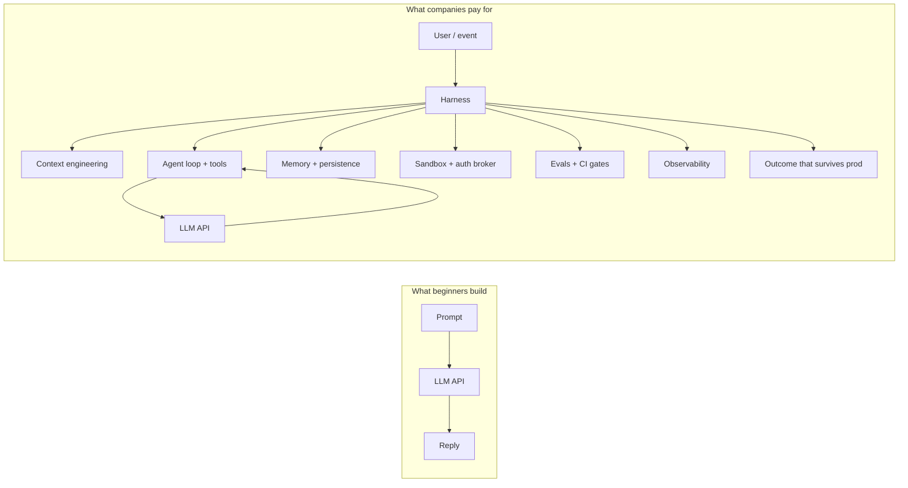
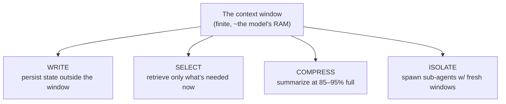
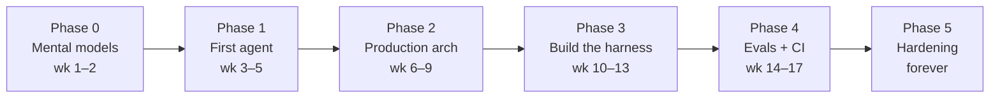

# Become an AI Engineer in 2026 — The Harness Engineering Curriculum

> A complete, build-first course that turns a working programmer into someone who
> can **ship agent systems that survive production traffic** — the one thing
> companies are actually paying for in 2026.

This curriculum is an expanded, corrected, and heavily elaborated treatment of
Rahul's ([@sairahul1](https://x.com/sairahul1)) widely-shared roadmap
*"How To Become An AI Engineer in 2026."* The original thread nailed the thesis.
This repo turns that thesis into a teachable course: every phase has full lessons,
architecture diagrams, runnable code, anecdotes, pitfalls, and exit criteria.

---

## The one-sentence thesis

> **The model is a commodity. The _harness_ around the model is the job.**

A *harness* is everything that sits between you and the raw model API: the agent
loop, tool dispatch, context assembly, memory, persistence, sandboxing,
observability, and evals. The same model on a good harness vs. a bad one can
swing **10–36 points** on agent benchmarks. You are not paid to call an API. You
are paid to build the system that makes the model reliable, measurable, and safe.



The left box is a *feature*. The right box is a *system*. The distance between
them is roughly the distance between "replaceable" and "unfireable."

---

## What changed: prompt engineering is now a sub-skill of context engineering

The single most important reframe in this curriculum:

> **You no longer engineer a prompt. You engineer the entire context window —
> every token in front of the model at every step of a loop.**

There are exactly four moves you can make with a context window. Memorize them;
the whole course is built on them.

| Primitive | What it means | Example |
|-----------|---------------|---------|
| **Write** | The agent records state to a scratchpad / memory file it can re-read | `TODO.md`, `findings.md`, a memory store |
| **Select** | Pull the *right* tokens in at the point of use, not a giant upfront dump | retrieval, tool results, file reads on demand |
| **Compress** | Summarize when the window fills (typically at 85–95%) | rolling summary, compaction step |
| **Isolate** | Give a sub-task its **own** context window via a sub-agent | parallel research workers with clean contexts |



---

## The 6-phase roadmap

Every phase ends by **shipping something**. No phase is "done" because you read
it — it is done when the project runs.

| Phase | Title | Weeks (FT) | You ship | Lessons |
|-------|-------|-----------|----------|---------|
| **0** | [Build Correct Mental Models](curriculum/phase-0-mental-models/) | 1–2 | A 2-page concepts doc, in your own words | [→](curriculum/phase-0-mental-models/) |
| **1** | [Build Your First Agent From Scratch](curriculum/phase-1-first-agent/) | 3–5 | A daily-briefing agent (raw loop + Agent SDK) | [→](curriculum/phase-1-first-agent/) |
| **2** | [A Real Agent With Proper Architecture](curriculum/phase-2-production-architecture/) | 6–9 | A durable, multi-agent Research Analyst | [→](curriculum/phase-2-production-architecture/) |
| **3** | [Build the Harness Layer Yourself](curriculum/phase-3-build-the-harness/) | 10–13 | A ~1,500-line mini-harness + post-mortem | [→](curriculum/phase-3-build-the-harness/) |
| **4** | [Build the Eval & Regression Harness](curriculum/phase-4-evals-and-regression/) | 14–17 | A golden dataset + CI gate that blocks regressions | [→](curriculum/phase-4-evals-and-regression/) |
| **5** | [Production Hardening](curriculum/phase-5-production-hardening/) | Forever | Cost/latency/safety/drift/resilience discipline | [→](curriculum/phase-5-production-hardening/) |

**Timeline:** ~17 weeks full-time, ~40 weeks at 10–15 hrs/week. See the detailed
week-by-week plan and exit criteria in **[ROADMAP.md](ROADMAP.md)**.



---

## The 5 portfolio projects

Pick one as your capstone. They are ranked by difficulty and each proves a
distinct competency that hiring managers look for. Full specs (architecture,
milestones, eval criteria, stretch goals) live in **[projects/](projects/)**.

| # | Project | Level | Proves |
|---|---------|-------|--------|
| 1 | [AI-Powered Mobile App with a Small Language Model](projects/01-edge-slm-mobile-app.md) | Beginner | Edge AI + resource optimization |
| 2 | [Self-Improving Coding Agent](projects/02-self-improving-coding-agent.md) | Intermediate | Agentic loops + production debugging |
| 3 | ["Cursor, but for video editors"](projects/03-multimodal-video-agent.md) | Advanced | Multimodal AI + complex tool integration |
| 4 | [Personal Life-OS Agent](projects/04-personal-life-os-agent.md) | Expert | Deep context + privacy-first architecture |
| 5 | [Autonomous Enterprise Workflow Agent](projects/05-enterprise-workflow-agent.md) | Master | Production-grade orchestration |

---

## The stack you'll actually learn

You do not need to learn ten frameworks. You need to learn the **primitives**,
then one production framework deeply. Full rationale and "what to skip" in
**[reference/the-stack.md](reference/the-stack.md)**.

- **Primitives first:** the raw model SDK + a hand-written agent loop.
- **Reference harness:** the **Claude Agent SDK** (the same harness that powers
  Claude Code) — study CLAUDE.md, Skills, sub-agents, hooks, filesystem-as-memory.
- **Production framework:** **LangGraph** (state machine + durable checkpointing
  + time-travel + observability) and **Deep Agents** (a packaged harness on top).
- **Observability:** LangSmith, Braintrust, or Arize Phoenix — pick one.

> ⚠️ **A note on framework hype:** frameworks churn fast. The *primitives*
> (loop, tools, context, persistence, evals) are stable; the package names will
> change. This course teaches the primitives so any framework becomes readable.

---

## How to use this repo

1. **Read the phase README**, then the numbered lessons inside it, in order.
2. **Type the code.** Do not copy-paste the agent loop. Muscle memory is the point.
3. **Ship the phase project** before moving on. The exit criteria are explicit.
4. **Keep a build log** (`/your-notes/`): architecture decisions, failures, and
   how you recovered. That log *is* your interview material.

```
ai-engineer-2026/
  README.md            ← you are here (the improved roadmap)
  ROADMAP.md           ← week-by-week plan + exit criteria
  curriculum/          ← the six phases, each a folder of lessons + a project
    phase-0-mental-models/
    phase-1-first-agent/
    phase-2-production-architecture/
    phase-3-build-the-harness/
    phase-4-evals-and-regression/
    phase-5-production-hardening/
  projects/            ← the five portfolio capstone specs
  reference/           ← the stack, benchmark literacy, glossary, further reading
  code/                ← runnable scaffolds (raw agent loop, mini-harness, evals)
```

---

## How this differs from the original thread (what I improved)

This curriculum keeps the thread's thesis and structure but fixes its gaps:

- **Added a mechanics lesson the thread skips.** The thread says you don't need
  to know "what a transformer is." True for the *job* — but you cannot debug
  hallucination, non-determinism, or context rot without a working mental model
  of tokens, sampling, and attention. Phase 0 adds a *math-free* one.
- **Re-weighted retrieval.** The thread treats RAG as almost an afterthought.
  This course teaches retrieval as the **Select** primitive — first-class, with
  the honest caveat (don't build a vector store before you've measured a recall
  problem).
- **Flagged the speculative benchmarks.** The thread quotes specific May-2026
  numbers (and some model names that may not be real). This course teaches
  *benchmark literacy* instead — how to read SWE-bench / GAIA / τ-bench and find
  current numbers yourself. See [reference/benchmarks.md](reference/benchmarks.md).
- **Made every claim runnable.** Each concept ships as code you can execute, not
  just a bullet point.
- **Added eval rigor.** Phase 4 expands the four eval types into full, gradeable
  rubrics with calibration loops and contamination defenses.

---

## The brutal truth (why this is worth 17 weeks)

The market is flooded with thin layers over LLMs. Those are features waiting to
be absorbed by the platform. What is scarce — and therefore valuable — is the
engineer who can:

- build an agent that **doesn't break at 2am on a Friday**,
- **prove** with evals that the next change made it better, not worse, and
- run it at a **cost and latency** that clears the bar.

Industry surveys in this cycle put the bottleneck squarely on **quality** —
teams can call an LLM; far fewer can measure and harden one. That gap is the job
opening. This curriculum is the bridge.

➡️ **Start here:** [ROADMAP.md](ROADMAP.md), then
[Phase 0 — Build Correct Mental Models](curriculum/phase-0-mental-models/).

---

## Attribution & license

- Original roadmap concept: Rahul ([@sairahul1](https://x.com/sairahul1)),
  *"How To Become An AI Engineer in 2026."* This repo is an independent,
  expanded educational treatment.
- Curriculum content: MIT-licensed — use it, fork it, teach with it.
