# The Roadmap — Week by Week

> 17 weeks full-time. ~40 weeks moonlighting (10–15 hrs/week → multiply by ~2.5×).
> Every phase exits on a **shipped artifact**, not a finished reading.

This file is your project plan. Print it. Check the boxes. The rule that keeps
you honest: **a phase is not done until its exit criteria pass.**

---

## The shape of the journey

```mermaid
gantt
    title AI Engineer in 2026 — full-time track
    dateFormat  X
    axisFormat  wk %s
    section Foundations
    Phase 0 Mental models        :p0, 0, 2
    section Build
    Phase 1 First agent          :p1, 2, 3
    Phase 2 Production arch       :p2, 5, 4
    section Mastery
    Phase 3 Build the harness     :p3, 9, 4
    Phase 4 Evals + CI            :p4, 13, 4
    section Operate
    Phase 5 Hardening (forever)   :p5, 17, 4
```

---

## Skills matrix — what you can do after each phase

| After… | You can… |
|--------|----------|
| Phase 0 | Explain harness vs. model, workflow vs. agent, and the 4 context primitives in plain English, from memory |
| Phase 1 | Write a correct agent loop from scratch and reproduce it on a real Agent SDK |
| Phase 2 | Stand up a durable, observable, multi-agent system that survives a process kill |
| Phase 3 | Build the harness layer yourself and defend every trade-off you made |
| Phase 4 | Prove, with evals + CI gates, whether a change helped or hurt |
| Phase 5 | Operate an agent at controlled cost, latency, safety, and drift |

---

## Phase 0 — Build Correct Mental Models · Weeks 1–2

**Goal:** never write code you can't reason about when it breaks.

- [ ] Read [Phase 0](curriculum/phase-0-mental-models/) lessons 00–04.
- [ ] Be able to define, *without looking*: workflow vs. agent; the 5 workflow
      patterns; the 4 context primitives; orchestrator-worker.
- [ ] (Added) Hold a working, math-free model of tokens, context window,
      sampling/temperature, and why models hallucinate.

**Exit criteria — ship this:** a **2-page doc, in your own words**, defining the
four bullets above. If you can't write it without looking, re-read. No code yet.

---

## Phase 1 — Build Your First Agent From Scratch · Weeks 3–5

**Goal:** make the agent loop boring. Build it twice.

- [ ] **Build #1 — the raw loop:** ~100 lines on the raw model SDK. Three tools:
      `web_search`, `read_file`, `write_file`. Run a research task; read *every*
      step of the trace.
- [ ] **Build #2 — the same agent on the Claude Agent SDK:** add a `CLAUDE.md`,
      one **Skill**, one **PostToolUse hook** (auto-format written files), one
      **sub-agent** spawned via the Task tool.
- [ ] Write 200 words: *"What did the harness give me for free that I wrote
      myself in Build #1?"*

**Exit criteria — ship this:** a **daily-briefing agent** that reads your
Markdown notes + RSS feeds and writes a summary to disk every morning. Run it for
a week. Watch it fail. Fix it. (See [the project](curriculum/phase-1-first-agent/project.md).)

---

## Phase 2 — A Real Agent With Proper Architecture · Weeks 6–9

**Goal:** production patterns — state, durability, observability, multi-agent.

- [ ] Learn **LangGraph**: nodes/edges state machine, `PostgresSaver`
      checkpointing, time-travel debugging, human-in-the-loop interrupts, traces.
- [ ] Learn **Deep Agents**: planning middleware, virtual filesystem, sub-agent
      spawning, automatic compression, skills.
- [ ] Learn **middleware**: `before_agent`, `wrap_model_call`, `before_tools`,
      `after_tools`.

**Exit criteria — ship this:** a **Research Analyst Agent** — lead plans → spawns
3 parallel search sub-agents (isolated context) → citation sub-agent verifies →
writer produces cited Markdown. Durable via `PostgresSaver` (kill the process,
resume). HITL interrupt before exceeding a $1 token budget. Ship a trace URL with
the README. (See [the project](curriculum/phase-2-production-architecture/project.md).)

---

## Phase 3 — Build the Harness Layer Yourself · Weeks 10–13

**Goal:** the highest-leverage phase. You will never make the right harness
trade-offs in production until you've built one once.

- [ ] Study the **10 components of a modern harness** (loop, dispatch, context,
      persistence, sub-agents, skills/progressive disclosure, hooks,
      observability, sandboxing, auth brokering).
- [ ] Build a **mini-harness in ~1,500 lines of Python** that implements them.

**Exit criteria — ship this:** the mini-harness **plus a 1,000-word post-mortem**
comparing it to the Claude Agent SDK and Deep Agents: what you got right, what
you cut, what you'd do differently. (See
[the project](curriculum/phase-3-build-the-harness/project.md).)

---

## Phase 4 — Build the Eval & Regression Harness · Weeks 14–17

**Goal:** make "better" measurable. This is where most engineers stall — and
therefore where the leverage is.

- [ ] Implement the **4 eval types**: single-turn, trajectory, LLM-as-judge,
      end-state.
- [ ] Build a **golden dataset** (30–50 hand-graded items, 3 difficulty levels).
- [ ] Calibrate LLM-as-judge against human grades; defend against
      **eval-awareness** and contamination.
- [ ] Wire a **CI regression gate** (GitHub Actions): block merge if golden-set
      pass rate drops 3+ points. Nightly-sample 1% of live traces.

**Exit criteria — ship this:** the regression harness wrapping your Phase 2 agent,
with a CI gate that actually blocks a bad merge. (See
[the project](curriculum/phase-4-evals-and-regression/project.md).)

---

## Phase 5 — Production Hardening · Forever

**Goal:** operate the system. This phase never "completes."

- [ ] **Cost:** prompt caching, difficulty-based model routing, Batch API,
      multi-agent only when value clears the ~15× token cost.
- [ ] **Latency:** parallel tool calls, streaming, sub-agent fan-out.
- [ ] **Safety:** sandboxed code execution, auth brokered outside model context,
      HITL on irreversible actions.
- [ ] **Drift:** alert on cost/tool-failure/judge-score/p95; re-baseline evals
      after every model upgrade.
- [ ] **Resilience:** durable execution for anything running > 60s; checkpoint
      every node; rewind/fork always possible.

**Exit criteria:** an operational runbook for your capstone — dashboards, alert
thresholds, a model-upgrade re-baseline checklist. (See
[the phase](curriculum/phase-5-production-hardening/).)

---

## The capstone, in parallel

From Phase 2 onward, run **one [portfolio project](projects/)** alongside the
lessons. New to this? Start with Project 1. Already shipping code? Start with
Project 5. The market rewards shipping, not studying.

➡️ Begin: [Phase 0 — Build Correct Mental Models](curriculum/phase-0-mental-models/).
