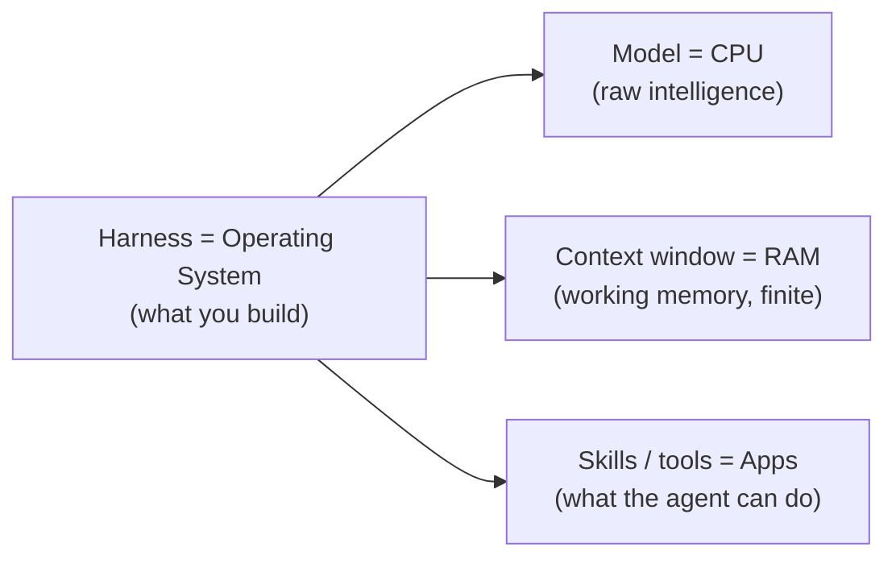
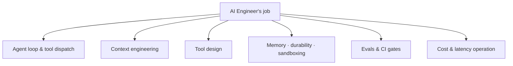

# Lesson 00 — What an AI Engineer Actually Does in 2026

> **Goal:** replace the fuzzy job title "AI Engineer" with a precise one, so you
> know exactly what skill you're building toward.

## The mental model

An AI engineer is **not** primarily a person who writes prompts or picks models.

> An AI engineer **builds and operates the system around the model.**

That system is called the **harness**. Hold this analogy — we'll use it all
course:

A faster CPU helps. But the **operating system** decides what the CPU can
*actually accomplish* — scheduling, memory management, drivers, sandboxing. Swap a
great OS for a bad one and the same CPU becomes useless. Same with models: the
harness decides what the model can actually do.

**WHY this matters for your career:** model quality is converging and commoditizing
across providers. Harness quality is not. The scarce, paid skill is building the
OS, not renting the CPU.

## The evidence: same model, different harness, huge gap

The headline result that motivates this entire curriculum: take *one* model and
run it inside two different harnesses on the same agent benchmark, and the score
can swing by **tens of points**. Reported gaps in this cycle range from ~10 to
~36 points on agentic benchmarks (e.g., a strong purpose-built coding harness vs.
a minimal generic one).

> ⚠️ **Benchmark literacy, not benchmark worship.** Specific numbers age in
> weeks and some quoted figures online are unverified. The *direction* is robust
> and repeatedly reproduced: **harness changes move agent scores as much as model
> changes do.** Learn to read benchmarks yourself —
> [reference/benchmarks.md](../../reference/benchmarks.md).

The takeaway is not "memorize the numbers." It's:

> **The harness is the job.** If you can make a fixed model perform dramatically
> better by engineering everything around it, you own the leverage.

## What the job concretely involves

Day to day, an AI engineer:

- **Designs the agent loop and tool dispatch** — the control structure that calls
  the model, runs tools, and feeds results back.
- **Engineers the context** — decides *which tokens* sit in front of the model at
  every single step. (This is the whole next phase.)
- **Writes tools the model picks correctly** — good names, schemas, and
  descriptions so the model chooses the right action.
- **Adds memory, durability, and sandboxing** — so the system survives real
  traffic, process kills, and untrusted output.
- **Wires evals and CI regression gates** — so "this is better" becomes a number,
  not a vibe.
- **Ships agents that survive real users and real cost.**

## Replaceable vs. unfireable

| The replaceable engineer | The unfireable engineer |
|--------------------------|-------------------------|
| Wraps an LLM with a few prompts | Ships autonomous systems |
| Calls it an "AI product" | Builds the harness around the model |
| Can't prove it isn't regressing | Has evals + CI gates that prove quality |
| Breaks silently under load | Durable, observable, recoverable |
| Competing with 10,000 others | In a bottlenecked, scarce talent pool |

**WAR STORY:** A common failure pattern in 2023–2024 startups was the "GPT
wrapper" — a thin prompt over an API, shipped fast, demoed beautifully, then
quietly died when (a) the platform shipped the same feature for free, or (b) it
hit real users and had no evals to catch regressions, no durability to survive
restarts, and no cost controls. The wrapper was a *feature*, not a *system*. The
difference is this curriculum.

## Why the bottleneck is *quality*, not API access

Industry surveys in this cycle consistently show:

- A majority of teams now have **agents in production**.
- Most of those have **observability** wired.
- The **#1 cited barrier is quality / reliability** — not "we can't call an LLM."

Read that carefully. The field is **bottlenecked on engineers who can build evals
and harnesses**, not on engineers who can call an API. Calling an API is table
stakes. Making the result *reliable and measurable* is the scarce skill. That is
the job opening, and Phases 3–5 are built to fill it.

## Pitfalls

- **GOTCHA — confusing a demo with a system.** A working demo proves the model
  *can* do the task once. A system proves it does the task reliably, measurably,
  affordably, and recoverably. Hiring managers can tell the difference in 30
  seconds; build for the second one.
- **GOTCHA — "I know LangChain" ≠ "I can engineer a harness."** Knowing a
  framework's API is not knowing *why* the loop, context, and evals are shaped the
  way they are. Phase 3 (build your own harness) is what converts framework-user
  into harness-engineer.

## Exercises

1. In two sentences, define "harness" without using the word "framework."
2. Find one "AI product" you use and sketch (on paper) which parts are *model* and
   which parts are *harness*. Which part is defensible?
3. Write the one-line difference between a replaceable and an unfireable AI
   engineer in *your own* words.

## Exit check

You can explain, to a non-engineer, why the same model can score 30 points apart
on the same test depending on the harness — and why that means the harness is the
job.

➡️ Next: [Lesson 01 — How LLMs behave (a math-free model)](01-how-llms-behave.md)
