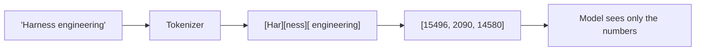
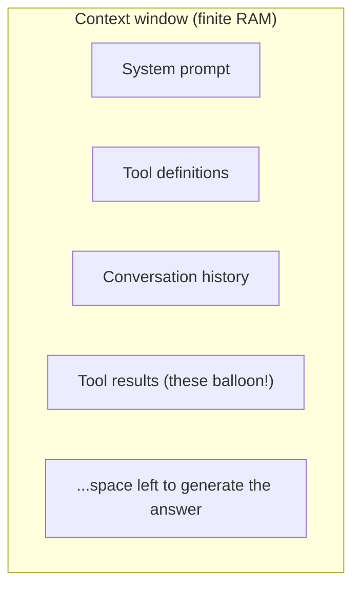
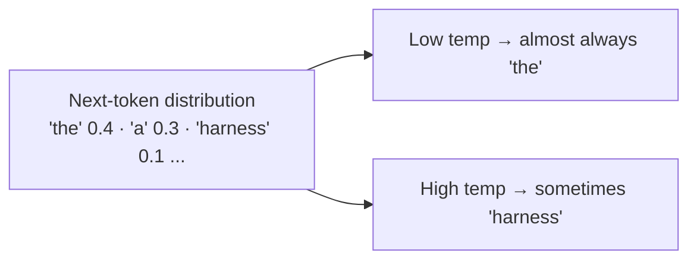

# Lesson 01 — How LLMs Behave (A Math-Free Mental Model)

> **Goal:** build just enough intuition about how an LLM works to *predict and
> debug its behavior* — without any linear algebra.

The original roadmap says you don't need to know "what a transformer is." For the
*job*, that's mostly true — you won't implement attention. But you **cannot debug
hallucination, non-determinism, or context rot** without a working model of what's
happening. This lesson gives you that model in plain English. It's the one piece
of "theory" in the whole course, and it pays for itself the first time an agent
does something baffling.

## The one-sentence model

> An LLM is a function that, given a sequence of tokens, predicts a probability
> distribution over the *next* token — and you sample from it, over and over.

Everything weird about LLMs falls out of that sentence. Let's unpack each word.

## Tokens: the model doesn't see characters or words

Text is chopped into **tokens** — sub-word chunks. "Engineering" might be
`Engine` + `ering`. A token is ~4 characters / ~0.75 words of English on average.

**Why you care:**

- **COST & limits are counted in tokens**, not words. Pricing, context-window
  size, and rate limits are all token-denominated.
- **GOTCHA — counting and spelling.** Because the model sees tokens, not letters,
  "how many r's in strawberry?" is genuinely hard for it — it never saw the
  letters. This isn't stupidity; it's the representation.
- Code, JSON, and non-English languages tokenize *less* efficiently (more tokens
  per character), so they cost more and fill the window faster.

## The context window: the model's RAM

The **context window** is the maximum number of tokens the model can attend to at
once — system prompt + conversation + tool definitions + tool results + the reply
it's generating, *all of it*. It is finite (think 200K tokens for a large model
today, but always finite).

**This is the single most important resource you manage as an AI engineer.** The
entire next phase (context engineering) is about spending this budget well.

- **GOTCHA — context rot.** As the window fills, models reliably attend best to
  the **start and end** and get fuzzier in the **middle** ("lost in the middle").
  A 180K-token context isn't 180K of equally-useful attention. More context is not
  automatically better; *relevant, well-placed* context is.
- This is *why* the four context primitives exist: when the window fills, you must
  **compress** or **isolate**, not just keep stuffing.

## Sampling & temperature: why it's not deterministic

The model outputs a *probability distribution* over the next token. To produce
text, you **sample** from that distribution.

- **Temperature** scales how much you favor high-probability tokens. `temperature
  = 0` ≈ "always take the most likely token" (near-deterministic, focused).
  Higher temperature ≈ more random, more creative, more error-prone.
- **GOTCHA — even at temperature 0 you're not guaranteed identical outputs.**
  Floating-point non-associativity across GPUs/batches, model updates, and
  load-balancing can change results. **Never assume bit-for-bit reproducibility.**
  This is *the* reason Phase 4 grades on *outcomes*, not exact strings.

## Why models hallucinate

The model is trained to produce a **plausible** continuation, not a **true** one.
When it doesn't "know," it doesn't have a built-in "I don't know" reflex — the
most *plausible-sounding* continuation is often a confident, wrong fact.

> Hallucination isn't a bug you can prompt away. It's the default behavior of a
> plausibility engine. You **engineer around it**: ground the model in retrieved
> facts (the **Select** primitive), give it tools to check reality, and **verify
> outputs with evals.**

**WAR STORY:** A lawyer once submitted a brief citing six court cases an LLM
produced. All six were fabricated — plausible names, plausible citations, zero
real. The model wasn't "lying"; it was doing exactly what it does: generating a
plausible-looking citation string. The fix is never "ask it to be honest." The
fix is *architectural*: tools that look up real cases, and evals that check.

## Attention, in one sentence

The "transformer" mechanism lets each token's representation be influenced by
("attend to") every other token in the window, learning which prior tokens matter
for predicting the next one. That's the whole intuition you need: **the model
reweighs the entire visible context to predict the next token.** It's why *what
you put in the window, and where,* changes the output so much.

## In-context learning: the superpower you'll exploit

Because the model conditions on everything in the window, you can change its
behavior **at runtime** just by putting examples/instructions/data in the
context — no retraining. This is **in-context learning**, and it's why context
engineering (not fine-tuning) is the default tool:

- Few-shot examples in the prompt → the model mimics the pattern.
- A retrieved document in the context → the model answers from it.
- A tool result fed back → the model continues with new information.

> **WHY fine-tuning comes much later (or never):** in-context learning gets you
> 90% of behavior change with zero training infrastructure. Reach for
> fine-tuning only after you've exhausted context engineering and measured a real
> gap. (We treat this honestly; the original roadmap rightly de-emphasizes
> training for most jobs.)

## Pitfalls

- **GOTCHA — treating the model as a database.** It is a *plausibility* engine
  with fuzzy, frozen-at-training-time knowledge. For facts, give it retrieval or
  tools.
- **GOTCHA — assuming determinism.** Tests and evals must tolerate variation.
- **GOTCHA — "more context = better."** Past a point, extra context dilutes
  attention and adds cost. Curate, don't dump.

## Exercises

1. Paste a paragraph into any tokenizer playground. Count tokens vs. words. Try a
   code snippet and a non-English sentence; note how the ratio changes.
2. Ask a model the same open-ended question 5 times at high temperature, then at
   temperature 0. Describe the difference in variation.
3. Explain "lost in the middle" to a teammate and connect it to why we **compress**
   and **isolate** context.

## Exit check

You can explain *why* an LLM hallucinates, *why* it isn't deterministic, and *why*
stuffing more into the context window can make answers worse — using none of the
words "matrix," "gradient," or "softmax."

➡️ Next: [Lesson 02 — Workflow vs. Agent](02-workflow-vs-agent.md)
