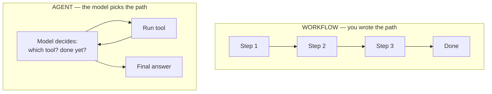
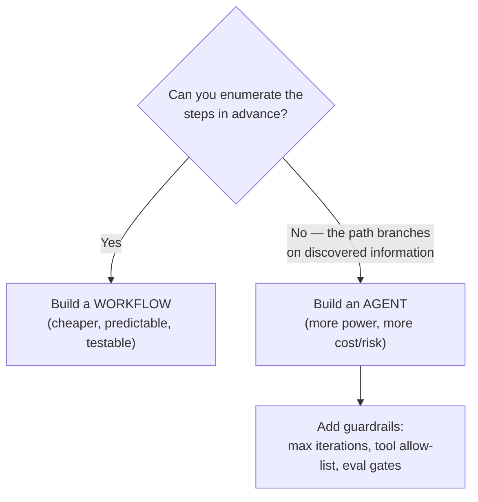

# Lesson 02 — Workflow vs. Agent

> **Goal:** learn the single most expensive architectural decision in applied AI —
> and a decision rule for getting it right.

## The mental model

> A **workflow** has a control flow *you* wrote. An **agent** decides its *own*
> control flow inside a loop.

In a workflow, the LLM is a *component* you call at fixed points (classify this,
summarize that, extract those fields). The branching is in **your** code. In an
agent, the LLM is the *controller*: it looks at the situation and chooses the next
action — call a tool, call another, or stop — in a loop you don't fully script.

## Why this is the expensive decision

> **Building an agent when you needed a workflow costs ~10× more and breaks ~2×
> as often.**

An agent loop is non-deterministic, harder to test, more expensive (many model
calls per task), and can fail in open-ended ways (loop forever, pick the wrong
tool, go off the rails). A workflow is cheap, debuggable, and predictable. So the
default should be: **use the simplest thing that works, and only add agency where
the task genuinely needs it.**

| | Workflow | Agent |
|---|----------|-------|
| Control flow | You write it | Model decides it |
| Predictability | High | Low |
| Cost per task | Low (few calls) | High (many calls) |
| Debuggability | Easy | Harder (need traces, evals) |
| Best when | The steps are known in advance | The path depends on what's discovered |

## The decision rule

Ask: **"Can I write down the steps in advance?"**

- **Yes →** build a **workflow.** (Most business tasks: classify a ticket → route
  it → draft a reply → check it. You know the steps.)
- **No, the steps depend on what's found along the way →** build an **agent.**
  (Research a question where each finding determines the next search; debug code
  where each test failure determines the next fix.)

**WHY the guardrails note:** the moment you choose an agent, you've accepted
open-ended behavior. That's exactly why Phases 3–4 exist: a bounded loop, a tool
allow-list, and evals are what make agency safe.

## Concrete examples

| Task | Workflow or agent? | Why |
|------|-------------------|-----|
| "Classify this email as spam/not-spam" | Workflow | One known step |
| "Extract name, date, total from this invoice" | Workflow | Known fields, known order |
| "Translate, then summarize, then tag" | Workflow (prompt chaining) | Fixed pipeline |
| "Research this question and write a cited report" | Agent | Each finding changes the next search |
| "Fix this failing test suite" | Agent | Each failure determines the next edit |
| "Answer FAQ from our docs" | Workflow (RAG) + maybe light agency | Retrieval then answer; loop only if it needs follow-ups |

**WAR STORY:** A team built a fully autonomous agent to "process invoices."
Invoices are a *known pipeline* — extract fields, validate, post to the ledger.
The agent version cost 12× more, occasionally invented vendor names, and was
impossible to audit. They rewrote it as a workflow with one classification step
and a deterministic posting routine. Cost dropped, errors dropped, and auditors
were happy. The lesson: **agency is a cost you pay only when the task can't be
scripted.**

## The hybrid reality

Real systems are usually a **workflow with agentic steps**, not pure one-or-the-
other. A customer-support system might be a workflow (route → retrieve → answer)
where *one* node is a small agent that can loop over tools to resolve a tricky
case. Start workflow-first; promote a node to an agent only where it earns it.

## Pitfalls

- **GOTCHA — "agent" as a resume word.** Adding a loop doesn't make something
  better; it makes it less predictable. Reach for the loop last.
- **GOTCHA — an agent with no bound.** `while True` with model-chosen actions is
  how you get a runaway loop and a surprise bill. Every agent gets a hard
  `max_iterations`. (You'll build this in Phase 1.)
- **GOTCHA — unaudited agency on irreversible actions.** If a step deletes data or
  spends money, that's a human-in-the-loop checkpoint, not free agency.

## Exercises

1. List five tasks from your own work. For each, apply the decision rule and
   justify workflow vs. agent in one sentence.
2. Take one task you labeled "agent" and try to *force* it into a workflow. What
   breaks? That breakage is the signal that agency is genuinely needed.
3. Sketch a hybrid: a workflow with exactly one agentic node. Mark where the
   guardrails go.

## Exit check

Given any task, you can confidently say "workflow" or "agent," name *why*, and
state the guardrail you'd add if it's an agent.

➡️ Next: [Lesson 03 — The 5 Workflow Patterns](03-five-workflow-patterns.md)
