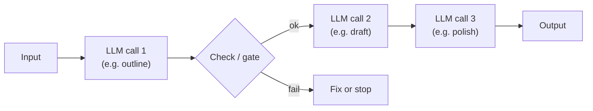
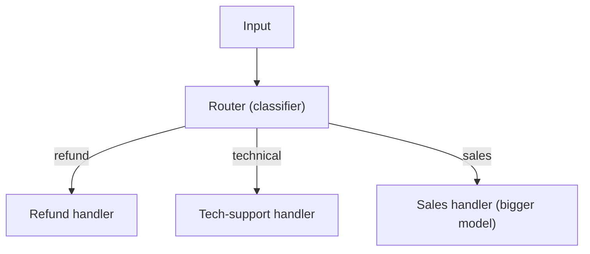
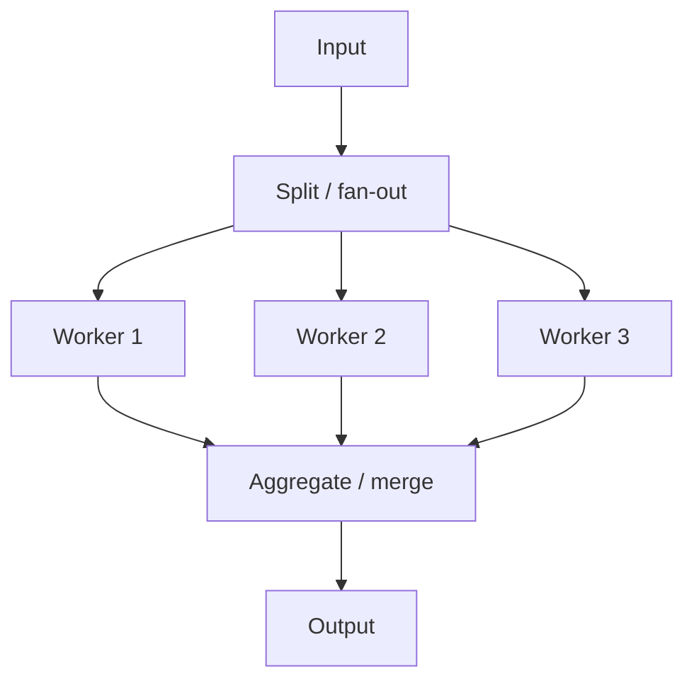
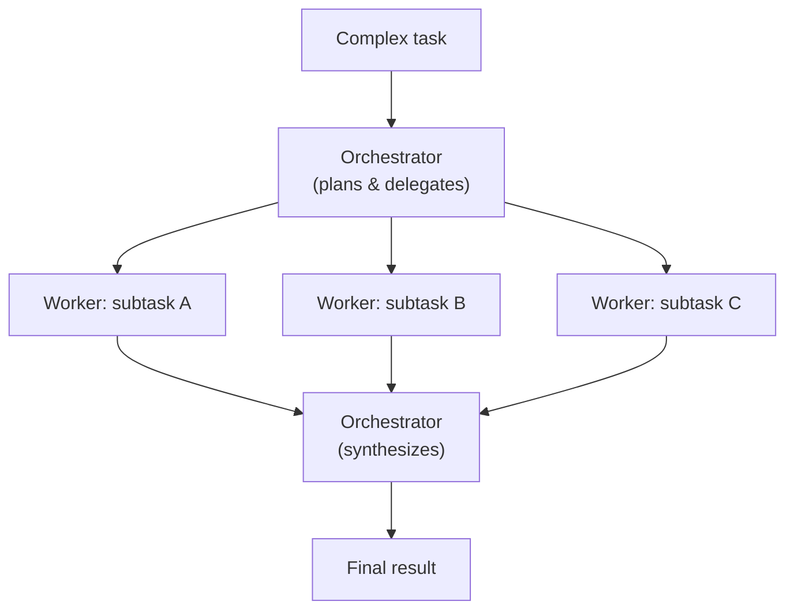
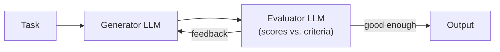
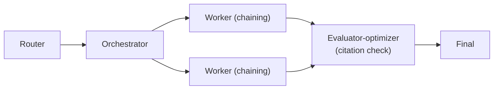

# Lesson 03 — The 5 Workflow Patterns

> **Goal:** learn the five reusable building blocks (from Anthropic's "Building
> Effective Agents") that compose into almost every real system — so you reach for
> a known pattern instead of inventing a tangled one.

Before you ever need a full agent, most value comes from composing these five
patterns. They're the "design patterns" of applied LLM systems. Learn to *name*
them; naming is what lets you discuss architecture instead of hand-waving.

## 1. Prompt chaining — pass output to the next call

Decompose a task into a fixed sequence where each step's output feeds the next.
Optionally gate between steps.



**Use when** the task splits into clean, ordered subtasks. Trades a little latency
for a lot of accuracy — each call has a simpler job.
**Example:** outline → draft → edit; or translate → check terminology → format.

```python
outline = llm(f"Outline a blog post on: {topic}")
draft   = llm(f"Write the post from this outline:\n{outline}")
final   = llm(f"Tighten and fix grammar:\n{draft}")
```

## 2. Routing — send different inputs to different handlers

Classify the input, then dispatch to a specialized prompt/model/tool.



**Use when** inputs fall into distinct categories that benefit from different
handling. A key **COST** lever: route easy inputs to a cheap/fast model and only
hard ones to the expensive model.
**Example:** customer-service triage; "simple → Haiku, hard → Opus" routing.

## 3. Parallelization — run subtasks at the same time

Two flavors:
- **Sectioning:** split work into independent chunks run in parallel, then merge.
- **Voting:** run the *same* task several times and aggregate (majority / best-of).



**Use when** subtasks are independent (sectioning) or you want robustness/diversity
(voting). Big **latency** win — wall-clock time is the slowest worker, not the sum.
**Example:** review code for security, performance, and style in parallel; or
generate 3 candidate answers and pick the best.

## 4. Orchestrator–worker — one brain, many hands

A central LLM (the orchestrator) dynamically *decomposes* a task, delegates
subtasks to worker LLMs, and synthesizes their results. Unlike parallelization,
the subtasks aren't known up front — the orchestrator decides them at runtime.



**Use when** you can't predict the subtasks in advance (that's the line between
this and plain parallelization). This is the backbone of multi-agent research
systems — and a core pattern you'll build in Phase 2.
**Example:** "research this question" → orchestrator spawns search workers per
sub-question, then writes the report.

## 5. Evaluator–optimizer — generate, judge, improve

One LLM generates; another evaluates against criteria and sends feedback; loop
until the evaluator is satisfied (or a cap is hit).



**Use when** there are clear evaluation criteria *and* iterative refinement
measurably helps — and especially when a human would also give feedback in rounds.
**Example:** literary translation (judge nuance, refine); writing code that must
pass tests (the test runner is a deterministic evaluator!).
**GOTCHA — bound the loop.** Like any loop, cap the iterations or it can ping-pong
forever burning tokens.

## How they compose

Real systems stack these. A research agent is an **orchestrator-worker** whose
workers each do **prompt chaining**, whose final step is an **evaluator-optimizer**
(a citation checker), with a **router** up front to pick model sizes.



**WAR STORY:** A team's "AI agent" for generating marketing copy was a 600-line
tangle of conditionals nobody could modify. Re-described in these five patterns it
was just: *route* by channel → *chain* (brief → draft → polish) → *evaluator-
optimizer* against brand rules. Same behavior, a quarter of the code, and now two
people could reason about it. **Naming the pattern is half the engineering.**

## Pitfalls

- **GOTCHA — jumping to orchestrator-worker.** It's the most powerful and the most
  expensive/complex. If the subtasks are fixed, plain parallelization is simpler.
- **GOTCHA — unbounded evaluator-optimizer.** Always cap rounds.
- **GOTCHA — pattern soup.** Compose deliberately; don't nest five patterns when
  two would do.

## Exercises

1. For each of the five patterns, write one example from a domain you know.
2. Take the research-agent composition above and redraw it for a *different* task
   (e.g., "triage and resolve a support ticket").
3. Identify which pattern uses a **deterministic** evaluator (hint: tests) and why
   that's the gold standard when you can get it.

## Exit check

Given a system description, you can decompose it into named patterns and justify
each choice — and you know which one (orchestrator-worker) crosses into true
multi-agent territory.

➡️ Next: [Lesson 04 — The Harness & the 4 Context Primitives](04-harness-and-context-primitives.md)
