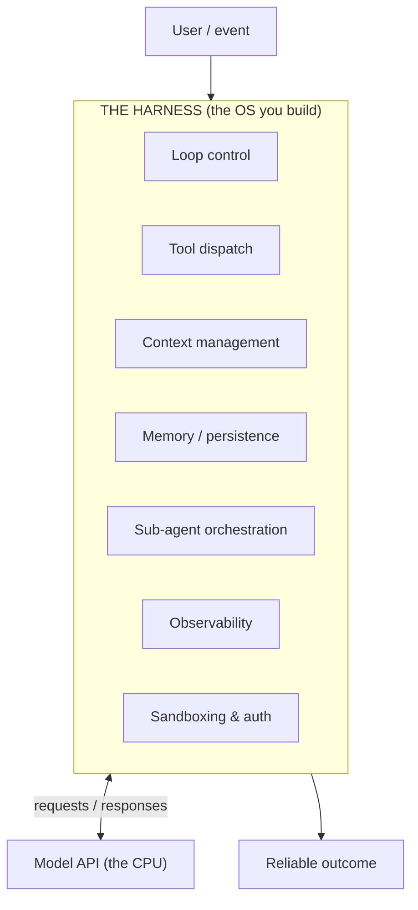
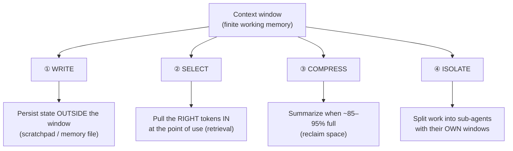
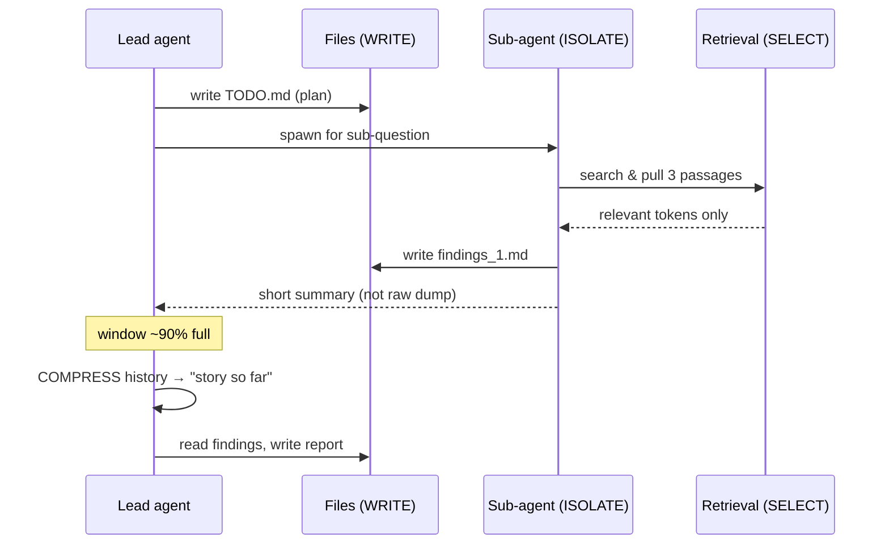

# Lesson 04 — The Harness & the 4 Context Primitives

> **Goal:** define the harness precisely and master the four — and only four —
> moves you can make on a context window. This is the conceptual heart of the
> whole curriculum.

## Part 1 — The harness, precisely

> The **harness** is everything between your code and the raw model API that turns
> a single text-completion call into a system that can act, remember, recover, and
> be measured.

Re-using the OS analogy from Lesson 00:

You'll build every one of those boxes by hand in **Phase 3**. For now, internalize:
the harness is *your* code, it's where the engineering lives, and it's what makes
one model outperform the same model on a worse harness.

## Part 2 — Context engineering replaces prompt engineering

> **Prompt engineering** (crafting one clever string) is now a *sub-skill* of
> **context engineering** (curating *every token* in the window at *every step* of
> a loop).

Why the shift? In a one-shot chatbot, the prompt *is* the context. In an agent
loop, the context changes on every iteration — tool results pour in, history
grows, the window fills. Managing that *flow* of tokens is the real job, and a
single clever prompt doesn't survive contact with a 30-step loop.

The context window is finite (Lesson 01). So at every step you are making a
budgeting decision: *what earns a place in front of the model right now?* There
are exactly **four primitive operations** you can perform. Everything in advanced
agent design is a combination of these four.

## The 4 context primitives

### ① Write — give the agent a memory outside its head

The agent records state to a place it can re-read later: a scratchpad, a `TODO.md`,
a `findings.md`, a key-value memory store. This frees the window (the note lives on
disk, not in every prompt) **and** survives across steps and even across runs.

- **Example:** a research agent writes its plan to `TODO.md`, then checks items off
  as it goes — so even after 40 steps it still "knows" the plan.
- **WHY:** without external memory, the only memory is the context window, which is
  finite and gets compressed away. Write = durable memory.

### ② Select — retrieve at the point of use, not upfront

Don't dump everything the agent *might* need into the prompt. Pull in the *right*
piece *when* it's needed — via retrieval (vector/keyword search), a file read, or a
tool call.

- **Example:** instead of pasting all 200 docs, the agent searches and pulls the 3
  relevant passages when it actually needs them.
- **WHY:** upfront dumping wastes the budget and triggers "lost in the middle"
  (Lesson 01). Just-in-time selection keeps the window dense with *relevant*
  tokens. **This is where retrieval / RAG lives** — as a primitive, not a separate
  product. (Honest caveat: don't build a vector store before you've measured a
  real recall problem; start with simple search.)

### ③ Compress — summarize when the window fills

When you approach the window limit (a common trigger is **85–95% full**), replace a
large chunk of history with a shorter summary that preserves what matters.

- **Example:** at 90% full, the harness summarizes the first 30 turns into a
  3-paragraph "story so far" and drops the raw turns.
- **GOTCHA:** compression is lossy. Summarize the *durable facts and decisions*,
  not the chatter — and keep the most recent turns verbatim (recency matters most).
- **WHY:** it's the release valve that lets long-running agents continue without
  hitting a hard wall.

### ④ Isolate — give a sub-task its own clean window

Spin up a **sub-agent** with a *separate* context window for a focused job. It does
its work in isolation and returns only a short summary to the parent — so the
parent's window stays clean.

- **Example:** a lead agent spawns three search sub-agents in parallel; each
  burns through dozens of tool results in *its own* window and hands back a tidy
  paragraph. The lead never sees the mess.
- **WHY:** isolation prevents one noisy subtask from polluting the main thread's
  context, and it enables parallelism. **COST caveat:** sub-agents multiply token
  usage (often ~15× for heavy multi-agent setups) — use isolation when the value
  clears that bar, not by default.

## Putting it together

Every advanced technique you'll meet later — memory systems, RAG pipelines,
multi-agent research, compaction middleware — is a *named combination* of Write,
Select, Compress, Isolate. If you can map a technique onto these four, you
understand it.

**WAR STORY:** An agent kept "forgetting" the user's earlier instructions on long
tasks. The instinct was to blame the model. The real cause: at ~85% full the
harness compacted history and the summary *dropped the constraints* ("must cite
sources", "budget $1"). The fix wasn't a better model — it was better
**compression**: pin the durable constraints so they survive every compaction.
A pure context-engineering bug, fixed with a context-engineering primitive.

## Pitfalls

- **GOTCHA — upfront dumping.** Pasting everything "just in case" is the most
  common context anti-pattern. Default to Select.
- **GOTCHA — lossy compression of constraints.** Summaries must preserve rules,
  decisions, and budgets, not just narrative.
- **GOTCHA — reflexive multi-agent.** Isolation is powerful but expensive; justify
  the token bill.

## Exercises

1. For each primitive, write one concrete example from a system you'd build.
2. Re-explain the "forgetting" war story in terms of which primitive failed and
   which primitive fixed it.
3. Take the Phase 2 Research Analyst spec (skim it) and label every step with which
   of the four primitives it uses.

## Exit check

You can name all four primitives from memory, give an example of each, and
decompose any advanced agent technique into a combination of them. **This is the
exit check for Phase 0 — now go write the 2-page doc.**

➡️ Next: [Phase 0 Project — the 2-page concepts doc](project.md)
