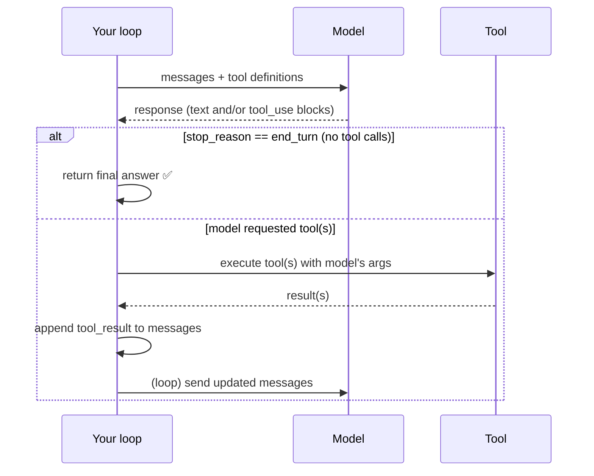

# Lesson 00 — The Agent Loop

> **Goal:** write a correct, bounded agent loop from scratch and internalize that
> *the loop is not magic* — it's about 30 lines of control flow.

## The mental model

An agent is a `while` loop around a model call. That's the whole secret.



The five steps, memorize them:

1. **Call** the model with the conversation `messages` and the available `tools`.
2. **Parse** the response for `tool_use` blocks (the model saying "run X with args Y").
3. **Execute** each requested tool in *your* code.
4. **Append** a `tool_result` back into `messages`.
5. **Loop** until the model stops asking for tools (`stop_reason == "end_turn"`).

## The loop in ~30 lines

Here is the core, provider-agnostic. (A full runnable version with a mock provider
that needs no API key lives in
[`code/raw_agent_loop.py`](../../code/raw_agent_loop.py) — read it, then rebuild it
yourself.)

```python
async def run_agent(provider, system: str, user_msg: str, tools, *,
                    max_iterations: int = 10) -> str:
    messages = [{"role": "user", "content": user_msg}]

    for step in range(1, max_iterations + 1):          # ← HARD CAP, never `while True`
        turn = await provider.generate(system=system, messages=messages, tools=tools)
        messages.append({"role": "assistant", "content": turn.content})

        tool_calls = [b for b in turn.content if b.type == "tool_use"]
        if not tool_calls:                              # model is done
            return turn.text                            # ← the only happy exit

        results = []
        for call in tool_calls:
            try:
                output = await tools.dispatch(call.name, call.args)   # run it
            except Exception as exc:                    # errors are DATA, not crashes
                output, is_error = f"Tool error: {exc}", True
            else:
                is_error = False
            results.append({"type": "tool_result", "tool_use_id": call.id,
                            "content": output, "is_error": is_error})
        messages.append({"role": "user", "content": results})         # feed back

    raise AgentError(f"No final answer within {max_iterations} steps")  # cap hit
```

That's it. Everything a framework does is built on this skeleton.

## The three non-negotiables

### 1. A hard iteration cap — never `while True`

> **SECURITY / COST:** an agent chooses its own actions. Without a bound, a confused
> model can loop forever — calling tools, burning tokens, and running up a bill at
> 2am with nobody watching. **Every agent gets a `max_iterations`.** When the cap is
> hit, you fail loudly (and in Phase 2+, checkpoint so you can resume). This is the
> first guardrail and it is not optional. (We *test* this property in Phase 4.)

### 2. Tool errors are data, not exceptions

When a tool fails (bad args, network blip, file not found), you do **not** crash the
loop. You package the error as a `tool_result` with `is_error=true` and feed it back.
The model then *sees* the error and can recover — retry, pick a different tool, or
explain to the user.

```python
# BAD: one bad tool call kills the whole agent
output = tools.dispatch(call.name, call.args)   # raises → loop dies

# GOOD: the model gets to recover
try:
    output, is_error = tools.dispatch(call.name, call.args), False
except Exception as exc:
    output, is_error = f"Tool error: {exc}", True   # ← recoverable
```

**WAR STORY:** An early agent crashed every time the model passed a slightly
malformed date to a tool. The "fix" people reach for is a better prompt. The real
fix is structural: return the validation error *to the model* as a tool result, and
it corrects itself on the next turn. Robust agents treat their own model's mistakes
as recoverable input. (This mirrors the curriculum's core lesson: no prompt is a
guarantee; structure is.)

### 3. Re-validate every tool argument

The model's tool arguments are **untrusted input** — it can hallucinate fields,
wrong types, or malicious values. Validate them (e.g., with a Pydantic model,
`extra="forbid"`) *before* executing. A bad argument becomes a recoverable tool
error, never an unchecked call. (You'll go deep on this in
[Lesson 01](01-tools-that-models-pick.md).)

## What `stop_reason` is telling you

The model's response carries a `stop_reason`. The two you care about now:

| stop_reason | Meaning | Your loop does |
|-------------|---------|----------------|
| `tool_use` | "Run these tools, then continue" | execute, append results, loop |
| `end_turn` | "I'm done, here's the answer" | return the final text |
| `max_tokens` | hit the output length limit | handle/continue (advanced) |

The loop's *only* clean exit is `end_turn` (no tool calls). Every other path either
loops or hits your cap.

## Build #1 — do this now

Write the loop yourself, in under 100 lines, against the **raw model SDK**. Give it
three tools:

- `web_search(query)` — returns text results
- `read_file(path)` — reads a local file
- `write_file(path, content)` — writes a local file

Then run it on a real research task ("research X and write a summary to
`out.md`") and **read every line of the trace.** Watching the model decide
"search → read → search again → write" is the moment agents stop being magic.

> Don't have an API key handy? Start from
> [`code/raw_agent_loop.py`](../../code/raw_agent_loop.py), which ships a
> deterministic **mock provider** so the whole thing runs offline. Then swap in the
> real provider.

## Pitfalls

- **GOTCHA — forgetting to append the assistant turn.** You must append the model's
  *own* `tool_use` message before the `tool_result`, or the conversation is
  malformed and the next call errors.
- **GOTCHA — mismatched tool_use_id.** Each `tool_result` must reference the exact
  `tool_use_id` from the call. Don't reorder or drop them.
- **GOTCHA — swallowing the trace.** If you can't see each step, you can't debug an
  agent. Log every model turn and every tool call/result from day one.
- **GOTCHA — unbounded loop.** Said three times for a reason. Cap it.

## Exercises

1. Implement the loop from memory. Diff it against `code/raw_agent_loop.py`.
2. Make a tool raise an exception on purpose. Confirm the agent *recovers* instead
   of crashing, by reading the trace.
3. Set `max_iterations=2` on a task that needs 4 steps. Confirm it fails loudly at
   the cap. Now you've *felt* the guardrail.

## Exit check

You can write a correct, bounded agent loop from memory, explain why tool errors are
fed back as data, and read a trace to explain *why* the agent took each step.

➡️ Next: [Lesson 01 — Tools the model picks correctly](01-tools-that-models-pick.md)
