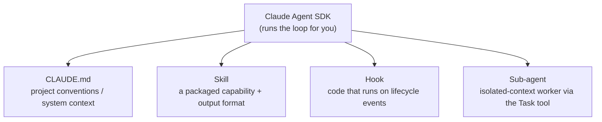
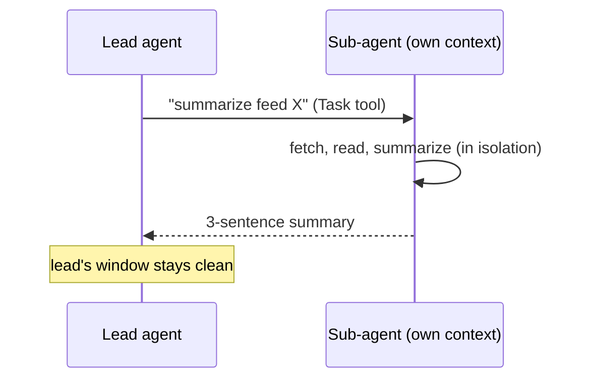

# Lesson 02 — The Same Agent on the Claude Agent SDK

> **Goal:** rebuild your raw agent on a real, production harness (the Claude Agent
> SDK — the same harness that powers Claude Code) and meet its four core primitives:
> **CLAUDE.md, Skills, hooks, and sub-agents.**

You just built the loop by hand. Now build the *same* daily-research agent on the
Claude Agent SDK and feel what a mature harness gives you. The SDK runs the loop,
tool dispatch, context management, and compaction *for* you — so you spend your
attention on the four things that actually shape behavior.

> **WHY study this SDK specifically:** it's the same harness behind Claude Code, and
> the broader ecosystem (LangGraph/Deep Agents and others) is **converging on these
> same primitives** — project memory files, packaged skills, lifecycle hooks, and
> filesystem-as-memory. Learn them here and they transfer everywhere.

## The four primitives you add



### 1. CLAUDE.md — the project's standing instructions

A `CLAUDE.md` file holds conventions the agent should always know: how this project
is structured, output formats, do's and don'ts, style. The harness loads it into the
system context on every run. Think of it as the durable, version-controlled system
prompt for your repo.

```markdown
# CLAUDE.md
- Write briefings as Markdown with an H1 title and dated H2 sections.
- Always cite sources as inline links.
- Never invent facts; if a feed is unreachable, say so explicitly.
- Keep each briefing under 400 words.
```

**WHY:** it's the **Write** primitive applied to *instructions* — durable context
that lives outside any single prompt and survives every turn.

### 2. Skills — packaged, progressively-disclosed capabilities

A **Skill** is a folder (with a `SKILL.md`) that defines a capability and, often, an
output format — e.g., a `research-summary` skill that specifies exactly how a summary
should be structured. The harness loads a skill's details **only when relevant**
(*progressive disclosure*), so you can have many skills without bloating every
prompt.

```
skills/research-summary/
  SKILL.md          # when to use it + the exact output format
  template.md       # the structure to fill in
```

**WHY progressive disclosure matters (context engineering!):** loading every
capability's full instructions upfront would blow the context budget. Skills are the
**Select** primitive for *capabilities* — pull in the detailed instructions only at
the point of use.

### 3. Hooks — run your code on lifecycle events

A **hook** is a function the harness calls at a defined moment. The one you'll add:
a **PostToolUse** hook that auto-formats every file the agent writes (run a formatter
after any `write_file`). Common hook points: `PreToolUse`, `PostToolUse`,
`PreCompact`, `Stop`.

```python
# PostToolUse hook: after the agent writes a file, format it.
def on_post_tool_use(event):
    if event.tool_name == "write_file" and event.path.endswith(".md"):
        run_markdown_formatter(event.path)   # deterministic cleanup, not the model's job
```

**WHY:** hooks let you enforce deterministic guarantees *around* a non-deterministic
model. Formatting, validation, logging, and policy checks belong in hooks — code you
trust — not in hopeful prompt instructions.

### 4. Sub-agents — isolated context via the Task tool

Spawn a **sub-agent** to handle a focused subtask in its **own** context window; it
returns a short summary to the parent. This is the **Isolate** primitive made
concrete. In the daily-briefing agent, you might spawn a sub-agent per feed to
summarize it, keeping the lead agent's context clean.



## Build #2 — the assignment

Rebuild the daily-research agent on the Claude Agent SDK and add **exactly one of
each**:

- [ ] A **CLAUDE.md** with your project conventions (format, citation, length rules).
- [ ] One **Skill** — a `research-summary` folder defining the output format.
- [ ] One **PostToolUse hook** that auto-formats every file the agent writes.
- [ ] One **sub-agent** spawned via the Task tool (e.g., one per feed/source).

Then write **200 words**: *"What did the harness give me for free that I had to
write myself in Build #1?"* (Keep this — it's Phase 1's reflection deliverable and
genuine interview material.)

> **Note on specifics:** SDK method names and config evolve. This lesson teaches the
> *primitives*; check the current Claude Agent SDK docs for the exact API. Because you
> built Build #1 by hand, the docs will read like a description of what you already
> know.

## Pitfalls

- **GOTCHA — putting deterministic logic in prompts.** Formatting, validation, and
  policy belong in **hooks**, not in "please remember to format" instructions the
  model may ignore.
- **GOTCHA — skill sprawl.** Skills are cheap because of progressive disclosure, but
  each still needs a crisp "when to use." Vague skills get mis-selected, same as
  vague tools (Lesson 01).
- **GOTCHA — reflexive sub-agents.** Isolation costs tokens. Spawn a sub-agent when a
  subtask genuinely needs its own clean window, not by default. (COST — revisited in
  Phase 5.)

## Exercises

1. Diff your Build #2 against Build #1. List every concern the SDK handled that you
   wrote by hand (loop, dispatch, retries, context compaction, tracing).
2. Disable your PostToolUse hook and instead *ask* the model to format files. Run 10
   times. Count failures. This is why deterministic guarantees go in hooks.
3. Write the 200-word reflection. Be specific: name the exact lines of Build #1 the
   harness replaced.

## Exit check

You can rebuild the agent on the SDK with a CLAUDE.md, a Skill, a hook, and a
sub-agent, and you can map each of the four primitives back to a context primitive
(Write / Select / Compress / Isolate).

➡️ Next: [Lesson 03 — Raw vs. harness: what you got for free](03-raw-vs-harness.md)
