# Lesson 03 — Raw vs. Harness: What You Got for Free

> **Goal:** make explicit the value a harness provides, so that when you build your
> *own* harness in Phase 3 you know exactly what you're choosing to implement, skip,
> or do differently.

You've now built the same agent twice. This short lesson names the gap between them —
because *that gap is the harness*, and the harness is the job.

## The side-by-side

```mermaid
flowchart LR
    subgraph Raw["BUILD #1 — you wrote it"]
        R1["loop + cap"]
        R2["tool dispatch"]
        R3["parse tool_use"]
        R4["append tool_result"]
        R5["manual tracing (prints)"]
    end
    subgraph Harness["BUILD #2 — the SDK gave you"]
        H1["loop + retries + caps"]
        H2["tool dispatch + schema validation"]
        H3["context compaction at ~85%"]
        H4["CLAUDE.md / Skills / hooks"]
        H5["sub-agents w/ isolated context"]
        H6["structured tracing & observability"]
        H7["prompt caching of stable prefix"]
    end
    Raw -->|"the delta = the harness"| Harness
```

## What the harness gave you for free

| Concern | Build #1 (raw) | Build #2 (harness) |
|---------|----------------|--------------------|
| Loop control | you wrote the `for` + cap | provided, with retries/backoff |
| Tool dispatch | manual `if name == ...` | registry + schema validation |
| Context management | none — you'd overflow | auto-compaction near the limit |
| Memory | you'd hand-roll files | filesystem-as-memory + Skills |
| Sub-agents | not feasible by hand | spawn via Task tool, isolated |
| Hooks | inline code | lifecycle hook points |
| Observability | `print()` statements | structured traces |
| Cost | full prompt every turn | prompt caching of the stable prefix |

## The point isn't "use the harness" — it's "understand the harness"

A beginner's takeaway here would be "great, always use the SDK." That's half right.
The *engineer's* takeaway is:

> Now you can **read** any framework, because you know what each feature is replacing.
> And in Phase 3 you'll **build** these features yourself — which is the only way to
> learn to make the right trade-offs when the packaged harness doesn't fit.

The harness is not a black box you defer to forever. It's a set of decisions —
*where* to compact, *how* to dispatch tools, *what* to checkpoint — and a senior AI
engineer owns those decisions. Phase 3 is where you take ownership.

**WAR STORY:** A team shipped on a packaged harness that auto-compacted context at
85%. Their agent kept "forgetting" a critical compliance rule on long runs, because
the default compaction summarized it away. They couldn't fix it from the outside —
they didn't understand the compaction step. The engineers who *had* built a harness
knew exactly which knob to turn (pin the rule so it survives compaction). The lesson:
**you can only configure what you understand**, and you understand it by building it
once.

## The reflection (your Phase 1 deliverable)

Write your 200 words: *"What did the harness give me for free that I wrote myself in
Build #1?"* Be concrete — cite the exact responsibilities from the table above. Keep
it; it's the seed of your Phase 3 post-mortem and a sharp interview answer to "do you
understand agent frameworks or just use them?"

## Pitfalls

- **GOTCHA — cargo-culting the framework.** Using a harness without understanding its
  defaults means its defaults silently own your behavior. Know what it's doing.
- **GOTCHA — never building your own.** If you only ever use packaged harnesses,
  you'll hit a wall the first time one doesn't fit and you can't reason about why.

## Exercises

1. From the table, pick the three harness features you'd *most* miss if you had to
   ship Build #1 to real users. Justify each in one sentence.
2. Predict: which of these will be hardest to build yourself in Phase 3? Write your
   guess; revisit it after Phase 3.

## Exit check

You can list what a harness provides, explain *why* each matters in production, and
articulate why building your own (Phase 3) — not just using one — is what makes you a
harness engineer. **This completes Phase 1's lessons — now ship the project.**

➡️ Next: [Phase 1 Project — the daily-briefing agent](project.md)
