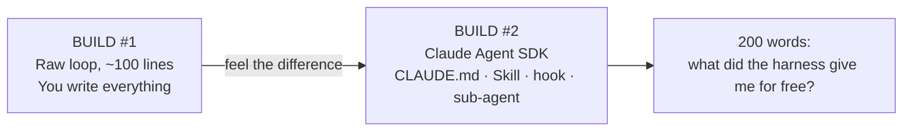

# Phase 1 — Build Your First Agent From Scratch · Weeks 3–5

> **Goal:** make the agent loop *boring*. You'll build the same agent **twice** —
> once from raw primitives, once on a real Agent SDK — so that every framework you
> meet afterward becomes readable.

The fastest way to never be intimidated by an "agent framework" again is to build
the loop yourself in ~100 lines. Once you've done it, you'll see that every
framework is just *your* loop plus conveniences. Then you build it a second time on
the Claude Agent SDK and feel — concretely — what the harness gave you for free.

## The two builds

## Lessons

| # | Lesson | You'll be able to |
|---|--------|-------------------|
| 00 | [The agent loop](00-the-agent-loop.md) | Write a correct, bounded loop from scratch |
| 01 | [Tools the model picks correctly](01-tools-that-models-pick.md) | Design tools (names, schemas, errors) the model uses right |
| 02 | [The same agent on the Claude Agent SDK](02-claude-agent-sdk.md) | Use CLAUDE.md, a Skill, a hook, and a sub-agent |
| 03 | [Raw vs. harness — what you got for free](03-raw-vs-harness.md) | Articulate what a harness buys you |

Runnable starting point: **[`code/raw_agent_loop.py`](../../code/raw_agent_loop.py)**
— a from-scratch loop that runs offline with a mock provider (no API key). Read it,
then rebuild it yourself without looking.

## What you ship

A **daily-briefing agent**: it reads your Markdown notes + RSS feeds and writes a
summarized briefing to disk every morning. Run it for a week, watch it fail on
real, messy input, and fix it. See **[project.md](project.md)**.

> **WHY a "boring" project:** a daily briefing forces every fundamental — tool use,
> file I/O, the loop, error handling — against *real* input that changes daily.
> Toy demos hide the failures that matter; a week of real runs surfaces them.

➡️ Start: [Lesson 00 — The agent loop](00-the-agent-loop.md)
