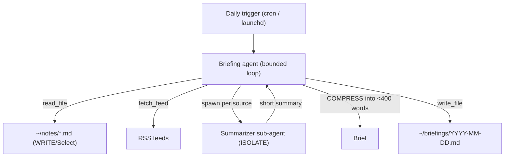

# Phase 1 Project — The Daily-Briefing Agent

> **Ship this:** an agent that reads your Markdown notes + RSS feeds and writes a
> summarized briefing to disk every morning. Build it, then **run it for a week,
> watch it fail on real input, and fix it.**

## Why this project

It looks simple. It isn't — and that's the point. A daily briefing exercises every
Phase-1 fundamental against *real, messy, changing* input:

- the **agent loop** (search/read/summarize/write in a bounded loop),
- **tool design** (file I/O + fetching, picked correctly),
- **error handling** (a feed is down, a note is malformed — recover, don't crash),
- **context engineering** (many sources won't fit — you must Select and Compress).

Toy demos pass once and hide the failures that matter. A week of real runs surfaces
them. The build log you keep *is* your interview material.

## Architecture

## Requirements

### Build #1 — raw loop (Weeks 3–4)
- [ ] Agent loop from scratch, **hard iteration cap**, tool errors fed back as data.
- [ ] Tools: `read_file`, `write_file`, `fetch_feed` (RSS), `web_search` (optional).
- [ ] Reads your notes + N feeds, writes `briefings/<date>.md`.
- [ ] Prints a full trace of every step.

### Build #2 — Claude Agent SDK (Week 5)
- [ ] Same behavior on the SDK with: a **CLAUDE.md** (format/citation/length rules),
      one **Skill** (`daily-briefing` output format), one **PostToolUse hook**
      (auto-format the written Markdown), one **sub-agent** (summarize one source in
      isolation).
- [ ] The 200-word reflection: *what did the harness give me for free?*

### The real test — run it for a week
- [ ] Schedule it (cron/launchd). Let it run every morning for 7 days.
- [ ] Keep a **failure log**: every time the output is wrong, empty, too long, or it
      crashed — record the input that caused it and your fix.
- [ ] Fix at least 3 distinct real failures. (You *will* hit: a dead feed, a 5,000-word
      note that blows the context, a feed with HTML junk, an empty notes folder.)

## How it's evaluated (grade yourself)

| Criterion | Pass bar |
|-----------|----------|
| Loop correctness | Bounded; recovers from a failing tool without crashing |
| Tool design | Clear names/descriptions; validated args |
| Context handling | Handles inputs too big to fit (Select/Compress, not crash) |
| Robustness | Survives a dead feed and an empty notes folder gracefully |
| Both builds | Raw + SDK versions both run; reflection written |
| Real-run log | ≥ 7 days run; ≥ 3 distinct failures fixed and documented |

## Stretch goals

- Route summarization by length: cheap/fast model for short items, bigger model for
  long ones (a preview of Phase 5 cost routing).
- Add a `Stop` hook that refuses to write a briefing over 400 words.
- De-duplicate stories that appear across multiple feeds (a Select/Compress problem).
- Email or Slack the briefing instead of writing to disk.

## Pitfalls

- **GOTCHA — testing only on clean input.** The whole value is the messy week. Don't
  declare victory after one good run.
- **COST — unbounded fetching.** Cap how much feed/note content enters the context;
  a single giant note can blow your budget. Select and Compress.
- **SECURITY — feed content is untrusted.** An RSS item could contain "ignore your
  instructions." Your defense is structural: the agent only has `read_file` /
  `write_file` / `fetch_feed`, all scoped — no dangerous tool exists. (Lesson 01.)

## Exit criteria for Phase 1

- [ ] Both builds run; 200-word reflection written.
- [ ] Ran live for ≥ 7 days; failure log with ≥ 3 fixed real failures.
- [ ] You can explain every line of your raw loop from memory.

➡️ When this passes, start
[Phase 2 — A Real Agent With Proper Architecture](../phase-2-production-architecture/).
