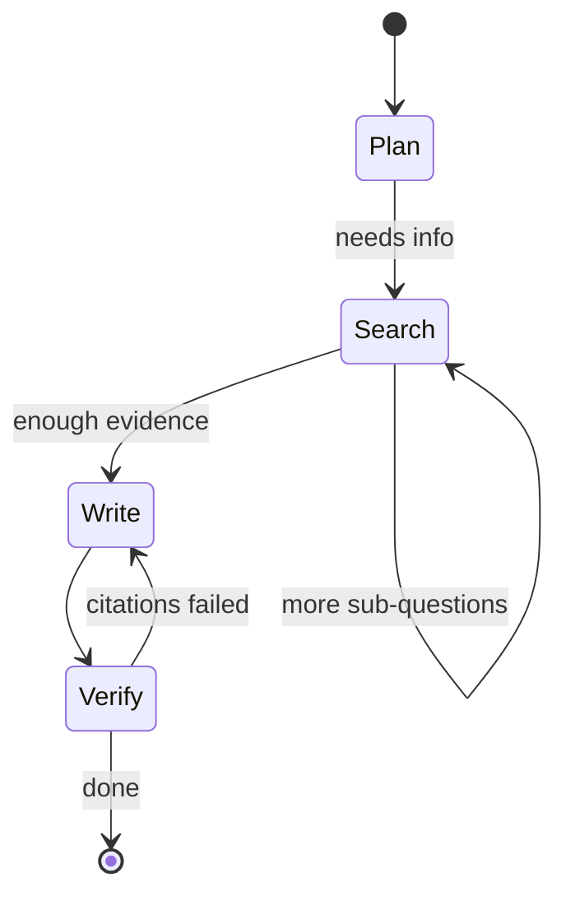
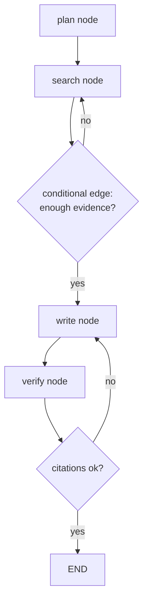

# Lesson 00 — State Machines with LangGraph

> **Goal:** model an agent as an explicit **graph of nodes and edges over shared
> state**, so its behavior is inspectable, testable, and recoverable — instead of an
> opaque `while` loop.

## The mental model

In Phase 1 your agent's control flow lived implicitly inside a `for` loop. That's
fine for one machine and one run. For production you want the control flow to be a
**first-class, inspectable object**: a state machine.

> A LangGraph agent is a **graph**: **nodes** are steps (functions that read and
> write a shared **state**), **edges** decide what runs next. The model's decisions
> become *conditional edges*.



Why turn a loop into a graph? Because a graph gives you, almost for free:

- **Checkpointing** — persist the state after each node (survive a crash).
- **Time-travel** — rewind to any past node and inspect or fork.
- **Human-in-the-loop** — pause at an edge, wait for approval, resume.
- **Observability** — every node transition is a span you can trace.

These are exactly the production properties Phase 1's bare loop lacked.

## The three concepts

### 1. State — the typed object every node reads and writes

State is a typed dict (often a `TypedDict` or Pydantic model) threaded through every
node. Nodes return *updates* to it; LangGraph merges them (with reducers for things
like appending to a list).

```python
from typing import Annotated, TypedDict
from operator import add

class ResearchState(TypedDict):
    question: str
    findings: Annotated[list[str], add]   # reducer: nodes append, not overwrite
    draft: str
    cost_usd: float
```

**WHY typed state:** it's the single source of truth that gets checkpointed. Anything
not in the state doesn't survive a restart. Design it deliberately.

### 2. Nodes — functions from state to state-update

```python
async def plan_node(state: ResearchState) -> dict:
    plan = await llm_plan(state["question"])
    return {"findings": [f"PLAN: {plan}"]}   # merged via the `add` reducer
```

A node can call the model, run a tool, spawn a sub-agent, or just transform data.
Keep nodes small and single-purpose — they're your unit of checkpointing and your
unit of testing.

### 3. Edges — fixed or conditional routing

```python
graph.add_edge("plan", "search")                 # always plan → search
graph.add_conditional_edges("verify", route)     # model/logic decides next
# route(state) -> "write" if citations bad else END
```

Conditional edges are where the *agency* lives: a function (often using a model's
output) decides the next node. This is the loop from Phase 1 — but now each decision
point is explicit, named, and traceable.



## Why the graph is the same loop — made honest

Everything you hand-wrote in Phase 1 maps onto the graph:

| Phase 1 raw loop | LangGraph |
|------------------|-----------|
| `messages` list | typed `State` |
| one iteration of the `for` loop | a node |
| `if not tool_calls: return` | a conditional edge to `END` |
| `max_iterations` cap | recursion limit on the graph |
| `print()` trace | structured node spans |

You're not learning a new paradigm — you're making your Phase-1 loop *inspectable and
durable*. That's the whole upgrade.

**WAR STORY:** A team's monolithic agent function would occasionally produce a broken
report, and they had no idea which step caused it — the whole thing was one 300-line
function with prints scrolling past. Rebuilt as a LangGraph, the failure was obvious
in the trace: the `verify` node was passing even when citations were empty, because
of a bug in one conditional edge. The graph didn't just make it *recoverable* — it
made the bug *visible*. **Structure is debuggability.**

## Pitfalls

- **GOTCHA — fat state.** Putting huge blobs (full documents) directly in state
  bloats every checkpoint. Store big artifacts on the **virtual filesystem** (next
  lessons) and keep *references* in state. (Context primitive: Write, not stuff.)
- **GOTCHA — nodes that do too much.** A node that plans *and* searches *and* writes
  can't be checkpointed or tested cleanly. One responsibility per node.
- **GOTCHA — forgetting the recursion limit.** The graph still needs a bound, just
  like the Phase-1 cap, or a conditional edge can cycle forever.

## Exercises

1. Redraw your Phase-1 daily-briefing agent as a node/edge diagram. Identify the
   conditional edges (where the model decides).
2. Define the `State` for it. What's the minimum that must survive a restart?
3. Map each Phase-1 loop concept to its LangGraph equivalent using the table above.

## Exit check

You can express an agent as nodes, edges, and typed state, explain why a conditional
edge *is* the agentic decision point, and say what must live in state to survive a
crash.

➡️ Next: [Lesson 01 — Durability, time-travel & human-in-the-loop](01-durability-and-hitl.md)
