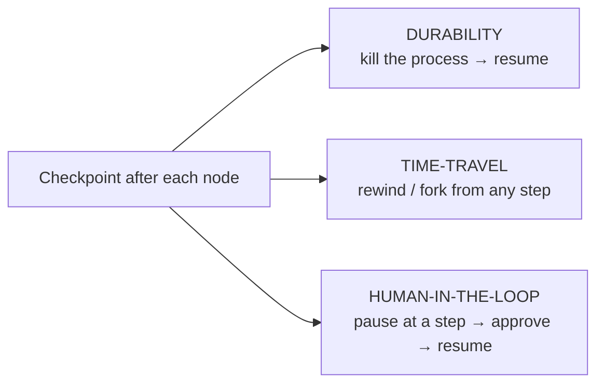
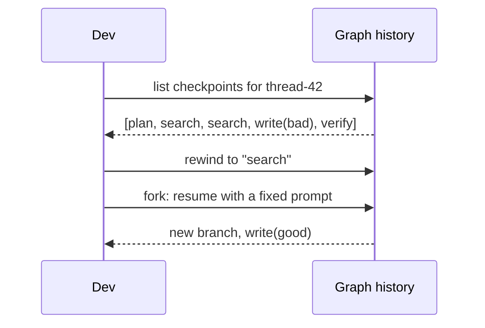
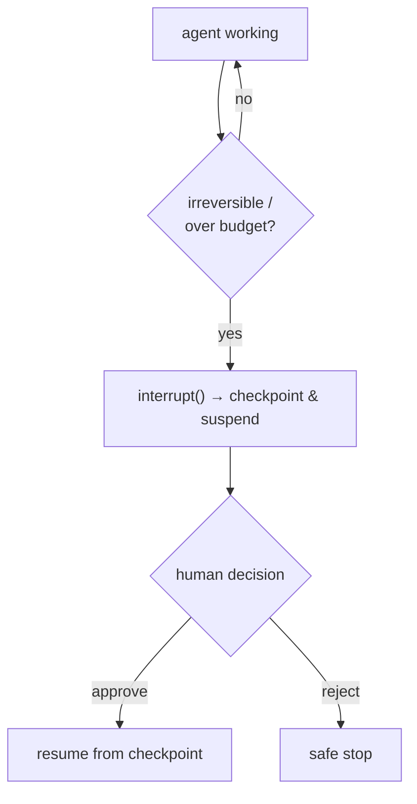

# Lesson 01 — Durability, Time-Travel & Human-in-the-Loop

> **Goal:** make your agent survive a process kill, let a human approve risky steps,
> and rewind to any past state — the three properties that separate a demo from a
> production system.

## The mental model

Because a LangGraph agent is a state machine (Lesson 00), you can **snapshot the
state after every node**. Once you have snapshots, three superpowers follow:



All three are the same primitive — a checkpoint — viewed from three angles.

## 1. Durability — survive a process kill

A **checkpointer** persists state after each node. With `PostgresSaver` (or
`SqliteSaver` for local dev), the state lives in a database keyed by a `thread_id`.
Kill the process, restart, pass the same `thread_id`, and the agent resumes from the
last completed node — not from scratch.

```python
from langgraph.checkpoint.postgres import PostgresSaver

graph = builder.compile(checkpointer=PostgresSaver.from_conn_string(DB_URL))

# Run keyed by a thread_id; state is saved after every node.
config = {"configurable": {"thread_id": "research-42"}}
await graph.ainvoke({"question": q}, config)
# ...process dies at step 7...
# Re-run with the SAME thread_id → resumes at step 7, not step 1.
await graph.ainvoke(None, config)
```

> **WHY this is non-negotiable for long agents:** an agent that runs 5 minutes and
> dies at minute 4 *without* checkpointing has wasted 4 minutes of tokens and lost
> all progress. With checkpointing it loses *one node*. For anything over ~60s,
> durability isn't a nicety — it's the difference between viable and not. (Phase 5
> revisits this as "durable execution.")

## 2. Time-travel — rewind, inspect, fork

Because every checkpoint is stored, you can list the history, jump back to any past
checkpoint, inspect the exact state there, and even **fork** — resume from that point
with a change. This is a debugger for agents.



**WAR STORY:** Debugging a non-deterministic agent by re-running it from the start is
agony — you can't even reliably reproduce the failure. Time-travel changes the game:
you jump to the exact checkpoint *before* the bad step, inspect the precise state the
model saw, tweak, and fork. A bug that took a day of "run and pray" took ten minutes
with checkpoints. **Reproducibility is a feature you architect in.**

## 3. Human-in-the-loop — pause for approval

An **interrupt** pauses the graph at a chosen point and waits for human input before
continuing. This is how you gate **irreversible or expensive** actions: spending
money, sending an email, deleting data, exceeding a budget.

```python
from langgraph.types import interrupt

async def budget_gate(state: ResearchState) -> dict:
    if state["cost_usd"] > 1.00:
        decision = interrupt({                       # pause; surface to a human
            "reason": "About to exceed $1 budget",
            "spent": state["cost_usd"],
        })
        if decision != "approve":
            return {"draft": "Halted by user at budget gate."}
    return {}
```

The graph *suspends* (state is checkpointed), a human is shown the request, and the
run resumes only on approval. Because it's built on checkpointing, the pause can last
milliseconds or days — the process can even be restarted while waiting.



> **SECURITY:** HITL on irreversible actions is a core safety control, not a UX nicety.
> The model is a non-deterministic controller; a human checkpoint before
> spend/delete/send is your circuit breaker. (Revisited in Phase 5.)

## How the three combine in your Phase 2 project

Your Research Analyst will use **all three**: `PostgresSaver` durability (kill →
resume), and a HITL **interrupt** before exceeding a $1 token budget. Time-travel is
your debugging tool when a run goes wrong. Shipping a trace URL proves it's
observable.

## Pitfalls

- **GOTCHA — durability without a stable thread_id.** Resume only works if you re-run
  with the *same* `thread_id`. Generate and persist it deliberately.
- **GOTCHA — interrupting after the irreversible action.** The gate must come
  *before* the spend/delete/send, not after. Order matters.
- **GOTCHA — giant state blobs in every checkpoint.** Checkpointing serializes state
  each node; keep big artifacts on the filesystem and store references (Lesson 00).
- **COST — checkpoint storage.** Frequent checkpoints of fat state add up. Snapshot
  references, not raw documents.

## Exercises

1. Add `SqliteSaver` to your Phase-1 agent. Kill it mid-run; resume with the same
   thread_id. Confirm it continues, not restarts.
2. Add an `interrupt()` before any tool that writes/sends. Approve and reject; confirm
   both paths behave.
3. Use the checkpoint history to rewind to a past step and fork with a changed input.
   Note how much faster debugging becomes.

## Exit check

You can make an agent resume after a kill, gate an irreversible action behind a human
approval, and rewind to a past checkpoint to debug — and you can explain why all
three are the same checkpoint primitive.

➡️ Next: [Lesson 02 — Deep Agents & middleware](02-deep-agents-and-middleware.md)
