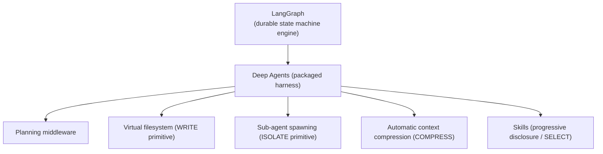
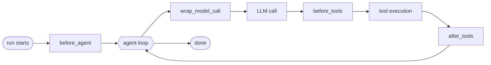

# Lesson 02 — Deep Agents & Middleware

> **Goal:** use a *packaged* harness (Deep Agents) for the primitives you'd otherwise
> hand-roll — planning, virtual filesystem, sub-agents, compaction, skills — and
> customize it cleanly via **middleware** instead of forking it.

## The mental model

LangGraph (Lessons 00–01) gives you the durable *engine*. **Deep Agents** is a
packaged *harness* built on top of it — it bundles the agent primitives you met in
Phase 1's SDK lesson so you don't reimplement them:



Notice every Deep Agents feature is one of the **four context primitives** from
Phase 0 — virtual filesystem = Write, skills = Select, compression = Compress,
sub-agents = Isolate. The harness is *literally* the primitives, packaged.

## What Deep Agents gives you

- **Planning middleware** — the agent maintains an explicit plan/TODO (often on the
  virtual filesystem) and works it down, rather than holding the whole plan in
  context.
- **Virtual filesystem** — a scratch space the agent reads/writes (the **Write**
  primitive). Big artifacts live here; only references live in context.
- **Sub-agent spawning** — delegate a subtask to an isolated-context child (the
  **Isolate** primitive) that returns a compressed summary.
- **Automatic context compression** — when the window fills, the harness compacts
  history (the **Compress** primitive) so long runs don't hit a wall.
- **Skills** — packaged capabilities loaded only when relevant (**Select** /
  progressive disclosure).

## Middleware — customize without forking

You will need to change a packaged harness's behavior: add logging, enforce a budget,
inject context, sanitize tool output. The wrong way is to fork the library. The right
way is **middleware** — hooks that wrap defined points in the agent's lifecycle.

> Middleware is how you customize a packaged agent **without forking it.** You wrap
> the harness's behavior at four well-defined points.



### The four hooks that matter

| Hook | Runs | Use it for |
|------|------|-----------|
| `before_agent` | once, before the loop starts | seed state, load memory, set budgets |
| `wrap_model_call` | around **every** LLM call | inject/trim context, add caching, log tokens, route models by difficulty |
| `before_tools` | before any tool executes | validate/authorize args, enforce allow-list, redact secrets |
| `after_tools` | after any tool executes | sanitize/sandbox output, offload big results to files, log results |

```python
def wrap_model_call(request, handler):
    # Context engineering happens HERE: shape what the model sees each call.
    request = trim_to_budget(request, max_tokens=150_000)   # COMPRESS/SELECT
    response = handler(request)                              # the actual model call
    log_tokens(response.usage)                               # observability
    return response

def before_tools(call):
    if call.cost_estimate_usd() > BUDGET_REMAINING:
        raise HumanApprovalRequired(call)                   # SECURITY / HITL gate
    return call
```

**WHY middleware beats forking:** the harness keeps improving upstream; your
customizations live *beside* it as composable wrappers. You get upstream fixes for
free and your changes stay readable. This is the same lesson as Phase 1's hooks —
deterministic, trusted code wrapping a non-deterministic model — now at framework
scale.

**WAR STORY:** A team needed per-customer token budgets. Their first instinct was to
fork the agent library and thread a budget parameter through 40 functions. Six weeks
later they couldn't merge upstream security fixes. Rewritten as a single
`wrap_model_call` middleware that checked and decremented a budget, it was ~30 lines,
upgrade-safe, and testable in isolation. **Customize at the seams, never in the
guts.**

## Mapping middleware to the primitives

| Middleware hook | Natural context-primitive job |
|-----------------|-------------------------------|
| `before_agent` | **Write** (load memory into state) |
| `wrap_model_call` | **Select / Compress** (shape the window each call) |
| `before_tools` | security/authorization gate |
| `after_tools` | **Write / Compress** (offload big results, summarize) |

## Pitfalls

- **GOTCHA — logic in the wrong hook.** Budget checks belong in `before_tools` /
  `wrap_model_call`, not buried in a tool. Put each concern at its proper seam.
- **GOTCHA — forking the harness.** If you find yourself editing library internals,
  stop — there's almost certainly a middleware seam for it.
- **GOTCHA — compression that drops constraints.** Auto-compaction can summarize away
  the rules (budget, must-cite). Pin durable constraints so they survive (the Phase-0
  war story, at framework scale).
- **COST — every `wrap_model_call` is a chance to cache.** Mark the stable prefix
  (system prompt + tools) for prompt caching here; it's the cheapest 90% you'll ever
  save. (Phase 5.)

## Exercises

1. Add a `wrap_model_call` middleware that logs token usage per call and a running
   cost. You now have the data Phase 5 alerts on.
2. Add a `before_tools` middleware that blocks any tool call estimated to push you
   over budget, raising an approval request (ties to Lesson 01's HITL).
3. For each of the four hooks, write one realistic use from your capstone project.

## Exit check

You can use Deep Agents' packaged primitives, name which context primitive each one
implements, and customize the harness through the four middleware hooks without
forking it.

➡️ Next: [Lesson 03 — Multi-agent architecture](03-multi-agent-architecture.md)
