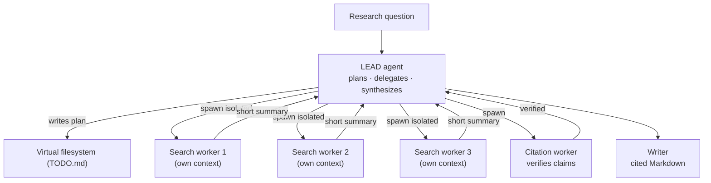
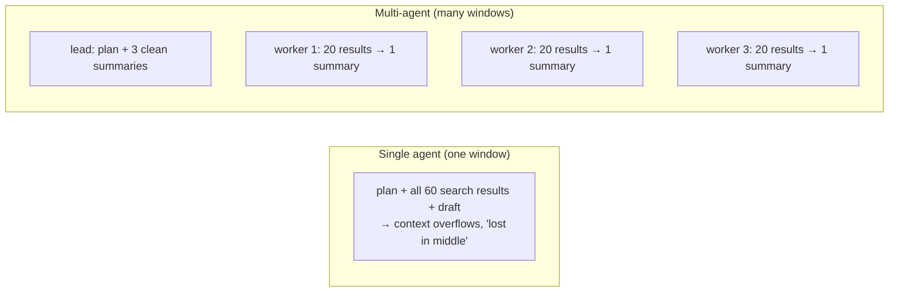
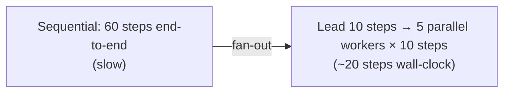

# Lesson 03 — Multi-Agent Architecture

> **Goal:** coordinate a lead agent and several isolated workers (the orchestrator-
> worker pattern), and — just as important — know *when multi-agent is worth its
> ~15× token cost* and when a single agent is the right call.

## The mental model

Multi-agent = the **orchestrator-worker** pattern (Phase 0, Lesson 03) made real,
powered by the **Isolate** context primitive. A **lead** agent plans and delegates;
**workers** each handle a sub-task in their *own* context window and return a
*compressed summary*; the lead synthesizes.

## Why isolation is the whole point

Each worker burns through dozens of noisy tool results (search snippets, web pages)
**in its own window** and hands back a clean paragraph. The lead never sees the mess —
its context stays dense with *decisions and summaries*, not raw search output. That's
why a multi-agent system can tackle research that would blow a single agent's window:
the work is **parallelized across windows.**

## The honest cost: ~15× tokens

> **COST — multi-agent burns roughly 15× the tokens of a single agent.** Every
> worker re-reads instructions, produces summaries, and the lead reads them all.
> Only run multi-agent when the value clears that bar.

When does it clear the bar?

| Use multi-agent when… | Use a single agent when… |
|-----------------------|--------------------------|
| The task **parallelizes** (independent sub-questions) | The task is inherently sequential |
| A single window **can't hold** all the needed context | Everything fits in one window |
| Sub-tasks need **isolation** (one's noise would pollute others) | One clean line of reasoning suffices |
| The output value justifies 15× cost (deep research, audits) | It's a cheap, frequent task |

**WAR STORY:** A team made *everything* multi-agent because it sounded sophisticated.
Their simple "summarize this PDF" feature spawned a lead + three workers, cost 15×,
and was *slower and worse* than one focused call — the workers fragmented a task that
wanted one coherent pass. They reserved multi-agent for genuine deep-research queries
and made the common case a single agent. **Multi-agent is a power tool, not a default.
Reach for it when the task fans out, not to look impressive.**

## Latency: fan-out turns sequential into parallel

Multi-agent's redeeming cost benefit is **wall-clock latency**. A 60-step sequential
agent becomes a 10-step lead + 5 workers running 10 steps *in parallel* — roughly the
latency of 20 sequential steps instead of 60.

> **Parallel tool calls, always.** Anthropic's own research-agent system prompt
> reportedly *insists* the model "MUST use parallel tool calls." Independent
> sub-tasks should never run one-at-a-time. (Phase 5 revisits latency.)

## Designing the worker contract

The lead↔worker interface is the critical design surface:

- **Workers get a narrow, explicit task** ("find peer-reviewed evidence on X, return
  ≤5 bullet findings with sources"). Vague delegation produces vague results.
- **Workers return *compressed* summaries**, not raw dumps — the whole point of
  isolation is that the mess stays in the worker's window.
- **Workers write artifacts to the filesystem** (Write primitive) and return a
  *reference + short summary*, so the lead can pull detail on demand (Select) without
  holding it all.

## Pitfalls

- **GOTCHA — multi-agent by default.** It's 15× cost and more failure modes. Justify
  it with parallelism or context-size pressure.
- **GOTCHA — workers returning raw dumps.** If a worker hands back everything it saw,
  you've lost the isolation benefit and polluted the lead's window. Enforce summary-
  only returns.
- **GOTCHA — vague delegation.** Workers need explicit, bounded tasks and output
  contracts, or the lead gets inconsistent garbage to synthesize.
- **GOTCHA — no per-worker bound.** Each worker is an agent and needs its own
  iteration cap and budget. A runaway worker is still a runaway.

## Exercises

1. Take your daily-briefing agent and identify whether it should be multi-agent.
   (Hint: per-feed summarization fans out — but is the value worth 15×? Decide and
   justify.)
2. Design the worker contract for one search worker in the Research Analyst: its
   input, its bound, and the exact shape of its summary return.
3. Estimate the token cost of the Research Analyst single-agent vs multi-agent. At
   what query value does multi-agent pay off?

## Exit check

You can design an orchestrator-worker system with isolated workers and summary-only
returns, *and* you can decide — with cost and latency reasoning — whether a given task
deserves multi-agent at all. **This completes Phase 2's lessons — now ship the
Research Analyst.**

➡️ Next: [Phase 2 Project — the Research Analyst Agent](project.md)
