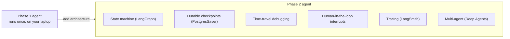

# Phase 2 — A Real Agent With Proper Architecture · Weeks 6–9

> **Goal:** graduate from "an agent that runs" to "an agent that survives" — with
> durable state, time-travel debugging, human-in-the-loop control, observability,
> and multiple coordinated agents.

Your Phase-1 agent works on your laptop. A production agent has to survive a process
kill mid-run, let a human approve a risky step, be debuggable after the fact, and
coordinate sub-agents without drowning in their output. That's an *architecture*
problem, and this phase teaches the production stack that solves it: **LangGraph**
(the durable state machine) and **Deep Agents** (a packaged harness on top).

> **WHY this stack:** LangGraph gives you a state machine with durable checkpointing,
> time-travel, HITL interrupts, and first-class observability, and it's
> model-agnostic. Deep Agents packages the harness primitives (planning, virtual
> filesystem, sub-agents, compaction, skills) on top. The alternatives
> (CrewAI/AutoGen/Swarm) trade production-readiness for demo speed — see
> [reference/the-stack.md](../../reference/the-stack.md). As always: learn the
> *primitives*; the framework names will churn.

## Lessons

| # | Lesson | You'll be able to |
|---|--------|-------------------|
| 00 | [State machines with LangGraph](00-langgraph-state-machines.md) | Model an agent as nodes/edges with durable state |
| 01 | [Durability, time-travel & human-in-the-loop](01-durability-and-hitl.md) | Survive a process kill; pause for human approval; rewind |
| 02 | [Deep Agents & middleware](02-deep-agents-and-middleware.md) | Customize a packaged harness via the four middleware hooks |
| 03 | [Multi-agent architecture](03-multi-agent-architecture.md) | Coordinate orchestrator + isolated workers, and know when it's worth ~15× tokens |

## What you ship

A **Research Analyst Agent**: a lead plans and writes a TODO to a virtual
filesystem → spawns 3 parallel search sub-agents (isolated context) → a citation
sub-agent verifies claims → a writer produces cited Markdown. State persists via
`PostgresSaver` (kill the process, resume where it left off). A human-in-the-loop
interrupt asks for confirmation before exceeding a $1 token budget. **Ship a
LangSmith trace URL alongside the README.** See **[project.md](project.md)**.

➡️ Start: [Lesson 00 — State machines with LangGraph](00-langgraph-state-machines.md)
