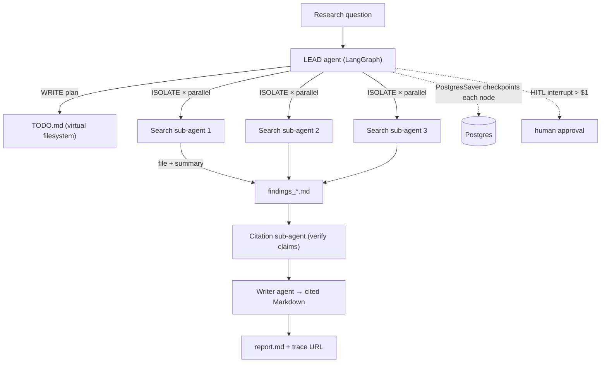

# Phase 2 Project — The Research Analyst Agent

> **Ship this:** a durable, observable, multi-agent research system. Input a
> question; get back a cited Markdown report. Kill the process mid-run and it
> resumes. It pauses for your approval before spending over $1. **Ship a LangSmith
> trace URL with the README.**

This is the centerpiece of the whole roadmap — it exercises every Phase-2 concept and
becomes the agent you'll wrap with evals in Phase 4. It's also the natural seed for
[capstone Project 5](../../projects/05-enterprise-workflow-agent.md) or
[Project 4](../../projects/04-personal-life-os-agent.md).

## Architecture

## Requirements

### Core architecture
- [ ] **Lead agent** plans and writes a TODO list to a **virtual filesystem** (Write).
- [ ] Spawns **3 search sub-agents in parallel**, each with **isolated context**
      (Isolate). Each writes results to files and returns a **short summary** (not a
      raw dump) to the parent.
- [ ] A **citation sub-agent** verifies the claims against the gathered sources.
- [ ] A **writer agent** produces the final Markdown with **inline citations**.

### Production properties
- [ ] **Durability:** state persists via **`PostgresSaver`**. Kill the process
      mid-run; resume with the same `thread_id` and it continues from the last node.
- [ ] **Human-in-the-loop:** an **interrupt** asks for confirmation before exceeding a
      **$1 token budget**. Both approve and reject paths work.
- [ ] **Observability:** ship a **LangSmith trace URL** alongside the README so a
      reviewer can see every node, model call, and sub-agent invocation.

## Milestones (each shippable)

1. **Single-agent baseline** — lead does plan→search→write in one window. Works, but
   overflows on big questions. (You'll *feel* why isolation is needed.)
2. **Add the virtual filesystem** — move findings to files; keep references in state.
3. **Fan out to 3 isolated search workers** — parallel, summary-only returns.
4. **Add the citation verifier + writer** — separate verification from generation.
5. **Add `PostgresSaver`** — prove resume-after-kill with the same `thread_id`.
6. **Add the $1 HITL budget gate** — interrupt before overspend.
7. **Wire LangSmith** — produce a shareable trace URL; write the README.

## How it's evaluated

| Eval type (preview of Phase 4) | What it checks here |
|--------------------------------|---------------------|
| **Trajectory** | Did the lead plan, spawn ≥2 sub-agents, verify citations, and finish under budget? |
| **End-state** | Does `report.md` exist, with real inline citations to sources actually gathered? |
| **LLM-as-judge** | Is the report accurate, well-structured, and responsive to the question? |
| **Durability test** | Kill at node 5 → resume → same final report (no restart) |

## Stretch goals

- Difficulty-route the workers: cheap model for simple searches, bigger for synthesis.
- Add prompt caching of the stable system prompt + tool defs (Phase 5 COST preview).
- Add a `before_tools` middleware that hard-stops any single call over remaining
  budget (ties Lesson 02 + 01).
- Make the number of search workers dynamic — the lead decides based on the question.

## Pitfalls

- **GOTCHA — fat checkpoints.** Don't put full documents in state; store them on the
  filesystem and checkpoint references (Lesson 00/01).
- **GOTCHA — workers dumping raw results.** Enforce summary-only returns or you lose
  the isolation benefit (Lesson 03).
- **COST — multi-agent is ~15×.** This task *justifies* it (deep research, parallel,
  context-heavy). Be able to say *why* it clears the bar.
- **SECURITY — web content is untrusted.** A fetched page may contain injection text.
  Defense is structural: workers have only search/read/write tools, all scoped
  (Phase 1, Lesson 01).

## Exit criteria for Phase 2

- [ ] All core + production requirements met.
- [ ] Process-kill resume demonstrated.
- [ ] $1 HITL gate demonstrated (approve and reject).
- [ ] LangSmith trace URL in the README.
- [ ] You can explain why this task deserves multi-agent (parallelism + context size).

➡️ When this passes, start
[Phase 3 — Build the Harness Layer Yourself](../phase-3-build-the-harness/).
