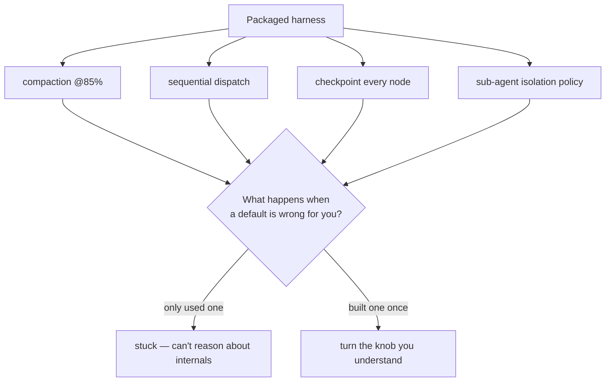

# Lesson 00 — Why Build a Harness

> **Goal:** understand *why* hand-building a harness is the highest-leverage thing you
> can do this year, and frame the build as a series of explicit trade-offs.

## The mental model

A packaged harness is a pile of **frozen decisions** someone else made:

- compact context at 85%? (why not 70%, or summarize differently?)
- dispatch tools sequentially or in parallel? retry how many times?
- checkpoint after every node, or only expensive ones?
- isolate sub-agents how — fresh window, or shared memory?
- sandbox tool execution where, with what privileges?

When you only *use* a harness, those decisions own you silently. The first time one is
wrong for your workload — and one always is — you'll be stuck, because you can't
override a decision you don't understand.

> Building a harness once converts every one of those frozen decisions into a knob you
> understand and can turn.

## The trade-offs you'll make (and must be able to defend)

Building the mini-harness is not about lines of code — it's about *choices*. By the
end you must be able to defend each:

| Decision | The trade-off |
|----------|---------------|
| Compaction threshold (e.g. 85%) | Too low → lose context early & re-summarize often; too high → risk overflow mid-step |
| What survives compaction | Keep durable facts/constraints vs. raw chatter; lossy by design |
| Sequential vs. parallel tools | Latency vs. complexity & rate limits |
| Checkpoint frequency | Recoverability vs. storage/serialization cost |
| Sub-agent isolation | Clean context & parallelism vs. ~15× token cost |
| Skills / progressive disclosure | Capability breadth vs. context budget |
| Sandbox boundary | Safety vs. engineering effort & latency |
| Auth brokering | Security (model never sees creds) vs. plumbing |

**WHY a post-mortem is the deliverable:** anyone can copy an agent loop. The signal
that you're a harness engineer is that you can articulate *why you chose 85% and not
70%*, *what you deliberately cut*, and *what you'd change*. That's the 1,000-word
post-mortem, and it's the most interview-valuable artifact in the whole course.

## Keep it thin — ~1,500 lines, on purpose

The goal is **not** to rebuild the Claude Agent SDK. It's a *thin* harness that
implements the ten components well enough to teach you the trade-offs. Resist
gold-plating. Thin-but-understood beats thick-but-copied.

**WAR STORY:** Two engineers interview for the same senior AI role. Both have shipped
agents on LangGraph. One says "I use the framework's checkpointer." The other says "I
built a checkpointer once; here's why I checkpoint references not blobs, why I compact
at 80% for my long-context workload, and the auth-brokering bug I hit when the model
tried to read its own credentials from a tool result." Guess who gets the offer. The
*build* is what produced the second answer.

## How this phase connects to the rest

- Everything you used in Phases 1–2 (loop, dispatch, context, persistence, sub-agents,
  skills, hooks, observability) you now **implement**.
- The **four context primitives** (Phase 0) become concrete code: Write =
  persistence/filesystem, Select = retrieval/tool reads, Compress = compaction,
  Isolate = the sub-agent spawn primitive.
- Phase 4 then wraps *your* harness in evals — so you can prove your trade-offs were
  good ones.

## Exercises

1. From the trade-off table, pick the three decisions you expect to be hardest for
   *your* capstone workload. Write your predicted choice and why.
2. Re-read your Phase-1 "what did the harness give me for free" reflection. Which of
   those freebies are you about to build?
3. Write one sentence defending an 85% compaction threshold — and one sentence for why
   you might pick 70% instead.

## Exit check

You can explain why building a thin harness is the highest-leverage move available to
you, and you can name at least five harness decisions as explicit, defensible
trade-offs rather than magic defaults.

➡️ Next: [Lesson 01 — The 10 components of a modern harness](01-the-ten-components.md)
