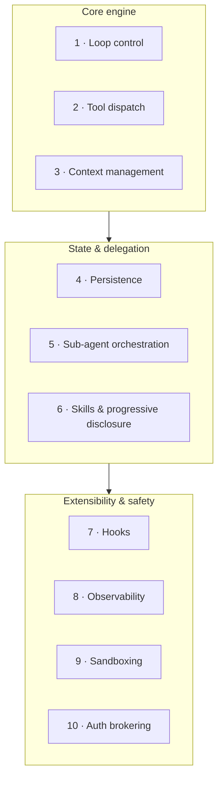
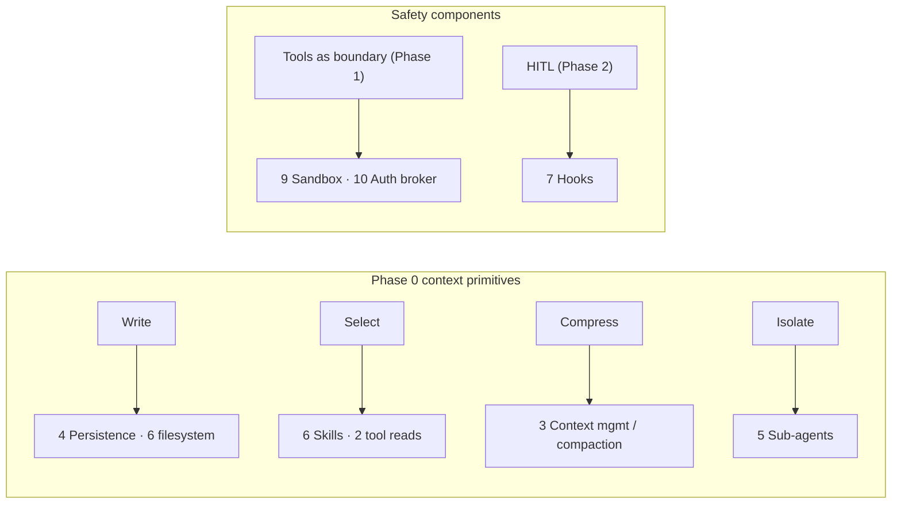

# Lesson 01 — The 10 Components of a Modern Harness

> **Goal:** get the complete map of what a harness *is* — all ten components, what
> each does, and how they fit — before you build them in the next lessons.

This is the blueprint for your Phase-3 project. Every modern agent harness (the
Claude Agent SDK, Deep Agents, and the rest) is some implementation of these ten
components. Learn the map; the next three lessons build the territory.

## The ten, each in one breath

### 1. Loop control
The `while`-loop driving model → tools → model, with the hard iteration cap. The
heartbeat. (You built a basic one in Phase 1; now it's a component with retries and
stop conditions.) → built in [Lesson 02](02-loop-dispatch-context.md).

### 2. Tool dispatch
A **registry** of tools with schema validation, plus parallel calls and retries. The
model names a tool + args; dispatch validates the args, runs the right function, and
returns a result (errors as data). → [Lesson 02](02-loop-dispatch-context.md).

### 3. Context management
System-prompt assembly + **compaction** when the window approaches its limit (~85%).
This is the **Compress** primitive in code: decide what to keep verbatim, what to
summarize, what to drop. → [Lesson 02](02-loop-dispatch-context.md).

### 4. Persistence
Checkpoint state every step so you can **resume, rewind, and fork**. The **Write**
primitive for *execution state*. (Phase 2's `PostgresSaver`, now built by you.) →
[Lesson 03](03-persistence-subagents-skills-hooks.md).

### 5. Sub-agent orchestration
Spawn isolated-context children that return compressed summaries — the **Isolate**
primitive as a reusable spawn function. →
[Lesson 03](03-persistence-subagents-skills-hooks.md).

### 6. Skills & progressive disclosure
Load capabilities **only when relevant** so they don't bloat the context — the
**Select** primitive for *capabilities*. A skill (e.g. `SKILL.md`) is pulled in at
the point of use. → [Lesson 03](03-persistence-subagents-skills-hooks.md).

### 7. Hooks
Pluggable extension points — `PreToolUse`, `PostToolUse`, `PreCompact`, `Stop` — where
*your* trusted code runs around the model's non-deterministic actions. →
[Lesson 03](03-persistence-subagents-skills-hooks.md).

### 8. Observability
OTEL-style **spans** for every model call, tool call, and sub-agent invocation, so you
can trace and debug. The data Phase 5 alerts on. →
[Lesson 04](04-observability-sandboxing-auth.md).

### 9. Sandboxing
Code execution in a container the model **never has credentials to** — so a tool that
runs model-generated code can't touch your real environment. →
[Lesson 04](04-observability-sandboxing-auth.md).

### 10. Auth brokering
Credentials **never enter the model's context.** The harness holds the API key and
injects it *outside* the model's view; the model calls a tool, the harness adds the
secret. → [Lesson 04](04-observability-sandboxing-auth.md).

## How the ten map to everything you've learned

Nothing here is new — it's the consolidation of Phases 0–2 into a single buildable
system. The four context primitives *are* components 3–6. The security lessons (tools
as a boundary, HITL) *are* components 7, 9, 10. You've been assembling this blueprint
all along.

## The grouping that guides your build

Build in this order (it's how the next lessons and your project are structured):

1. **Core engine first** (1–3): a harness with loop, dispatch, and context management
   already *runs* agents. Get this working end-to-end before anything else.
2. **State & delegation** (4–6): now make it durable, able to delegate, and able to
   load skills on demand.
3. **Extensibility & safety** (7–10): hooks to extend it, observability to see it,
   sandbox + auth brokering to make it safe.

> **GOTCHA — don't build all ten at once.** Get components 1–3 running on a real task
> first. A harness that loops and dispatches but has no sandbox is testable today; a
> half-built version of all ten is testable never.

## Exercises

1. For each of the ten, write the one-sentence "if this component didn't exist, the
   failure would be ___."
2. Map all four context primitives and both security lessons onto the ten components
   (use the diagram as an answer key).
3. Order the ten by build priority for *your* capstone. Justify the top three.

## Exit check

You can list all ten components from memory, say what each does and what fails without
it, and map them back to the four context primitives and the security lessons.

➡️ Next: [Lesson 02 — Loop, dispatch & context management](02-loop-dispatch-context.md)
