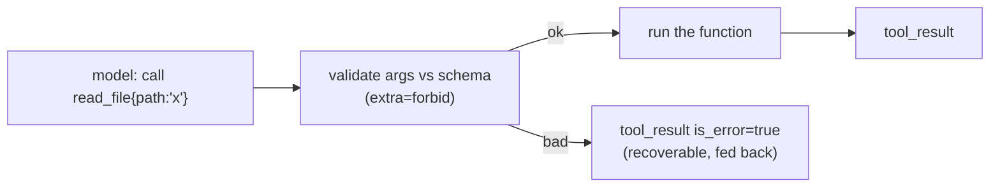
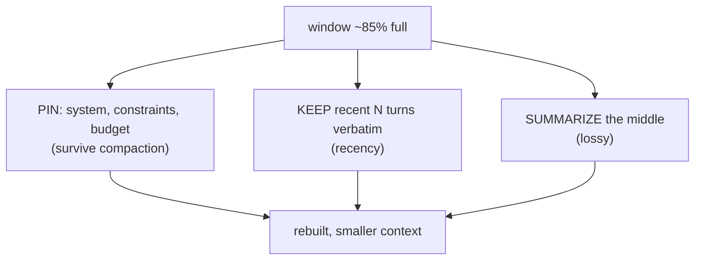

# Lesson 02 — Loop, Dispatch & Context Management

> **Goal:** build the **core engine** of your harness — components 1–3 — so it can run
> a real agent end-to-end before you add anything fancy.

These three components are the minimum viable harness. Get them working on a real task
first; everything else (persistence, sub-agents, safety) hangs off this spine. The
runnable skeleton is in [`code/mini_harness/`](../../code/mini_harness/) — read it,
then build your own.

## Component 1 — Loop control

You wrote this in Phase 1; now make it a proper component with **retries** and clean
**stop conditions**.

```python
async def run(self, task: str, *, max_iters: int = 25) -> RunResult:
    self.ctx.add_user(task)
    for step in range(1, max_iters + 1):            # HARD CAP (guardrail)
        await self.hooks.fire("pre_model", self.ctx)
        turn = await self._call_model_with_retry()  # retry/backoff on transient errors
        self.ctx.add_assistant(turn)
        calls = turn.tool_calls
        if not calls:
            await self.hooks.fire("stop", self.ctx)
            return RunResult(answer=turn.text, steps=step)
        results = await self.dispatch.run_all(calls)  # component 2
        self.ctx.add_tool_results(results)
        self.ctx.maybe_compact()                       # component 3
    raise HarnessError(f"no answer within {max_iters} steps")
```

**WHY retries belong here:** model APIs return transient errors (rate limits, 5xx). A
production loop retries with backoff on *transient* errors but does **not** retry a
bad tool call (that's data the model must see). Distinguish the two.

## Component 2 — Tool dispatch

A registry that turns a `@tool`-decorated function into (a) a JSON schema advertised to
the model and (b) a validated, dispatchable call.

```python
@tool
def read_file(path: str) -> str:
    """Read a UTF-8 text file from the working directory. Returns its contents."""
    return (WORKDIR / path).read_text()

# The decorator captures name + docstring + a JSON schema derived from the signature.
# Dispatch validates args against that schema BEFORE calling — one source of truth.
```

Three responsibilities, in order:



- **Parallel calls:** if the model requests several independent tools in one turn, run
  them concurrently (`asyncio.gather`) — a latency win (Phase 5).
- **Retries:** transient tool failures (network) may retry; logic errors become data.
- **GOTCHA — schema/validation drift.** Derive the advertised schema and the
  validation from the *same* definition, or the model will be told one contract and
  judged by another. (Phase 1, Lesson 01.)

## Component 3 — Context management

This is the **Compress** primitive in code, and the component most people get wrong.
Two jobs: **assemble** the prompt, and **compact** when it fills.

### Assembly
Build the request each turn from: system prompt + skill instructions (loaded on
demand) + relevant memory + conversation history + tool results. The stable prefix
(system + tools) should be **cache-marked** for prompt caching (Phase 5 COST).

### Compaction at ~85%
When estimated tokens cross a threshold (commonly **85%** of the window), replace older
history with a summary, preserving what matters.

```python
def maybe_compact(self) -> None:
    if self.estimated_tokens() < 0.85 * self.window:   # the threshold trade-off
        return
    head = self.pinned                                  # NEVER summarize these
    keep_recent = self.messages[-self.keep_n:]          # recency matters most
    old = self.messages[len(head):-self.keep_n]
    summary = self.summarizer(old)                      # lossy on purpose
    self.messages = head + [summary_message(summary)] + keep_recent
```



**The three rules of compaction:**

1. **Pin durable constraints.** Budgets, must-cite rules, the user's core instruction —
   these must survive every compaction, or you get the Phase-0 "forgetting" bug.
2. **Keep recent turns verbatim.** The most recent context is usually the most
   relevant; summarize the *middle*, not the present.
3. **Summarize decisions and facts, not chatter.** A good summary preserves what was
   *decided* and *learned*, not the back-and-forth.

**WAR STORY (revisited, now from the builder's seat):** the agent that "forgot" the
$1 budget on long runs — you now know *exactly* where that bug lives: the compaction
step dropped an unpinned constraint. Building component 3 yourself is what lets you
see the bug at all. Pin the constraint; ship.

## Get it running before moving on

A harness with components 1–3 can already run your Phase-1 daily-briefing task. **Do
that** — run it end-to-end — before adding persistence or sub-agents. A working spine
you understand beats a half-built ten-component skeleton.

## Pitfalls

- **GOTCHA — compaction that drops constraints.** The single most common context bug.
  Pin them.
- **GOTCHA — naive token counting.** Estimate tokens with the model's tokenizer, not
  `len(text)/4` for anything load-bearing; the error compounds near the limit.
- **GOTCHA — retrying logic errors.** Transient (network) → retry. Bad args / wrong
  result → feed back as data. Don't conflate them.
- **COST — re-summarizing too often.** Too-low a threshold means you pay to compact
  repeatedly. Tune it; that's a real trade-off (Lesson 00).

## Exercises

1. Build components 1–3 and run your daily-briefing task on them. Watch the trace.
2. Force a compaction (tiny window) and confirm your pinned constraint survives while
   the middle gets summarized.
3. Make two tools that can run in parallel; dispatch them concurrently and measure the
   latency difference vs. sequential.

## Exit check

You have a running mini-harness core: a bounded loop with retries, a validating tool
registry with parallel dispatch, and context compaction that pins constraints and
keeps recent turns. It runs a real task end-to-end.

➡️ Next: [Lesson 03 — Persistence, sub-agents, skills & hooks](03-persistence-subagents-skills-hooks.md)
