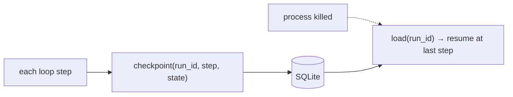
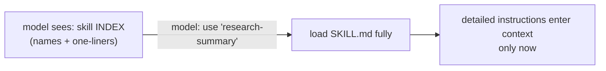
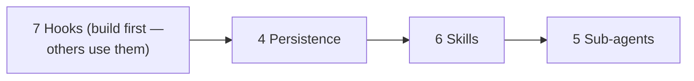

# Lesson 03 — Persistence, Sub-Agents, Skills & Hooks

> **Goal:** build components 4–7 — the layer that makes your harness **durable,
> able to delegate, able to load capabilities on demand, and extensible.**

Your core engine (Lessons 02) runs agents. Now make it production-shaped.

## Component 4 — Persistence (durable resume)

Checkpoint state after each step so a killed process resumes instead of restarting —
the **Write** primitive applied to *execution state*. In Phase 2 you used
`PostgresSaver`; here you build a thin version (SQLite is plenty).

```python
class Checkpointer:
    def save(self, run_id: str, step: int, state: dict) -> None:
        self.db.execute(
            "INSERT OR REPLACE INTO checkpoints(run_id, step, state) VALUES (?,?,?)",
            (run_id, step, json.dumps(state)),
        )
        self.db.commit()                      # durable AFTER each step

    def load(self, run_id: str) -> dict | None:
        row = self.db.execute(
            "SELECT state FROM checkpoints WHERE run_id=? ORDER BY step DESC LIMIT 1",
            (run_id,)).fetchone()
        return json.loads(row[0]) if row else None
```



- **GOTCHA — checkpoint references, not blobs.** Store big artifacts on the filesystem
  and checkpoint *paths*. Serializing full documents every step is slow and huge.
- **WHY:** anything running over ~60 seconds needs this, or a transient failure throws
  away minutes of token spend. (Phase 5: durable execution.)

## Component 5 — Sub-agent orchestration (Isolate)

A reusable `spawn` primitive: run a child agent with its **own** context window and a
narrow task; return only a **compressed summary** to the parent.

```python
async def spawn(self, task: str, *, tools=None, max_iters: int = 10) -> str:
    child = Harness(provider=self.provider,           # FRESH context window
                    tools=tools or self.tools,
                    system=SUBAGENT_SYSTEM)
    result = await child.run(task, max_iters=max_iters)
    return summarize(result.answer)                   # summary, not raw transcript
```

```mermaid
flowchart TD
    Parent["parent (clean window)"] -->|spawn(task)| Child["child (own window)"]
    Child -->|"noisy work stays here"| Child
    Child -->|"compressed summary only"| Parent
```

- **GOTCHA — leaking the child's transcript.** Return a summary, not the whole
  conversation, or you defeat isolation and pollute the parent (Phase 2, Lesson 03).
- **COST — each spawn multiplies tokens (~15×).** Make `spawn` easy to call but
  document the cost so it isn't used reflexively.
- Each child is a full agent → it needs its **own** iteration cap and budget.

## Component 6 — Skills & progressive disclosure (Select)

A **skill** is a capability defined in a folder (a `SKILL.md` + assets). The harness
exposes a short **index** of skills to the model and loads a skill's full instructions
**only when the model selects it** — the **Select** primitive for capabilities.



```python
def skill_index(self) -> str:
    # cheap: just names + one-line descriptions (the SELECT menu)
    return "\n".join(f"- {s.name}: {s.summary}" for s in self.skills)

def load_skill(self, name: str) -> str:
    # expensive detail, pulled in ONLY at the point of use
    return (self.skills_dir / name / "SKILL.md").read_text()
```

**WHY progressive disclosure:** loading every skill's full instructions upfront would
blow the context budget. The index is cheap; the detail is just-in-time. This is *the*
pattern that lets an agent have dozens of capabilities without a bloated prompt.

## Component 7 — Hooks (extensibility)

Pluggable points where *your trusted code* runs around the model's actions. Build a
simple registry; fire events at defined moments.

```python
class Hooks:
    def __init__(self): self._h = defaultdict(list)
    def on(self, event: str, fn): self._h[event].append(fn)
    async def fire(self, event: str, ctx) -> None:
        for fn in self._h[event]:
            await fn(ctx)        # pre_tool, post_tool, pre_compact, stop, ...

# usage
hooks.on("post_tool", auto_format_written_files)   # deterministic guarantee
hooks.on("pre_tool", enforce_budget_and_authz)     # security gate
```

The four hook points that matter (you saw them as SDK/middleware concepts; now they're
yours): **PreToolUse, PostToolUse, PreCompact, Stop.**

| Hook | Fires | Typical job |
|------|-------|-------------|
| `PreToolUse` | before a tool runs | authorize args, enforce allow-list/budget, inject brokered auth |
| `PostToolUse` | after a tool runs | format/sanitize output, offload big results to files, log |
| `PreCompact` | before compaction | pin/protect constraints so they survive (the famous bug fix!) |
| `Stop` | when the agent finishes | final validation, persist results, emit metrics |

- **WHY hooks instead of editing the loop:** deterministic, trusted behavior belongs in
  composable code *around* the model, not as hopeful prompt text and not hard-wired
  into the engine. This is how you keep the harness thin and customization separate.

## Build order within this lesson



Build **hooks first** — persistence and sub-agents are cleaner when they can fire
events. Then persistence (durability), then skills (Select), then sub-agents (Isolate).

## Pitfalls

- **GOTCHA — compaction dropping constraints** is *fixed* by a `PreCompact` hook that
  pins them. Wire it.
- **GOTCHA — child transcript leakage** defeats isolation. Summaries only.
- **GOTCHA — eager skill loading** defeats progressive disclosure. Index cheap, detail
  late.
- **SECURITY — hooks are where authorization lives.** A `PreToolUse` hook is your
  enforcement point for budgets, allow-lists, and brokered credentials.

## Exercises

1. Add a `PreCompact` hook that pins the user's core instruction + budget. Force a
   compaction; confirm they survive. You just fixed the canonical context bug yourself.
2. Implement `spawn` and have your harness solve a research task with two parallel
   children returning summaries. Confirm the parent's window stays small.
3. Add two skills with an index; confirm only the selected skill's full text enters
   context (log the token delta).

## Exit check

Your harness now resumes after a kill, spawns isolated sub-agents that return
summaries, loads skills only when selected, and fires pluggable hooks at the four
lifecycle points — with constraints pinned across compaction.

➡️ Next: [Lesson 04 — Observability, sandboxing & auth brokering](04-observability-sandboxing-auth.md)
