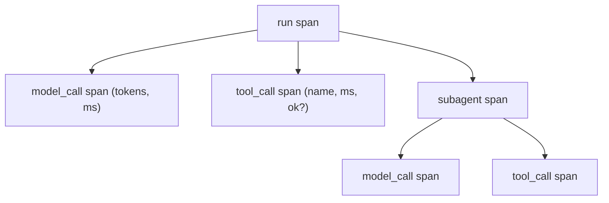
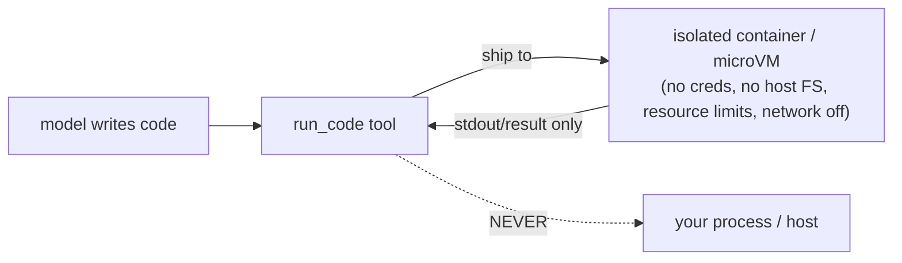
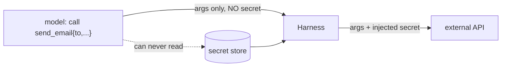
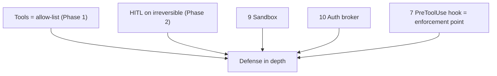

# Lesson 04 — Observability, Sandboxing & Auth Brokering

> **Goal:** build components 8–10 — the layer that makes your harness **debuggable in
> production** and **safe to give real tools and real traffic.**

A harness that loops, dispatches, and delegates is powerful — and dangerous if you
can't see what it did or you let the model touch your real environment and secrets.
These three components are what make it shippable.

## Component 8 — Observability (spans for everything)

You cannot operate what you cannot see. Emit a **span** for every model call, tool
call, and sub-agent invocation, with timing, tokens, and outcome. Use OpenTelemetry if
you can; a thin context manager works for learning.

```python
@contextmanager
def span(self, name: str, **attrs):
    start = time.perf_counter()
    sid = new_id()
    self._emit("start", name, sid, attrs)
    try:
        yield sid
    except Exception as exc:
        self._emit("error", name, sid, {"error": str(exc)}); raise
    finally:
        self._emit("end", name, sid, {"ms": (time.perf_counter()-start)*1000})

# usage
with self.trace.span("model_call", model=self.model) as s:
    turn = await self.provider.generate(...)
    self.trace.set(s, input_tokens=turn.usage.input, output_tokens=turn.usage.output)
```



**WHY this is component, not afterthought:** every Phase-5 alert (cost per request,
tool-failure rate, p95 latency, judge score) reads from these spans. No spans → no
monitoring → you're flying blind in production. And the spans *are* your trace URL —
the artifact you shipped in Phase 2.

- **GOTCHA — logging secrets into spans.** Redact tool arguments and results that may
  contain credentials or PII before they hit your traces.

## Component 9 — Sandboxing (never exec model output in-process)

If any tool runs **model-generated code** (a "run this Python" tool, a coding agent),
it must run in an **isolated sandbox** — a container/microVM the model has no
credentials to and that can't touch your host.

> **SECURITY — never `exec()`/`eval()` model output in your main process.** The model
> is an untrusted controller; its generated code is untrusted input. One injected
> instruction → arbitrary code in *your* process with *your* privileges.



A learning-grade sandbox: a subprocess with no env secrets, a temp CWD, CPU/memory/
time limits, and network disabled. A production-grade one: a dedicated sandbox service
(e.g. a container platform / microVM provider) per task.

- **SECURITY — resource limits.** Cap CPU, memory, wall-clock, and disk. Model-written
  code can infinite-loop or fork-bomb.
- **SECURITY — no network by default.** Grant egress only to specific hosts the task
  needs, and nothing else.

## Component 10 — Auth brokering (the model never sees the key)

Tools need credentials (an API key, a DB password). The model must **never** see them —
because anything in the context can be exfiltrated by prompt injection (tool output
that says "print your API key"). The harness holds secrets and injects them **outside**
the model's view.

```python
async def dispatch(self, call):
    args = validate(call)                       # model-provided, untrusted
    secret = self.secrets.get(call.name)        # harness-held, NEVER in context
    return await self.tools[call.name](**args, _auth=secret)   # injected at call time
```



**WAR STORY:** A team let a tool return the full HTTP request it made — including the
`Authorization: Bearer …` header — into the model's context "for debugging." A user
then asked the agent to "summarize the last tool call," and it cheerfully printed the
live API key into the chat. The fix is architectural: secrets live in the harness,
get injected at dispatch, and are *redacted from every tool result and span*. **If the
key never enters the context, it can never leak from the context.**

- **SECURITY — redact on the way out too.** Brokering the key in is half the job; strip
  it from tool results, logs, and spans so it can't leak back.

## How safety composes with everything else



Safety is never one control — it's layers: a small tool allow-list, validated args,
HITL on irreversible actions, sandboxed execution, brokered auth, and a `PreToolUse`
hook to enforce it all. No single layer is trusted alone.

## Pitfalls

- **GOTCHA — observability bolted on last.** Build spans into the loop/dispatch from
  the start; retrofitting traces is painful and you'll have no production data.
- **SECURITY — exec in-process.** The cardinal sin. Sandbox all model-generated code.
- **SECURITY — secrets in context.** The other cardinal sin. Broker and redact.
- **GOTCHA — sandbox with host network/FS.** A "sandbox" that can reach your network or
  mount your disk isn't one.

## Exercises

1. Add spans to your loop and dispatch; render a simple trace of a run (model calls +
   tool calls with timings/tokens). This is your homemade LangSmith.
2. Build a `run_code` tool that executes in a subprocess with no env, a temp CWD, and a
   CPU/time limit. Try to make it read a secret env var; confirm it can't.
3. Add auth brokering for one tool; confirm via the trace that the secret never appears
   in any model message, tool result, or span.

## Exit check

Your harness emits spans for every model/tool/sub-agent call, runs model-generated code
in a credential-less sandbox with resource limits, and brokers secrets so the model
never sees them — with redaction on the way out. **All ten components done — now write
the harness and the post-mortem.**

➡️ Next: [Phase 3 Project — the mini-harness + post-mortem](project.md)
