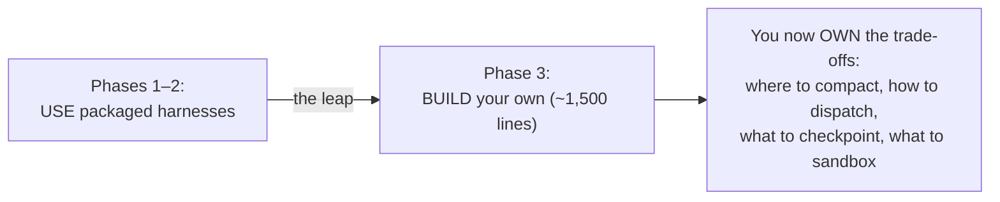

# Phase 3 — Build the Harness Layer Yourself · Weeks 10–13

> **Goal:** the highest-leverage phase in the roadmap. Stop *using* a packaged
> harness and **build a thin one yourself** — because you will never make the right
> harness trade-offs in production until you've made them once, by hand.

In Phase 1 you used the Claude Agent SDK. In Phase 2 you used LangGraph + Deep Agents.
You can now *read* any harness. This phase makes you able to *build* one — which is
what separates a framework user from a harness engineer, and it's the single thing
that most differentiates senior AI engineers in 2026.

> **WHY this is the highest-leverage phase:** every default in a packaged harness is
> a *decision* — where to compact context, how to dispatch tools, what to checkpoint,
> how to isolate sub-agents. In production those defaults will eventually be *wrong*
> for your case. You can only override what you understand, and you understand it by
> building it once.

## Lessons

| # | Lesson | You'll be able to |
|---|--------|-------------------|
| 00 | [Why build a harness](00-why-build-a-harness.md) | Justify the build and frame the trade-offs |
| 01 | [The 10 components of a modern harness](01-the-ten-components.md) | Name and explain all ten, end to end |
| 02 | [Loop, dispatch & context management](02-loop-dispatch-context.md) | Build the core engine + compaction at 85% |
| 03 | [Persistence, sub-agents, skills & hooks](03-persistence-subagents-skills-hooks.md) | Make it durable, isolating, extensible |
| 04 | [Observability, sandboxing & auth brokering](04-observability-sandboxing-auth.md) | Make it traceable and safe |

Starter skeleton (read it, then build the real thing yourself):
**[`code/mini_harness/`](../../code/mini_harness/)** — a scaffold with working pieces
(hooks, persistence, tracing) and clearly-marked `TODO(student)` stubs.

## What you ship

A **mini-harness in ~1,500 lines of Python** implementing the ten components, **plus a
1,000-word post-mortem** comparing it to the Claude Agent SDK and Deep Agents: what
you got right, what you cut, what you'd do differently. The post-mortem is the real
deliverable — it proves you understand the trade-offs, not just the code. See
**[project.md](project.md)**.

➡️ Start: [Lesson 00 — Why build a harness](00-why-build-a-harness.md)
