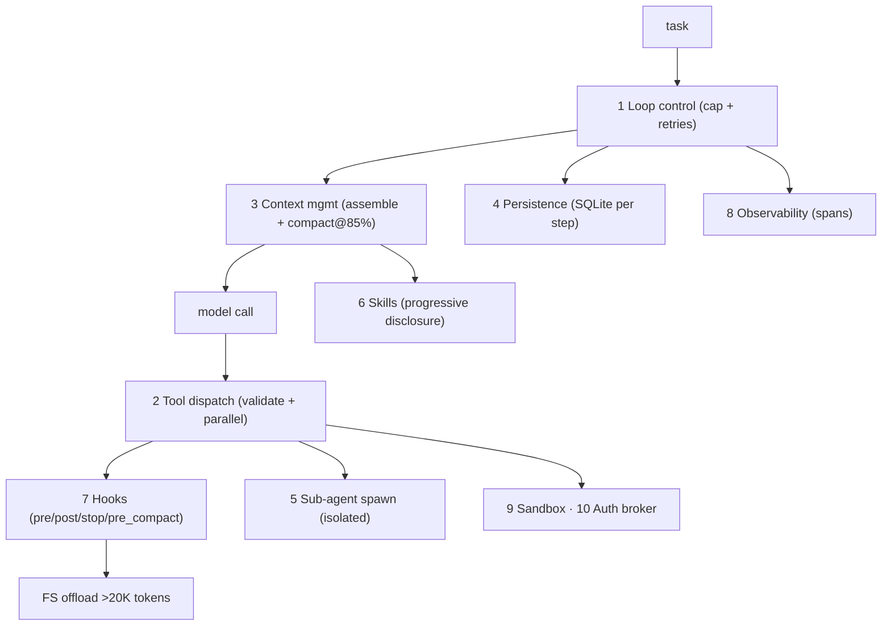

# Phase 3 Project — The Mini-Harness + Post-Mortem

> **Ship this:** a **~1,500-line Python mini-harness** implementing the ten
> components, **plus a 1,000-word post-mortem** comparing it to the Claude Agent SDK
> and Deep Agents. The post-mortem is the real deliverable — it proves you understand
> the *trade-offs*, not just the code.

This is the highest-leverage artifact in the entire roadmap. Anyone can use a
framework. Having built one — and being able to explain every decision — is what makes
you a harness engineer.

## What it must include

Implement the ten components (build on
[`code/mini_harness/`](../../code/mini_harness/) if you like):

- [ ] **Tool registry** from a `@tool` decorator with **JSON-schema generation** from
      type hints, and arg validation (`extra="forbid"`).
- [ ] **`CLAUDE.md`-style system-prompt loader** (project conventions → system context).
- [ ] **`SKILL.md` progressive-disclosure loader** (index cheap, detail on demand).
- [ ] **Sub-agent spawn primitive** with **isolated context**, returning a compressed
      summary.
- [ ] **Filesystem offload:** any tool result over ~20K tokens is written to disk and
      replaced in context with a path + a 10-line preview (Write + Compress).
- [ ] **Auto-compaction at ~85%** of the context window, pinning durable constraints.
- [ ] **Pluggable hook system:** `pre_tool`, `post_tool`, `stop` (and ideally
      `pre_compact`).
- [ ] **OpenTelemetry-style tracing** of every model call, tool call, sub-agent.
- [ ] **Durable resume:** persist to SQLite after each step; reload by `run_id`.
- [ ] **Loop control** with a hard iteration cap and retry/backoff on transient errors.

(That maps 1:1 to the ten components from
[Lesson 01](01-the-ten-components.md). Sandboxing + auth brokering may be thin stubs
with clear `SECURITY` comments if you're short on time — but *say so* in the
post-mortem.)

## Architecture

## Build order (don't build all ten at once)

1. **Core engine** (loop + dispatch + context) → run your daily-briefing task on it.
2. **Hooks** → so later components can fire events.
3. **Persistence** → prove resume-after-kill by `run_id`.
4. **Skills + sub-agents** → progressive disclosure + isolation.
5. **Observability** → spans you can read as a trace.
6. **Sandbox + auth brokering** → safety (or documented stubs).

## The post-mortem (1,000 words — the real deliverable)

Compare your mini-harness to the Claude Agent SDK and Deep Agents. Structure:

1. **What I got right** — decisions you'd keep, and why.
2. **What I cut** — what you deliberately left out (e.g., real sandboxing) and the
   risk you accepted.
3. **What I'd do differently** — bugs, dead-ends, and the trade-offs you'd revisit.
4. **The trade-offs, defended** — for at least five decisions from
   [Lesson 00's table](00-why-build-a-harness.md), state your choice and justify it
   (compaction threshold, checkpoint frequency, sequential vs parallel dispatch,
   sub-agent isolation, sandbox boundary).

> **WHY this matters more than the code:** in an interview, "I built a harness" is
> good; "I built a harness and here's why I compact at 80% for long-context workloads,
> why I checkpoint references not blobs, and the auth-brokering leak I caught" is a
> job offer.

## How it's evaluated

| Criterion | Pass bar |
|-----------|----------|
| Runs a real task | Solves your Phase-1 briefing task end-to-end on *your* harness |
| Durability | Kill mid-run → resume by `run_id`, no restart |
| Context discipline | Compaction at ~85% with pinned constraints; >20K results offloaded |
| Isolation | Sub-agents return summaries; parent window stays small |
| Observability | A readable trace of model/tool/sub-agent spans |
| Safety | Sandbox + auth brokering present (or stubbed *and documented*) |
| Post-mortem | 1,000 words; ≥5 trade-offs defended with reasoning |

## Stretch goals

- Swap the model provider behind a `Protocol` so the harness is provider-agnostic
  (and testable offline with a mock — sets up Phase 4).
- Add `pre_compact` constraint-pinning and *prove* the Phase-0 "forgetting" bug can't
  happen.
- Add prompt-cache marking of the stable prefix; measure the token savings (Phase 5).

## Exit criteria for Phase 3

- [ ] Mini-harness (~1,500 lines) implementing the ten components, running a real task.
- [ ] Resume-after-kill demonstrated.
- [ ] 1,000-word post-mortem with ≥5 defended trade-offs.
- [ ] You can whiteboard the ten components and your key decisions from memory.

➡️ When this passes, start
[Phase 4 — Build the Eval & Regression Harness](../phase-4-evals-and-regression/).
