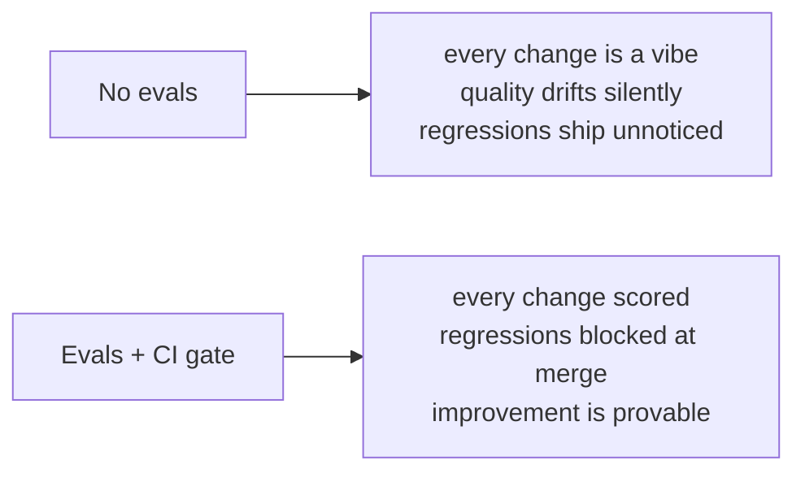
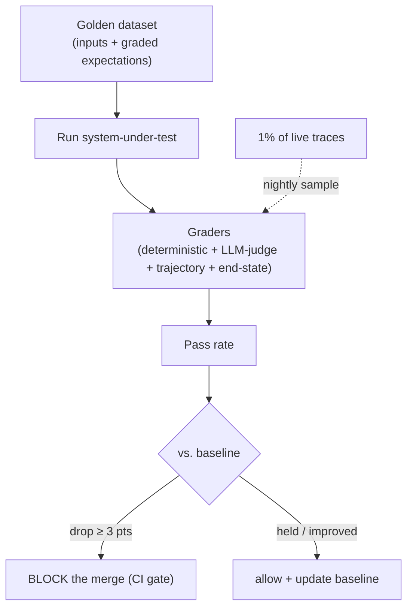

# Lesson 00 — Why Evals Are the Job

> **Goal:** internalize *why* evaluation — not prompting, not model choice — is the
> skill that separates engineers who ship reliable agents from everyone else.

## The mental model

A non-deterministic system you can't measure is a system you can't improve — you can
only *change* it and hope. Every prompt tweak, tool edit, and model upgrade is a coin
flip until you can answer one question with a number:

> **Did this change make the system better or worse?**

Evals are how you answer it. They turn an opaque, stochastic agent into something you
can iterate on like real software — with a test suite, a regression gate, and a graph
that goes up and to the right.

## Why this is *the* bottleneck (and therefore the leverage)

Read the market honestly:

- A **majority of teams** now have agents in production.
- Most have **observability** wired.
- The **#1 cited barrier is quality** — roughly a third of teams name it.

That means the field is **not** bottlenecked on people who can call an LLM (everyone
can) or even on people who can build an agent (many can). It's bottlenecked on people
who can **make an agent provably reliable.** Evals are that skill. Being the person on
the team who can build the eval harness is the most direct path to "unfireable."

> **WAR STORY:** A startup demoed a support agent that wowed investors. Three months
> later, churn spiked. The cause: a "small" prompt tweak weeks earlier had quietly
> degraded refund-handling, and nobody noticed because there were no evals — just a
> demo that still looked fine on the happy path. A 40-item golden set with a CI gate
> would have caught it at the pull request. The lesson the whole industry is learning:
> **a demo proves it *can* work once; evals prove it *keeps* working.**

## The trap: "it feels better"

The single most expensive habit in applied AI is evaluating by vibes — running a few
prompts by hand, eyeballing the output, and shipping. It fails because:

- You test the **happy path** and miss the long tail where users actually live.
- Non-determinism means one good run tells you nothing about the *distribution*.
- You have **no baseline**, so "better" is unanchored.
- Regressions are **invisible** until a customer finds them.

Evals replace all of that with a measured pass rate over a fixed dataset, compared to
a stored baseline, enforced in CI.

## The shape of an eval system (what you'll build)

Four pieces, each a lesson:
1. A **golden dataset** (Lesson 02) — your hand-graded ground truth.
2. **Graders** of four types (Lesson 01) — how you score outputs and trajectories.
3. A **CI gate** (Lesson 03) — block regressions automatically.
4. **Production sampling** (Lesson 03) — catch drift the dataset misses.

## The honest caveats (taught up front)

- **Public benchmarks ≠ your task.** SWE-bench/GAIA scores don't measure *your* use
  case. You must build evals on *your* data. (That's why this phase exists.)
- **Models can detect evals.** They sometimes behave differently on inputs that "look
  like a test." Your dataset design has to account for it (Lesson 03).
- **Evals cost money and effort.** LLM-as-judge runs aren't free, and a golden set
  takes real labeling work. It's still the highest-ROI work you'll do.

## Exercises

1. Write down the last three changes you made to any agent. For each, how would you
   *prove* it helped? If you can't, you've just found why this phase matters.
2. Describe your capstone's "happy path" and three long-tail inputs a demo would miss.
   Those long-tail inputs are your first golden-set items.
3. In one sentence each: why does vibes-evaluation fail on (a) non-determinism and
   (b) regressions?

## Exit check

You can explain why a non-deterministic system is unimprovable without measurement,
why evals are the industry's current bottleneck, and the four-piece shape of an eval
system you're about to build.

➡️ Next: [Lesson 01 — The four eval types](01-the-four-eval-types.md)
