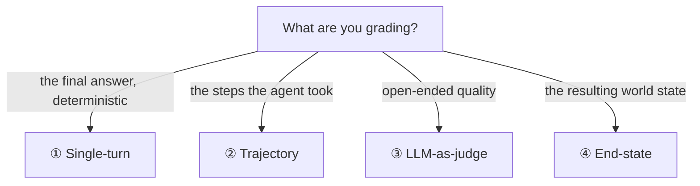
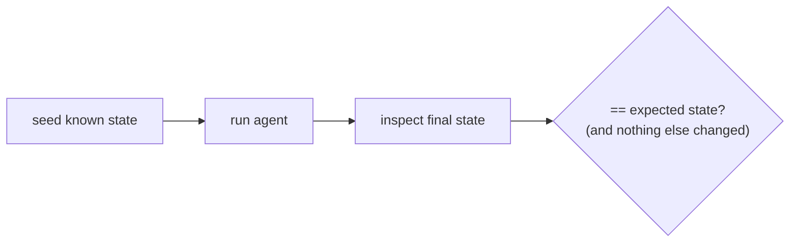

# Lesson 01 — The Four Eval Types

> **Goal:** implement the four kinds of eval — **single-turn, trajectory,
> LLM-as-judge, and end-state** — and know which to reach for when.

No single eval type covers everything. A factual Q&A needs a different check than "did
the agent take the right *steps*" or "did the database end up correct." You need all
four, applied where each fits.



## ① Single-turn evals — "given this input, is the output right?"

The cheapest and most reliable. One input → one output → a **deterministic** grader.
Run these constantly (they're fast and free).

```python
def grade_factual(output: str, expected: str) -> bool:
    return normalize(output) == normalize(expected)          # exact
def grade_numeric(output: float, expected: float) -> bool:
    return abs(output - expected) <= 0.01                    # tolerance
def grade_contains(output: str, must_include: list[str]) -> bool:
    return all(s in output for s in must_include)            # keyword/regex
```

**Use for:** classification, extraction, factual Q&A, format compliance — anything with
a knowable correct answer. **Prefer deterministic graders wherever possible** — they're
free, instant, and never flake.

- **GOTCHA — over-strict matching.** "4" vs "four" vs "4.0" should pass. Normalize
  before comparing, or use tolerance/regex, not raw `==`.

## ② Trajectory evals — "did it take the right path?"

Agents don't just produce an answer; they take **actions**. A trajectory eval checks
the *sequence of tool calls and arguments* — because an agent can reach a plausible
answer via a wrong (expensive, unsafe, lucky) path.

```python
def grade_trajectory(trace: list[ToolCall]) -> bool:
    names = [c.name for c in trace]
    return (
        "plan" in names
        and names.count("spawn_search") >= 2        # fanned out
        and "verify_citations" in names
        and trace[-1].name == "write_report"        # ended correctly
    )
```

Three granularities — test all three:

| Variant | Checks |
|---------|--------|
| **Single-step** | given a state, did it pick the right *next* tool + args? |
| **Full-turn** | over one user turn, was the whole tool sequence right? |
| **Multi-turn** | across a conversation, did it stay coherent and on-policy? |

**Use for:** any agent. This is how you catch "it got the right answer for the wrong
reason," budget blowouts, and skipped safety steps (e.g., didn't verify before writing).

- **WHY it matters:** the same answer reached by 2 tool calls vs. 40 is a 20× cost
  difference. Trajectory evals are how cost and safety become *gradeable*.

## ③ LLM-as-judge — "is this open-ended output good?"

For outputs with no single right answer — research reports, code reviews, explanations,
summaries — use a *model* to grade against an explicit **rubric**. (You'll calibrate it
against humans in [Lesson 02](02-golden-datasets-and-judges.md).)

```python
RUBRIC = [
    ("accuracy",     "Are all claims supported by the cited sources?"),
    ("completeness", "Does it address every part of the question?"),
    ("structure",    "Is it well-organized and readable?"),
    ("citations",    "Is every nontrivial claim cited to a real source?"),
    ("conciseness",  "Is it free of padding and repetition?"),
]

async def llm_as_judge(answer: str, sources: list[str], rubric=RUBRIC) -> dict:
    # ask a judge model to score each criterion 1–5 with justification
    return await judge_model.score(answer, sources, rubric)
```

**Use for:** subjective/open-ended quality. **Best practices:**

- **Score per-criterion, not one global number** — diagnostics you can act on.
- **Demand a justification** for each score (it improves reliability and is auditable).
- **Use a strong model as judge**, ideally different from the one under test.
- **Calibrate weekly** against human-graded examples (Lesson 02) — an uncalibrated judge
  is just another vibe.

- **GOTCHA — judge bias.** Judges favor longer answers, their own outputs, and the
  first option presented. Randomize order; calibrate; watch for length bias.

## ④ End-state evals — "did the world end up correct?"

For **stateful** agents, the answer text is irrelevant — what matters is what *changed*.
Did the right rows get written? The right files modified? The right email queued?
Compare the **final environment state** to ground truth.

```python
async def grade_end_state(db) -> bool:
    task = await db.get_task("deploy")
    return task is not None and task.priority == "high" and task.status == "todo"
# also: assert no OTHER rows changed (no collateral damage)
```



**Use for:** coding agents (did tests pass? right files changed?), data agents (DB
correct?), workflow agents (right actions taken, nothing extra). **The gold standard
when available** — it's deterministic *and* measures real impact.

- **GOTCHA — checking only the intended change.** Also assert nothing *else* changed.
  An agent that completes the task *and* corrupts three other rows must fail.

## Which to use — the cheat sheet

| Situation | Eval type |
|-----------|-----------|
| Known correct answer | ① Single-turn (deterministic) |
| Care about *how* it got there (cost/safety) | ② Trajectory |
| Open-ended quality, no single right answer | ③ LLM-as-judge (+ calibration) |
| Agent changes a database/files/world | ④ End-state (gold standard) |

Most real systems use **several at once**: a research agent gets a trajectory eval (did
it plan/spawn/verify?), an LLM-as-judge on the report, and single-turn checks on any
factual sub-answers. Your Phase-4 project wires three of the four.

## Pitfalls

- **GOTCHA — only grading the final answer.** You'll miss wrong-reason successes and
  cost blowouts. Add trajectory + end-state.
- **GOTCHA — uncalibrated judge.** Without human calibration, LLM-as-judge is a
  confident vibe. Calibrate (Lesson 02).
- **GOTCHA — flaky deterministic graders.** Normalize; don't fail on "4" vs "four."

## Exercises

1. For your capstone, list which of the four eval types apply and write one example of
   each.
2. Implement a deterministic single-turn grader and a trajectory grader against a
   recorded trace from your Phase-2 agent (start from
   [`code/eval_harness/`](../../code/eval_harness/)).
3. Write a 5-criterion rubric for your capstone's main open-ended output.

## Exit check

You can implement all four eval types, pick the right one for a given output, and
explain why grading only the final answer misses cost, safety, and side-effects.

➡️ Next: [Lesson 02 — Golden datasets & LLM-as-judge calibration](02-golden-datasets-and-judges.md)
