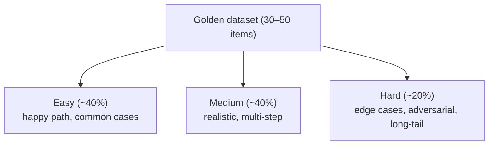
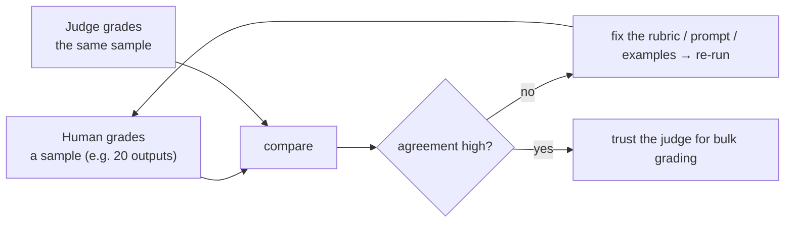
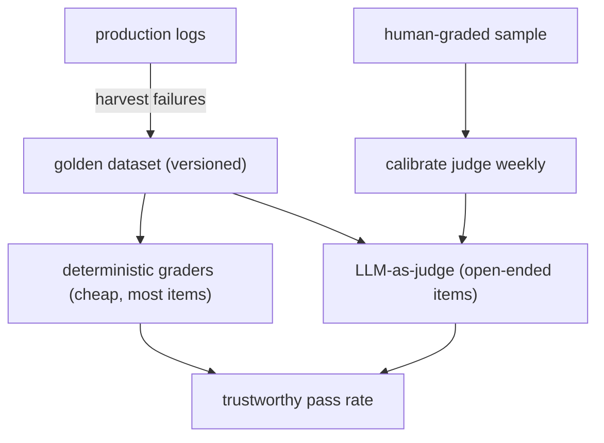

# Lesson 02 — Golden Datasets & LLM-as-Judge Calibration

> **Goal:** build the **ground truth** your evals score against — a golden dataset —
> and **calibrate** your LLM-as-judge so its scores actually track human judgment.

An eval is only as good as the data it runs on and the grader it trusts. This lesson is
about both: assembling a golden dataset, and making sure your judge isn't just
confidently wrong.

## Part 1 — The golden dataset

> A **golden dataset** is a fixed set of inputs paired with hand-graded expected
> outcomes. It's your regression test suite for a non-deterministic system.

### Composition (the Phase-4 target: 30–50 items, 3 difficulty levels)



Each item carries everything a grader needs:

```jsonl
{"id": "q-014", "level": "hard", "question": "Compare X and Y on Z, with sources",
 "must_include": ["X", "Y"], "min_sources": 3, "max_cost_usd": 1.0,
 "trajectory": ["plan", "spawn_search", "spawn_search", "verify_citations", "write_report"]}
```

### Where the items come from (this is the important part)

> **Use real production queries, not synthetic ones.** Synthetic data tests the cases
> you *imagined*; production data tests the cases users *actually* send — and the
> long-tail is where systems break.

- **Best source:** real (anonymized) user queries from logs, especially the ones that
  failed or got thumbs-down.
- **Then:** edge cases you've personally seen break the system.
- **Sparingly:** synthetic items to cover gaps, clearly labeled as such.

### Rules

- **Freeze it and version it.** A dataset that drifts can't measure regressions. Commit
  it; change it deliberately with a changelog.
- **Hand-grade the expectations.** A human decides the right outcome for each item.
  That human judgment is the "gold."
- **Grow it from failures.** Every production bug becomes a new golden item, so it can
  never silently regress again. The dataset compounds in value.

**WAR STORY:** A team's golden set was 100% synthetic questions written by the same
engineer who wrote the prompts — so it tested exactly what they'd already thought of.
It passed at 98% while real users hit failures daily. They rebuilt it from logged
queries (especially thumbs-down ones); the "98%" became an honest 71%, and *that* number
was finally improvable. **A green eval on the wrong data is worse than no eval — it's
false confidence.**

## Part 2 — Calibrating the LLM-as-judge

An LLM-as-judge (Lesson 01) is only trustworthy if its scores **agree with humans.** An
uncalibrated judge is just another opinion wearing a number.

### The calibration loop



1. **Human-grade a sample** of outputs against the rubric (the same 1–5 criteria).
2. **Have the judge grade the same sample.**
3. **Measure agreement** (e.g., how often judge and human land within 1 point;
   correlation; confusion on pass/fail).
4. **If agreement is low, fix the *rubric*, not the data** — sharpen vague criteria,
   add anchor examples ("a 5 looks like this; a 2 looks like this"), reduce ambiguity.
5. **Re-calibrate weekly** and after any model change — judges drift too.

### Make the judge reliable

- **Anchored rubric:** give concrete examples of each score level. "Well-structured"
  is vague; "has an intro, sectioned body, and conclusion; no wall-of-text" is gradeable.
- **Per-criterion scores + justifications** (Lesson 01) — easier to calibrate and audit.
- **Mitigate known biases:** length bias (don't reward verbosity), position bias
  (randomize option order in pairwise judging), self-preference (judge with a different
  model family than the one under test).

- **GOTCHA — trusting an uncalibrated judge in CI.** If your CI gate depends on a judge
  that doesn't match humans, you're blocking/allowing merges on noise. Calibrate before
  you gate.
- **COST — judging isn't free.** Each judge run is a model call. Reserve LLM-as-judge
  for the open-ended items; use deterministic graders for everything else.

## Putting Part 1 + Part 2 together



This is the engine room of Phase 4: a dataset built from reality, deterministic graders
for most of it, and a *calibrated* judge for the parts that need judgment.

## Exercises

1. Build a 30-item golden set for your capstone: ~40% easy, ~40% medium, ~20% hard,
   sourced from real or realistic queries. Version it in your repo.
2. Write an anchored 5-criterion rubric with concrete examples of a 5 and a 2 per
   criterion.
3. Hand-grade 15 outputs, judge-grade the same 15, and measure agreement. If low,
   improve the rubric and re-run. Record the before/after agreement.

## Exit check

You have a versioned golden dataset drawn from realistic queries across three
difficulty levels, and an LLM-as-judge you've *measured* against human grades and
improved — so its scores are trustworthy enough to gate on.

➡️ Next: [Lesson 03 — CI gates & eval-awareness](03-ci-gates-and-eval-awareness.md)
