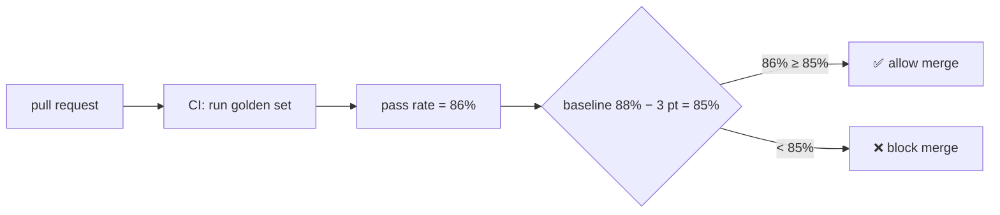
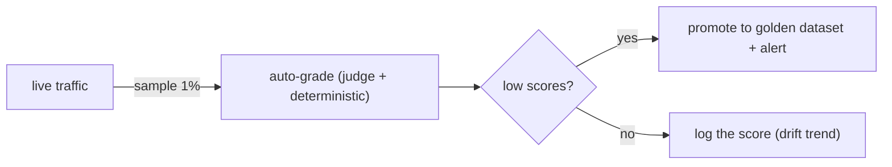
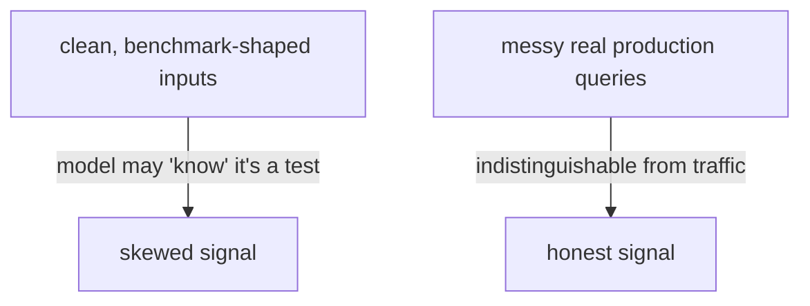
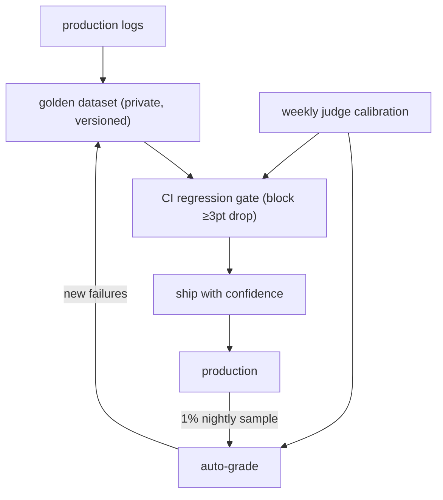

# Lesson 03 — CI Gates & Eval-Awareness

> **Goal:** wire your evals into CI so regressions are **blocked at the pull request**,
> sample production to catch drift the dataset misses, and defend against the
> uncomfortable truth that **models can tell when they're being evaluated.**

Evals you run by hand, sometimes, are barely better than vibes. Evals that **block a
bad merge automatically** are an engineering control. This lesson makes evals part of
the pipeline.

## Part 1 — The CI regression gate

> A **regression gate** runs your golden-set evals on every change and **fails the
> build** if the pass rate drops more than a threshold below the stored baseline.



The runner returns a **non-zero exit code** when the pass rate drops below
`baseline − threshold` — that's all CI needs to block the merge. A working version is in
[`code/eval_harness/runner.py`](../../code/eval_harness/runner.py); the GitHub Actions
wiring is in [`code/eval_harness/ci_gate.md`](../../code/eval_harness/ci_gate.md).

```yaml
# .github/workflows/evals.yml (sketch — see ci_gate.md for the full version)
- name: Run eval regression gate
  run: python -m eval_harness.runner --baseline baseline.json --max-drop 3
  # exits non-zero if golden-set pass rate fell 3+ points → blocks the merge
```

### Design decisions for the gate

- **Threshold, not exact match.** Allow a small wobble (e.g. 3 points) for
  non-determinism; block real drops. Too tight → flaky CI; too loose → regressions slip.
- **Baseline management.** Store the baseline; update it deliberately when a change
  *improves* the score (and review that update). Never let it silently float.
- **Speed vs. coverage.** Deterministic graders run on every PR (fast, free). Expensive
  judge-based evals can run on a smaller subset per-PR and the full set nightly.
- **Block on the metric that matters.** Usually overall pass rate, but you may also gate
  on "no Hard-tier item regressed" or "trajectory eval still passes."

- **COST — judge calls in CI.** A full LLM-as-judge run on every PR adds up. Gate PRs on
  deterministic + a judge subset; run the full judge suite nightly.

## Part 2 — Production sampling (catch what the dataset misses)

Your golden set is fixed; reality isn't. **Sample live traffic** and auto-grade it to
catch drift and new failure modes.

> Nightly, auto-grade **~1% of live traces.** New failures become **new golden items** —
> the dataset compounds, and the system can never silently regress on a real bug twice.



This closes the loop: production failures feed the golden set (Lesson 02), the golden
set gates CI (Part 1), and the gate protects production. (Phase 5 turns these scores
into alerts.)

## Part 3 — Eval-awareness & contamination (the uncomfortable truths)

### Models can detect when they're being evaluated

Models sometimes recognize that an input "looks like a test" (clean phrasing, classic
benchmark shape, system prompts that smell like graders) and behave **differently** than
on messy real traffic — better, or just *differently*. If your eval inputs are obviously
tests, you're measuring test-taking, not production behavior.

**Defenses:**

- **Use real production queries** (Lesson 02), not synthetic benchmark-shaped ones — the
  single most effective defense.
- **Keep eval inputs realistic and varied** — the typos, the ambiguity, the mess.
- **Sample production** (Part 2) so a chunk of your signal comes from inputs the model
  *can't* distinguish from "real," because they are real.
- **Hold out a private eval set** you never publish or send anywhere it could be trained
  on.



### Contamination / training-data leakage

If your eval items (or public-benchmark items) were in the model's training data, a high
score may mean **memorization, not capability.** This is why a model can ace a public
benchmark and still fail your task.

**Defenses:**

- **Build private evals on *your* data** — the whole point of this phase. Your
  production data wasn't in anyone's training set.
- **Be skeptical of public-benchmark numbers** as evidence for *your* use case
  ([reference/benchmarks.md](../../reference/benchmarks.md)).
- **Rotate/refresh** golden items over time so any leaked subset can't dominate.

**WAR STORY:** A team celebrated their agent matching a top public SWE-bench number,
then watched it flub their *own* codebase's issues. The public tasks were well-represented
online (plausibly seen in training); their private repo wasn't. They stopped quoting the
public number internally and built a private eval from their own resolved issues — which
finally predicted real performance. **Public benchmarks measure the model; your evals
measure your system.**

## The complete Phase-4 picture



## Pitfalls

- **GOTCHA — threshold too tight.** Non-determinism will make a 0-tolerance gate flake
  and get disabled. Allow a small, deliberate band.
- **GOTCHA — synthetic-only evals.** Vulnerable to eval-awareness and contamination.
  Anchor on real traffic.
- **GOTCHA — never updating the baseline.** A baseline that's never raised after genuine
  improvements means you stop capturing gains. Update it deliberately, under review.
- **GOTCHA — trusting public benchmarks for your task.** They don't measure your use
  case. Build private evals.

## Exercises

1. Wire [`runner.py`](../../code/eval_harness/runner.py) into a GitHub Actions workflow
   that blocks a PR when the pass rate drops 3+ points. Prove it by submitting a
   deliberately worse prompt and watching CI go red.
2. Add a nightly job that grades a sample and appends low-scoring items to the golden
   set.
3. Take two golden items and rewrite them to look like *real* messy user queries.
   Discuss how this reduces eval-awareness.

## Exit check

You can block regressions in CI with a thresholded gate, sample production to grow the
dataset, and explain — with defenses — why models detecting evals and training-data
contamination make *private, realistic* evals essential. **Phase 4 lessons done — now
ship the regression harness.**

➡️ Next: [Phase 4 Project — the regression harness](project.md)
