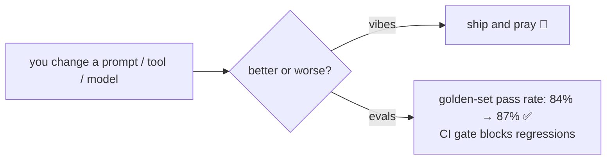

# Phase 4 — Build the Eval & Regression Harness · Weeks 14–17

> **Goal:** make "better" a number, not a vibe. Without evals, every "improvement" is
> a guess — and this is exactly where most engineers stall, which is exactly why it's
> the highest-leverage skill you can own.

You can now build a great agent (Phases 1–3). Here's the uncomfortable question that
ends most AI projects: **did your last change make it better or worse?** If your
answer is "it feels better," you are not yet doing the job. This phase teaches you to
*prove* it.

> **The bottleneck is here.** Industry surveys put *quality/reliability* — not API
> access — as the #1 barrier to shipping agents. Teams that can build evals are scarce.
> That scarcity is your leverage. (See [reference/benchmarks.md](../../reference/benchmarks.md).)

## Lessons

| # | Lesson | You'll be able to |
|---|--------|-------------------|
| 00 | [Why evals are the job](00-why-evals-are-the-job.md) | Frame evals as the core differentiator and avoid the "vibes" trap |
| 01 | [The four eval types](01-the-four-eval-types.md) | Implement single-turn, trajectory, LLM-as-judge, end-state evals |
| 02 | [Golden datasets & LLM-as-judge calibration](02-golden-datasets-and-judges.md) | Build a graded dataset; calibrate a judge against humans |
| 03 | [CI gates & eval-awareness](03-ci-gates-and-eval-awareness.md) | Block regressions in CI; defend against contamination & eval-gaming |

Runnable scaffold: **[`code/eval_harness/`](../../code/eval_harness/)** — deterministic
graders, a mock LLM-judge, a tiny `golden.jsonl`, a trajectory checker, and a `runner`
that returns a non-zero exit code when the pass rate drops (the CI gate).

## What you ship

A **regression harness around your Phase-2 Research Analyst**:

- a **golden dataset** of 30–50 hand-graded research questions across 3 difficulty
  levels,
- **deterministic graders** for factual queries + an **LLM-as-judge** (5-criterion
  rubric) for open-ended ones,
- a **trajectory eval** (did it plan, spawn ≥2 sub-agents, cite sources, finish under
  budget?),
- a **GitHub Actions gate** that **blocks merge if the golden-set pass rate drops 3+
  points**,
- **nightly production sampling**: 1% of live traces auto-graded.

See **[project.md](project.md)**.

➡️ Start: [Lesson 00 — Why evals are the job](00-why-evals-are-the-job.md)
