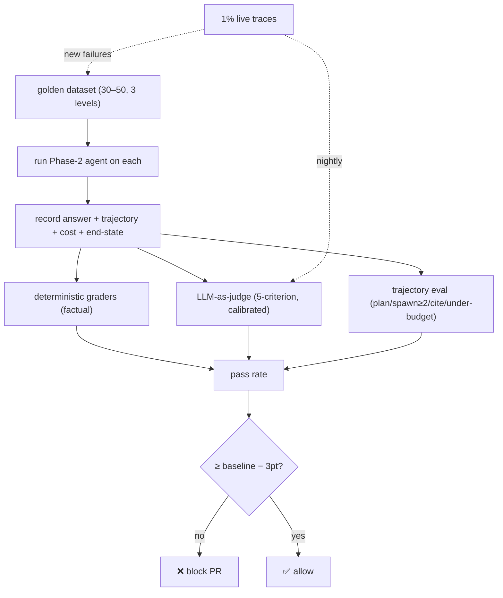

# Phase 4 Project — The Regression Harness

> **Ship this:** a regression harness wrapping your **Phase-2 Research Analyst**, with
> a CI gate that actually **blocks a bad merge.** This is the artifact that proves you
> can make quality measurable — the scarcest skill in the field.

## What it must include

- [ ] **Golden dataset:** 30–50 hand-graded research questions across **3 difficulty
      levels**, sourced from realistic/real queries (versioned in the repo).
- [ ] **Deterministic graders** for factual queries (exact / numeric-tolerance /
      keyword).
- [ ] **LLM-as-judge** with a **5-criterion rubric** for open-ended reports,
      **calibrated** against a human-graded sample.
- [ ] **Trajectory eval:** did the agent **plan, spawn ≥2 sub-agents, cite sources, and
      finish under budget?**
- [ ] **CI gate (GitHub Actions):** **block merge if golden-set pass rate drops 3+
      points** vs. the stored baseline.
- [ ] **Production sampling:** **1% of live traces auto-graded nightly**, with new
      failures promoted into the golden set.

Start from [`code/eval_harness/`](../../code/eval_harness/) — it has deterministic
graders, a mock judge, a tiny `golden.jsonl`, a trajectory checker, a `runner` that
exits non-zero on a drop, and a `ci_gate.md` with the Actions YAML.

## Architecture

## Milestones (each shippable)

1. **Golden v0** — 10 items, deterministic graders only, `runner` computes a pass rate.
2. **CI gate** — wire `runner.py` into GitHub Actions; prove it blocks a deliberately
   worse prompt.
3. **Trajectory eval** — assert plan → ≥2 sub-agents → verify → under budget on recorded
   traces.
4. **LLM-as-judge** — 5-criterion rubric on the open-ended reports.
5. **Calibrate** — human-grade 15 outputs, measure judge agreement, fix the rubric.
6. **Grow to 30–50 items** across 3 levels, from realistic queries.
7. **Production sampling** — nightly 1% auto-grade; promote failures into the golden set.

## How it's evaluated (meta — grade your eval harness)

| Criterion | Pass bar |
|-----------|----------|
| Dataset quality | 30–50 items, 3 levels, realistic (not all synthetic), versioned |
| Grader coverage | All applicable eval types used (deterministic + judge + trajectory) |
| Judge trust | Calibrated against humans; agreement measured and reported |
| CI gate works | A real bad change is *actually blocked* (show the red CI run) |
| Closed loop | Production sample feeds new golden items |
| Honesty | You can name eval-awareness/contamination risks and your defenses |

## Stretch goals

- Add **end-state evals** if your agent writes to a store (assert the right rows/files
  changed and nothing else).
- Add a **published-benchmark run** of your agent via an eval framework (e.g. an Inspect-
  style harness) — and write up how your *private* numbers differ from the public ones.
- Gate separately on "no Hard-tier regression" in addition to overall pass rate.
- Track the pass-rate trend over time on a dashboard (sets up Phase 5 drift alerts).

## Pitfalls

- **GOTCHA — synthetic-only dataset.** Vulnerable to eval-awareness/contamination; anchor
  on real queries (Lesson 03).
- **GOTCHA — uncalibrated judge gating CI.** You'd be blocking merges on noise. Calibrate
  first (Lesson 02).
- **GOTCHA — zero-tolerance gate.** Non-determinism will make it flake; use a small band.
- **COST — full judge suite on every PR.** Use deterministic + judge-subset per PR, full
  judge nightly.

## Exit criteria for Phase 4

- [ ] Golden dataset (30–50, 3 levels, realistic) versioned in the repo.
- [ ] Deterministic + LLM-as-judge (calibrated) + trajectory evals implemented.
- [ ] CI gate demonstrably **blocks** a worse change (screenshot the red run).
- [ ] Nightly production sampling feeding new golden items.
- [ ] You can explain your defenses against eval-awareness and contamination.

➡️ When this passes, start
[Phase 5 — Production Hardening](../phase-5-production-hardening/).
