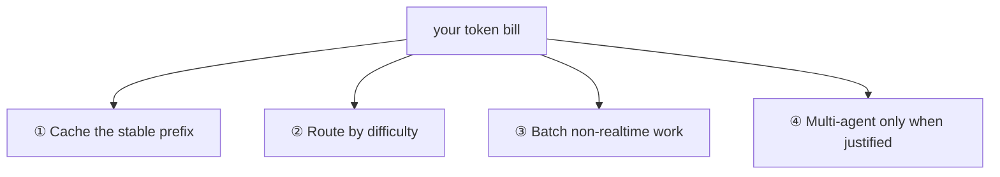
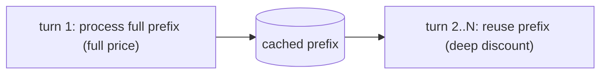
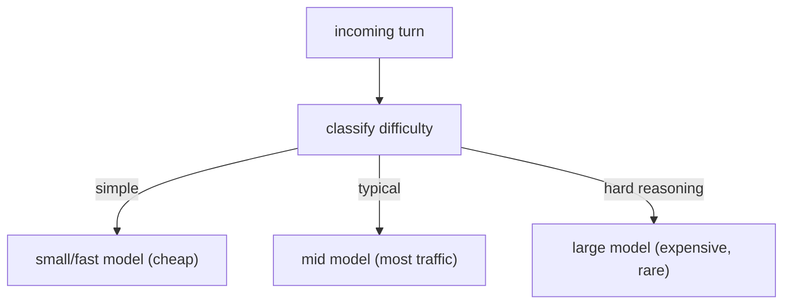
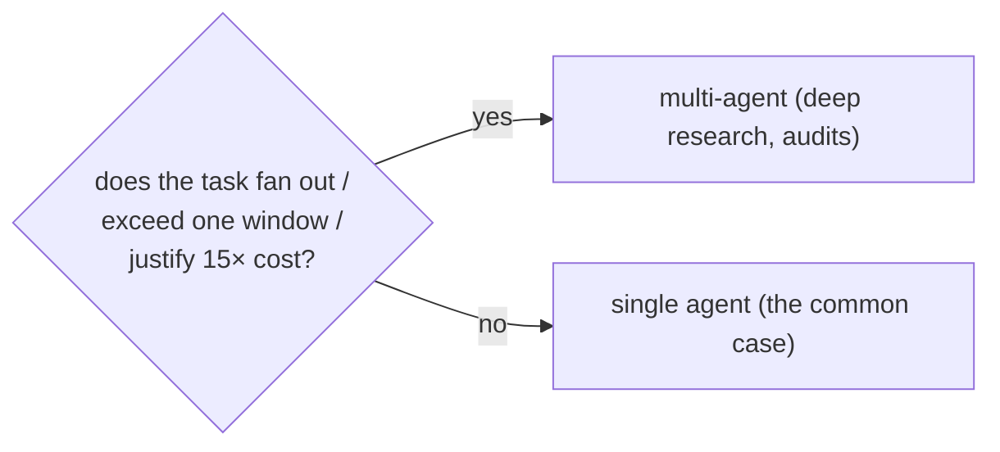

# Lesson 00 — Cost Discipline

> **Goal:** cut your token bill by an order of magnitude with four levers — caching,
> model routing, batching, and disciplined multi-agent — without sacrificing quality.

## The mental model

> Every token in every request is money, and an agent re-sends a *huge, mostly
> unchanging* prefix on every turn. Cost engineering is mostly about **not paying for
> the same tokens twice** and **not using a Ferrari to fetch the groceries.**

## ① Prompt caching — the cheapest 90% you'll ever save

Your system prompt, `CLAUDE.md`, and tool definitions are a large prefix that's
*identical* on every turn. Providers can **cache** that prefix server-side so you don't
pay full price to re-process it each call.

> **COST — caching the stable prefix can cut costs up to ~90%** on
> prefix-dominated workloads (long system prompt + many tools + a short user turn).

- Mark the stable prefix (system + tools) for caching; keep the volatile part (the
  latest user/tool messages) after it.
- **GOTCHA — cache invalidation.** Any change to the cached prefix busts the cache.
  Keep the prefix stable; don't interpolate per-request data into it.
- This is the single highest-ROI cost change. Do it first.

## ② Model routing — Haiku/Sonnet/Opus by difficulty

Not every turn needs your most powerful model. **Route by difficulty:** a small fast
model for simple turns, a mid model for most tasks, the big model only for hard
reasoning. (This is the **routing** workflow pattern from Phase 0, applied to cost.)

- A **model cascade** is a cheap variant: try the small model first; escalate only if it
  fails a confidence/verification check.
- **GOTCHA — routing everything to the big model "to be safe."** That's how bills 10×.
  Most traffic is easy; serve it cheaply.

## ③ Batch API — 50% off for non-real-time work

For work that doesn't need an immediate response — nightly evals, bulk summarization,
offline data processing — use the provider's **Batch API**.

> **COST — Batch API is typically ~50% cheaper** in exchange for asynchronous
> (within-24h-style) processing.

- **Use for:** your Phase-4 nightly eval runs, backfills, bulk enrichment.
- **Don't use for:** anything a user is waiting on.

## ④ Multi-agent only when the value clears ~15×

The single biggest cost trap. Recall from Phase 2:

> **COST — multi-agent burns ~15× the tokens of single-agent.** Only run it when the
> value clears that bar.

Reserve multi-agent for genuinely parallel, context-heavy, high-value work. Make the
common case a single agent. (Phase 2, Lesson 03.)

## Putting the levers together

A disciplined cost stack, in priority order:

1. **Cache** the stable prefix (biggest, easiest win).
2. **Route** by difficulty (don't overpay per turn).
3. **Batch** everything non-interactive.
4. **Gate** multi-agent behind a value check.

**WAR STORY:** A team's agent bill was alarming. No exotic fix was needed: they cached
the system prompt + tool defs (the prefix was ~80% of every request), routed trivial
turns to a small model, and moved nightly evals to the Batch API. The bill dropped by
roughly an order of magnitude with *zero* quality loss — they were simply paying full
price for the same prefix thousands of times a day. **Most "expensive AI" is just
undisciplined token spend.**

## Pitfalls

- **GOTCHA — interpolating per-request data into the cached prefix.** Busts the cache
  every call; you pay full price *and* get cache overhead. Keep the prefix stable.
- **GOTCHA — big model for everything.** The default-to-Opus reflex is the #1 overspend.
- **GOTCHA — multi-agent by habit.** 15× cost for a task one agent could do.
- **COST — measure before optimizing.** Use your Phase-3 spans / Phase-4 traces to find
  *where* the tokens go before you tune. (Next lesson: the spans also drive latency and
  drift work.)

## Exercises

1. Instrument cost per request from your spans. What fraction is the stable prefix?
   That's your caching opportunity.
2. Add difficulty routing to your capstone; measure cost before/after on a realistic
   mix of queries.
3. Move your Phase-4 nightly evals to a batch path; estimate the savings.

## Exit check

You can cut an agent's cost dramatically by caching the stable prefix, routing by
difficulty, batching non-realtime work, and reserving multi-agent for tasks that justify
15× — and you measure each change rather than guessing.

➡️ Next: [Lesson 01 — Latency](01-latency.md)
