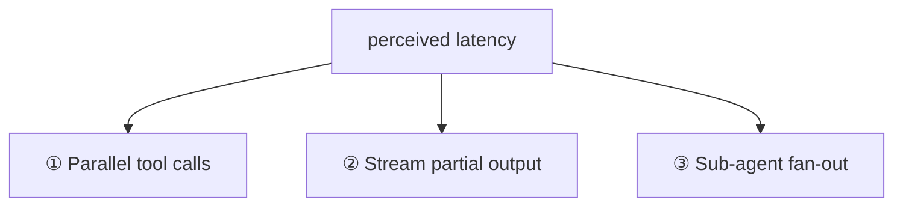
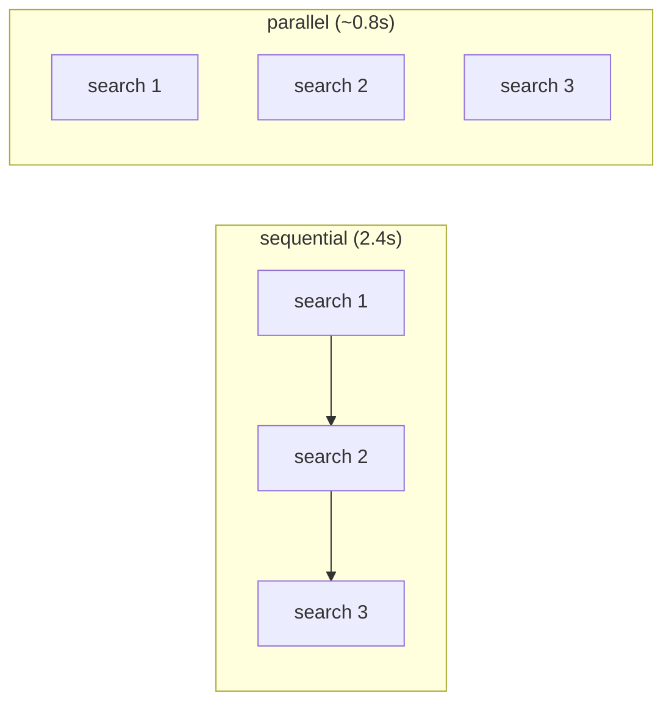
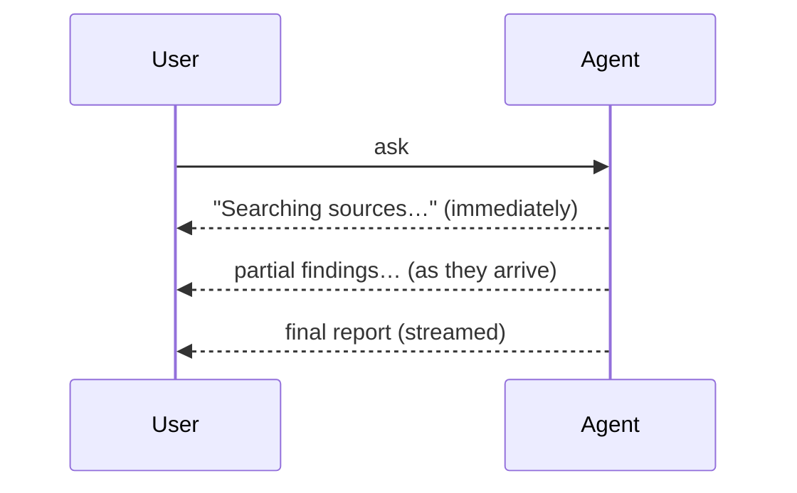
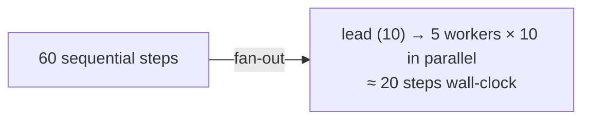

# Lesson 01 — Latency

> **Goal:** make agents *feel* fast with three levers — parallel tool calls, streaming,
> and sub-agent fan-out — by attacking wall-clock time, not just total work.

## The mental model

> An agent's latency is dominated by **sequential round-trips** to the model and tools.
> The win is turning sequential work into **parallel** work and **streaming** results so
> the user sees progress before the whole thing finishes.



## ① Parallel tool calls — always

When the model requests several **independent** tools in one turn, run them
concurrently, not one-by-one. Three searches that each take 800ms are 2.4s sequential or
~0.8s in parallel.

> Anthropic's own research-agent system prompt reportedly *insists* the model **"you MUST
> use parallel tool calls."** Independent tool calls running sequentially is wasted
> wall-clock time, every time.

```python
# sequential: sum of latencies
for call in tool_calls:
    results.append(await dispatch(call))      # ❌ 3 × 800ms = 2.4s

# parallel: max of latencies
results = await asyncio.gather(*(dispatch(c) for c in tool_calls))  # ✅ ~800ms
```



- **GOTCHA — parallelizing dependent calls.** Only independent calls parallelize. If
  call 2 needs call 1's output, they're sequential by nature — don't force it.
- This is both a latency win *and* (via fewer wall-clock minutes) often a UX-cost win.

## ② Stream partial output

Don't make the user stare at a spinner for 20 seconds. **Stream** tokens/steps to the UI
as they're produced so progress is visible immediately. Perceived latency is often more
about *time-to-first-token* than total time.



- Stream the **final answer** token-by-token, and surface **intermediate steps** ("planning
  → searching → writing") so a long agent run shows life.
- **WHY:** a 20s task that streams progress feels faster than a 10s task that shows
  nothing until the end. Perceived speed is a feature you engineer.

## ③ Sub-agent fan-out — parallelize the *work itself*

This is the latency payoff of multi-agent (Phase 2). A long sequential agent becomes a
short lead plus parallel workers:

> A **60-step sequential** agent → a **10-step lead + 5 parallel 10-step sub-agents** ≈
> the wall-clock of ~20 sequential steps instead of 60.



- Remember the trade-off: fan-out cuts **latency** but costs **~15× tokens** (Lesson 00).
  You're trading money for speed — justify it.
- Each worker still needs its own iteration cap (Phase 3).

## The combined picture

```mermaid
flowchart TD
    Task --> Lead["lead plans"]
    Lead -->|fan-out (parallel)| W1["worker 1"] & W2["worker 2"] & W3["worker 3"]
    W1 & W2 & W3 -->|each uses parallel tool calls| Synth["lead synthesizes"]
    Synth -->|stream| UI["user sees progress + streamed answer"]
```

**WAR STORY:** A research agent took ~90 seconds and users assumed it had hung — they'd
refresh and re-trigger it, doubling the load. Two changes fixed the *perception*: stream
a "planning → searching (3 sources) → writing" status, and fan the searches out in
parallel. Actual time dropped some; *perceived* time dropped a lot; the re-trigger storm
stopped. **Latency is half real, half perceived — engineer both.**

## Pitfalls

- **GOTCHA — sequential independent tool calls.** The most common, most wasteful latency
  bug. Parallelize.
- **GOTCHA — no streaming on long runs.** Users equate silence with failure. Always show
  progress.
- **GOTCHA — fan-out without cost awareness.** Speed bought with 15× tokens; make it a
  deliberate trade.
- **GOTCHA — over-parallelizing into rate limits.** Concurrency that exceeds your API
  rate limits just trades latency for 429s. Bound the fan-out.

## Exercises

1. Find a turn in your agent that issues independent tool calls sequentially.
   Parallelize it and measure the wall-clock difference.
2. Add streaming of intermediate steps to your capstone's UI/CLI. Compare perceived speed
   before/after with a friend.
3. Estimate the latency and the token cost of your Research Analyst as single-agent vs.
   fan-out. State the trade you'd choose and why.

## Exit check

You can cut both real and perceived latency with parallel tool calls, streaming, and
sub-agent fan-out — and you can articulate the cost trade that fan-out implies.

➡️ Next: [Lesson 02 — Safety & sandboxing](02-safety-and-sandboxing.md)
