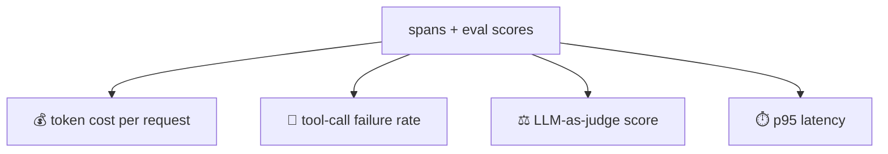
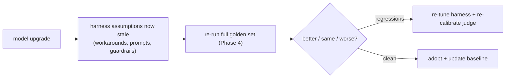

# Lesson 03 — Monitoring & Drift

> **Goal:** know your agent's health in real time via the right alerts, and survive the
> thing that silently breaks production agents — **model drift after upgrades.**

## The mental model

> An agent's quality can degrade with **nothing in your code changing** — a model
> updates, a data source shifts, traffic patterns evolve. Monitoring is how you *notice*;
> re-baselining is how you *recover.*

This lesson reads directly off the spans you built in Phase 3 (Lesson 04) and the evals
you built in Phase 4.

## What to alert on

Four signals, each from your observability layer:



| Alert on | Why it matters | A spike means |
|----------|----------------|---------------|
| **Cost per request** | runaway spend | a loop blew up, caching broke, or routing regressed |
| **Tool-call failure rate** | broken capability | a tool/API changed, or the model started misusing a tool |
| **LLM-as-judge score** | quality drift | output quality is degrading (often post-upgrade) |
| **p95 latency** | UX + capacity | a dependency slowed, or fan-out/parallelism broke |

- **Use p95/p99, not averages.** Averages hide the tail where users actually suffer. A
  fine average with a terrible p95 is a bad system.
- **Alert on trends, not just thresholds.** A slow upward creep in cost or a slow decline
  in judge score is drift; catch it before it's a cliff.

## The drift killer: model upgrades

Here's the trap that's special to AI engineering:

> **SECURITY/QUALITY — re-baseline your evals after every model upgrade.** A harness
> encodes assumptions about what the model **can't** do — what you compensated for with
> tools, prompts, guardrails, and compaction. A new model invalidates some of those
> assumptions, and your carefully-tuned harness can get *worse*, not better, until you
> re-tune it.



The re-baseline procedure (make it a checklist — it's your Phase-5 deliverable):

1. **Run the full golden set** (Phase 4) on the new model. Don't assume "newer = better"
   for *your* task.
2. **Re-calibrate the LLM-as-judge** — judges drift too (Phase 4, Lesson 02).
3. **Re-check guardrails and prompts** — a workaround for an old model's weakness may now
   be counterproductive.
4. **Re-tune cost levers** — routing thresholds and caching assumptions may shift.
5. **Update the baseline** only after the new model passes, under review.

**WAR STORY:** A team upgraded to a newer, "better" model and their agent's quality
*dropped* on their task. The cause: their prompt contained elaborate workarounds for the
*old* model's quirks, plus a compaction strategy tuned to the old context behavior. The
new model didn't need the workarounds and they actively confused it. Because they had a
golden set, they caught it in an afternoon and re-tuned. Teams *without* evals shipped the
"upgrade," degraded silently, and found out from customer complaints. **"Newer model" is
a change like any other — gate it through evals.**

## Closing the loop with Phase 4

```mermaid
flowchart TD
    Prod["production"] --> Spans["spans → dashboards + alerts"]
    Prod -->|1% sample (Phase 4)| Grade["auto-grade → drift trend"]
    Grade --> Golden["new failures → golden set"]
    Up["model upgrade"] --> Rebase["re-baseline golden set"]
    Rebase --> Prod
```

Monitoring (this lesson), evals (Phase 4), and observability (Phase 3) are one system:
spans feed alerts *and* eval grading; eval scores become a monitored signal; upgrades
trigger a re-baseline. Drift is caught at the dashboard, not the support queue.

## Pitfalls

- **GOTCHA — averages instead of p95/p99.** You'll miss the tail that hurts users.
- **GOTCHA — assuming a newer model is strictly better.** For *your* task it might not
  be. Re-baseline.
- **GOTCHA — alerting on thresholds but not trends.** Slow drift slips under a static
  threshold until it's a crisis.
- **GOTCHA — judge score as a monitored metric without re-calibration.** A drifting judge
  produces a drifting metric. Re-calibrate on a schedule.

## Exercises

1. Wire your four core alerts (cost/request, tool-failure rate, judge score, p95) off your
   spans. Pick thresholds from a week of baseline data.
2. Write your model-upgrade re-baseline checklist (the 5 steps above), tailored to your
   capstone.
3. Simulate a "model upgrade" by swapping a prompt; run the golden set; confirm the gate
   catches the regression. (You're practicing the upgrade drill.)

## Exit check

You monitor cost, tool-failure rate, judge score, and p95 latency off your spans, and you
have a written procedure to re-baseline evals after every model upgrade — because your
harness's assumptions go stale when the model changes.

➡️ Next: [Lesson 04 — Resilience & durable execution](04-resilience-and-durable-execution.md)
