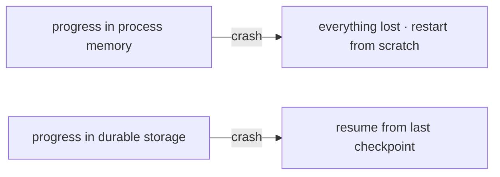
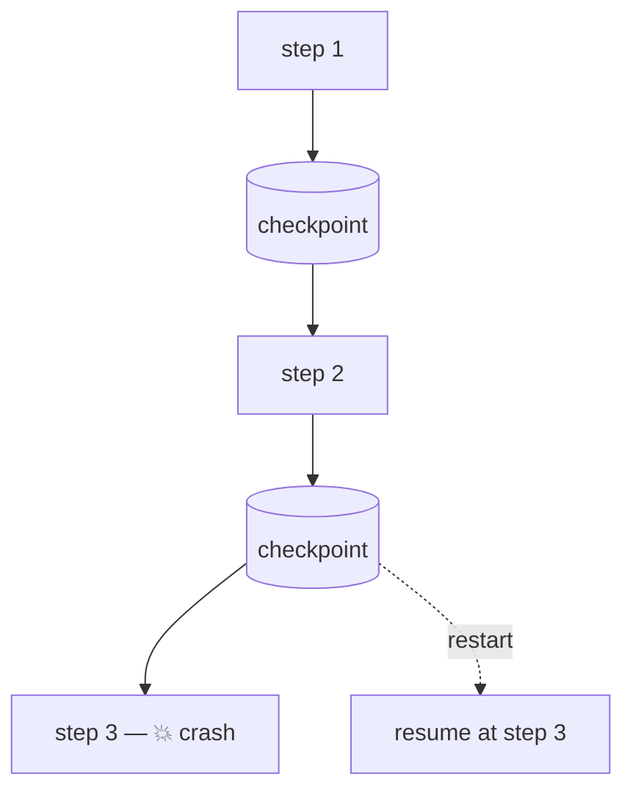
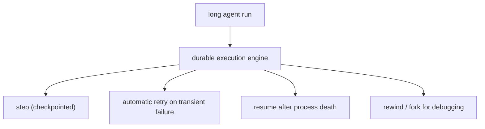
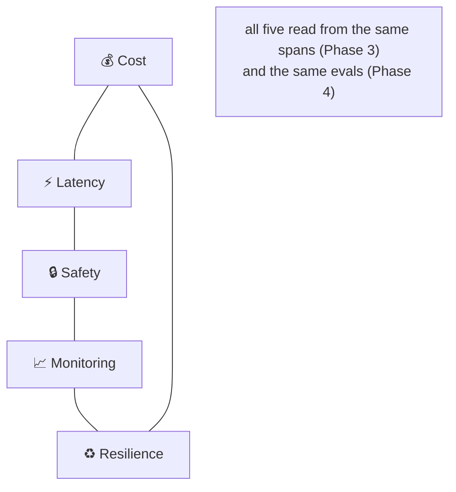

# Lesson 04 — Resilience & Durable Execution

> **Goal:** make long-running agents survive crashes, restarts, and partial failures —
> so a process kill at minute 4 of a 5-minute run costs you one step, not the whole run.

## The mental model

> Any agent that runs longer than a few seconds **will** be interrupted — a deploy, a
> crash, a timeout, a rate-limit storm. Resilience means the run's progress lives in
> **durable storage**, not in process memory, so it can always resume, rewind, or fork.

You met this as durability + checkpointing in Phase 2 (LangGraph) and built it as the
persistence component in Phase 3. This lesson is the operational discipline.

## The rule

> **Anything running over ~60 seconds needs durable execution.** Checkpoint after every
> node/step; rewind and fork should always be possible.

## The tools

You don't hand-roll this in production — you use a durable-execution system that
persists state and replays/resumes on failure:

| Tool | What it gives you |
|------|-------------------|
| **LangGraph `PostgresSaver`** | checkpoint each node; resume by `thread_id` (Phase 2) |
| **Temporal** | durable workflows: code that survives process death, with retries/timeouts as first-class |
| **Inngest** | event-driven durable functions with step-level retries |
| Your **Phase-3 SQLite checkpointer** | the learning-grade version of the same idea |

## Resilience patterns beyond checkpointing

- **Checkpoint after every step** — the smaller the unit, the less you lose on failure
  (balance against checkpoint storage cost; store references not blobs — Phase 3).
- **Idempotent steps** — a resumed/retried step must be safe to run again. Sending an
  email twice on resume is a bug; design steps so replay is harmless (or guard with an
  idempotency key).
- **Retries with backoff** on *transient* failures (rate limits, 5xx); never retry a
  logic error (feed it back as data — Phase 1).
- **Circuit breakers** — when a dependency is failing hard, stop hammering it; fail fast
  and recover. (Capstone Project 5 makes this explicit.)
- **Rewind & fork** — the debugging superpower (Phase 2, Lesson 01): jump to the
  checkpoint before a bad step, inspect the exact state, and fork with a fix.

## Why this is non-negotiable for agents specifically

Agents are uniquely expensive to restart: every lost step is lost **tokens** (money) and
lost **wall-clock** (latency) — and a long multi-agent research run can represent dollars
and minutes of work. Without durability, a single transient blip throws all of it away.
With it, the blip costs one step.

**WAR STORY:** A nightly enterprise agent processed hundreds of workflows in one long
run. A routine deploy restarted the process at hour two — and with no durable execution,
it began again from zero, re-doing two hours of work (and re-sending notifications it had
already sent — the idempotency bug bit too). After moving to a durable-execution engine
with idempotent steps, the same restart resumed exactly where it left off, no duplicates.
**For long-running agents, durability isn't an enhancement — it's the difference between
viable and not.**

## How the five Phase-5 concerns interlock

Cost, latency, safety, monitoring, and resilience aren't five separate projects — they're
five views of operating one system, all powered by the observability and evals you already
built. That's the whole point of the roadmap's ordering: Phases 3–4 give you the
instrumentation; Phase 5 is using it forever.

## Pitfalls

- **GOTCHA — progress in memory.** A long run whose state lives only in the process dies
  with the process. Persist it.
- **GOTCHA — non-idempotent steps on resume/retry.** Duplicated emails, double charges.
  Make replay safe.
- **GOTCHA — retrying logic errors.** Transient → retry; logic error → feed back as data.
- **GOTCHA — fat checkpoints.** Store references to big artifacts, not the artifacts
  (Phase 3).

## Exercises

1. Add durable execution to your capstone (start with your Phase-3 SQLite checkpointer or
   LangGraph `PostgresSaver`). Kill it mid-run; confirm it resumes, not restarts.
2. Find a non-idempotent step (sends/charges/writes) and make it safe to replay with an
   idempotency key.
3. Add a circuit breaker around your flakiest external dependency; simulate the dependency
   failing and confirm the agent fails fast and recovers.

## Exit check

You can make a long-running agent survive a process kill with durable, checkpointed,
idempotent steps and resume from the last checkpoint — and you can explain why
durability is mandatory for any agent running over ~60 seconds. **Phase 5's lessons are
the job, forever — now write the runbook.**

➡️ Next: [Phase 5 Project — the operational runbook](project.md)
