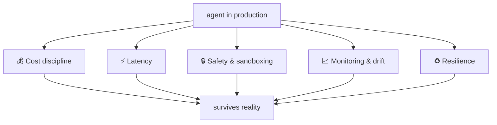

# Phase 5 — Production Hardening · Forever

> **Goal:** operate the system. This phase doesn't end — it's the ongoing discipline of
> running an agent at controlled **cost, latency, safety, drift, and resilience.**

You can build a great agent (Phases 1–3) and prove it works (Phase 4). Phase 5 is what
keeps it working *in production, under real traffic, at a cost that clears the bar* —
month after month, across model upgrades. These are the five concerns that never go
away.

## Lessons

| # | Lesson | The discipline |
|---|--------|----------------|
| 00 | [Cost discipline](00-cost-discipline.md) | Caching, model routing, Batch API, the 15× multi-agent rule |
| 01 | [Latency](01-latency.md) | Parallel tool calls, streaming, sub-agent fan-out |
| 02 | [Safety & sandboxing](02-safety-and-sandboxing.md) | Sandboxed execution, auth brokering, HITL on irreversible actions |
| 03 | [Monitoring & drift](03-monitoring-and-drift.md) | Alert thresholds; re-baseline evals after every model upgrade |
| 04 | [Resilience & durable execution](04-resilience-and-durable-execution.md) | Durable execution, checkpointing, rewind/fork |

## What you ship

There's no single "project" — Phase 5 is a *practice*. The deliverable is an
**operational runbook** for your capstone: dashboards and alert thresholds, a
cost/latency budget, a safety checklist, and a **model-upgrade re-baseline procedure.**
See **[project.md](project.md)**.

> **WHY "forever":** harnesses encode assumptions about what the model *can't* do. Every
> model upgrade can invalidate those assumptions. Production hardening isn't a milestone
> you pass — it's the job, ongoing.

➡️ Start: [Lesson 00 — Cost discipline](00-cost-discipline.md)
