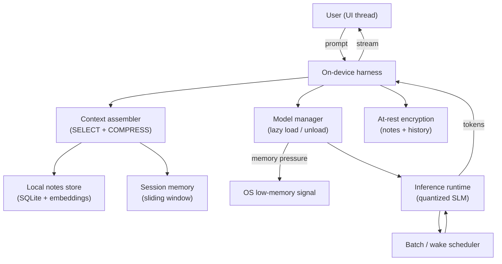
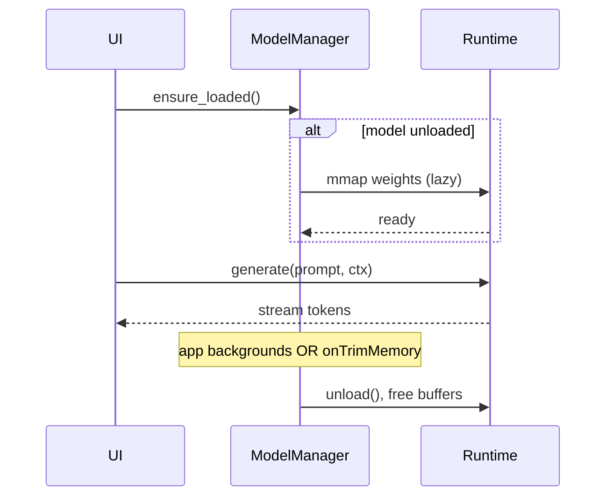

# Project 1 — AI-Powered Mobile App with a Small Language Model

> **Level / Proves:** Beginner · **Edge AI + resource optimization.** You prove you
> can run a real model *on a device you don't control*, under hard memory, battery,
> and latency budgets — with zero API spend and zero data leaving the phone.

## Why this project gets you hired

Most "AI engineers" only ever call a hosted endpoint. The hard, scarce version of
the skill is making a model behave when the harness lives on a 4-year-old phone
with 3 GB of usable RAM, an OS that kills your process the instant you blink, and a
user who notices a 200 ms stutter. That is the **harness as operating system**
analogy taken literally: here you *are* the memory manager and the scheduler.

This project demonstrates three things a hiring manager can verify in 60 seconds by
holding the phone:

- **Resource discipline.** You can reason about a fixed RAM budget, quantization
  trade-offs, and battery wake cycles — not just token costs on a bill.
- **Privacy-by-construction.** Nothing leaves the device. For health, legal, or
  on-prem buyers, that property *is* the product.
- **Context engineering under a tiny window.** A small model gives you a small
  context window, so the four primitives (Write / Select / Compress / Isolate)
  stop being theory and start being survival.

**WHY this is the right first project:** it forces every primitive at small scale
where you can see all of it at once. You are not yet orchestrating five agents; you
are keeping *one* model alive inside a phone. Master the constraints here and the
later projects are just the same constraints with more zeros.

## What you'll build

An **offline-first mobile assistant** — a journaling / notes / Q&A app that runs a
small language model (SLM, ~0.5B–3B params) entirely on-device. No network calls,
no API key, no telemetry. The user can:

- Ask questions about their own notes ("what did I decide about the lease?").
- Get summaries and rewrites of text they paste in.
- Chat with a model that remembers the current session.

All of it works in airplane mode. The headline number on your portfolio: **$0.00
in API cost and 0 bytes of user data transmitted, ever.**

Target stack: a cross-platform shell (React Native / Flutter / Kotlin Multiplatform)
over an on-device inference runtime — **llama.cpp / MLC-LLM / MediaPipe LLM
Inference / ONNX Runtime Mobile**. Pick one runtime; the harness logic around it is
the portfolio, not the runtime.

> **GOTCHA:** "small language model" is a moving target. Teach the primitive, name
> the model as the vehicle. Use whatever sub-4B model fits your device this quarter
> (e.g. a Gemma/Phi/Qwen-class small model) and pin the exact build in your README.
> Do **not** quote benchmark scores you didn't measure on *your* device — see
> [reference/benchmarks.md](../reference/benchmarks.md).

## Architecture



The UI thread never blocks: prompts go to the **harness** on a background thread.
The **context assembler** is where the four primitives live — it *selects* the
relevant notes (retrieval over an on-device embedding index), pulls the *sliding
session window*, and *compresses* old turns into a running summary when the tiny
context window fills. The **model manager** is the memory manager: it loads the
model weights lazily on first inference and unloads them when the OS signals memory
pressure or the app backgrounds. The **batch / wake scheduler** groups work so the
CPU/NPU wakes in bursts instead of trickling, which is what actually saves battery.
Everything written to disk goes through **at-rest encryption**.



## What makes it non-trivial

**Lazy-load on demand, unload under memory pressure.** Holding ~1–2 GB of weights
resident is the fastest way to get your process OOM-killed the moment the user opens
the camera. The model manager treats weights like a cache: `mmap` them on first use,
keep a usage timestamp, and release on `onTrimMemory` / `applicationDidReceiveMemoryWarning`
or on backgrounding. This is the **harness-as-OS** idea made concrete — *you* are
doing demand paging. The trade-off you must measure and document: unload saves RAM
but the next prompt pays a cold-load latency tax. The right policy is hysteresis
(don't unload for a 2-second background blip).

```python
import time
from dataclasses import dataclass, field

@dataclass
class ModelManager:
    """Demand-paged model lifecycle. The harness IS the memory manager."""
    runtime: "Runtime"
    idle_unload_after_s: float = 90.0
    _loaded: bool = False
    _last_use: float = field(default_factory=time.monotonic)

    async def ensure_loaded(self) -> None:
        if not self._loaded:
            await self.runtime.mmap_weights()   # lazy, ~hundreds of ms
            self._loaded = True
        self._last_use = time.monotonic()

    async def on_memory_pressure(self, level: str) -> None:
        # OS is telling us we're about to die. Drop weights immediately.
        if level in ("critical", "moderate") and self._loaded:
            await self.runtime.unload()
            self._loaded = False

    async def maybe_unload_idle(self) -> None:
        if self._loaded and time.monotonic() - self._last_use > self.idle_unload_after_s:
            await self.runtime.unload()
            self._loaded = False
```

**Sliding context window with semantic chunking.** A 2B model might give you only a
2k–8k token window — far too small to stuff a user's whole notebook in. So you can't
"dump and pray." You **Select**: chunk notes on semantic boundaries (paragraphs,
headings — not fixed 512-token blocks that slice sentences in half), embed them with
a tiny on-device embedding model, and retrieve only the top-k relevant chunks per
query. For chat history you **Compress**: keep the last N turns verbatim, and fold
everything older into a one-paragraph rolling summary the model re-reads. This is
literally Select + Compress from the curriculum, forced on you by hardware.

**4-bit quantization for older devices, 8-bit for newer.** Quantization is the
single biggest lever between "runs" and "OOM." 4-bit (Q4) roughly halves memory vs
8-bit and is the only way a 7B-class model fits on a budget phone — at a measurable
quality cost. 8-bit (Q8) preserves more quality for devices with headroom. The
engineering move is **device-tiered model selection at install/first-run**: detect
total RAM and SoC class, then download the appropriate quant. Ship a capability
probe, not a single fat artifact.

```python
def pick_quant(total_ram_gb: float, has_npu: bool) -> str:
    if total_ram_gb < 4:
        return "q4_0"          # survival mode: smallest footprint
    if total_ram_gb < 8 or not has_npu:
        return "q4_k_m"        # 4-bit, better quality variant
    return "q8_0"              # newer device: spend the headroom on quality
```

**Batch inference to reduce battery wake cycles.** Each time the CPU/NPU spins up
from idle there's a fixed energy cost (the "wake tax"). Generating one token, idling,
generating the next is the worst possible pattern. Instead, keep generation in a
tight burst, and batch background work (e.g. re-embedding edited notes, building the
index) into a single scheduled wake rather than firing on every keystroke. This is a
**scheduling** decision — the same instinct as not waking a server cron every second.
Measure it: battery drain per 1,000 tokens, before and after batching.

**Tie-back to the mental models.** Model = CPU (the SLM). Context window = RAM (tiny,
so every token earns its place). Harness = OS — and on a phone you implement the OS
parts the real OS won't do for you: demand paging (load/unload), the scheduler
(batching), and the memory manager (pressure handling). This is a **workflow**, not a
fully autonomous agent — a fixed prompt→retrieve→generate path — which is exactly
right for a beginner project: deterministic, debuggable, no runaway loops.

## Milestones

Each milestone is shippable on its own (a runnable build you could demo).

- [ ] **M1 — Hello, on-device token.** Get *any* sub-4B model generating tokens on a
  real device through your chosen runtime. No UI polish. Success = tokens stream in
  airplane mode.
- [ ] **M2 — The harness loop + UI.** Non-blocking prompt→generate→stream on a
  background thread, with a chat UI. Session memory as a naive full-history window
  (you'll fix it in M4).
- [ ] **M3 — Model lifecycle manager.** Lazy load, idle unload, and memory-pressure
  unload wired to OS callbacks. Demo: open a memory-hungry app mid-chat; your app
  survives instead of being killed.
- [ ] **M4 — Context engineering.** Sliding window + rolling summary (Compress), and
  semantic-chunk retrieval over notes with an on-device embedding index (Select).
- [ ] **M5 — Device-tiered quantization.** RAM/SoC probe → correct quant download.
  Ship Q4 and Q8 paths; document the measured quality/latency/memory delta.
- [ ] **M6 — Battery & encryption.** Batch background work into scheduled wakes;
  measure mWh per 1k tokens before/after. Encrypt notes + history at rest with a
  platform keystore-backed key.
- [ ] **M7 — The eval harness.** A small golden set of prompts run on-device with a
  CI script that flags latency, memory-peak, or answer-quality regressions.

## How it's evaluated

Concrete, measurable success criteria — pick numbers for *your* target device and
put them in the README:

| Criterion | Target | Eval type |
|-----------|--------|-----------|
| First-token latency (warm) | < 1.5 s on mid-tier device | single-turn |
| Peak RAM during inference | under a stated budget (e.g. < 1.8 GB) | end-state |
| Survives memory pressure | not OOM-killed when a heavy app opens | end-state / trajectory |
| Notes-grounded answer quality | correct on golden Q&A set | LLM-as-judge (run offline on a dev box) |
| Battery per 1k tokens | improves measurably after batching | end-state |
| Data egress | **0 bytes** transmitted (verify with a network monitor) | end-state |

- **Single-turn evals** grade one prompt→answer pair (quality, latency).
- **Trajectory evals** check the *lifecycle* path: load → answer → background →
  unload → resume without corruption.
- **End-state evals** assert measurable system facts (RAM peak, zero egress, battery).
- **LLM-as-judge** grades answer quality — run the *judge* off-device (a bigger model
  on your laptop) against transcripts the phone produced, so judging never touches the
  user's device or breaks the offline promise.

## Stretch goals

- **Speculative decoding** with a tiny draft model to cut latency.
- **On-device fine-tune / LoRA** so the assistant adapts to the user's writing style
  without any data leaving the phone.
- **Multimodal-lite:** OCR a photo of a receipt or whiteboard, then reason over it.
- **NPU offload** (CoreML / NNAPI / QNN) and a measured speed/battery comparison vs CPU.
- **Background "Write" memory:** the app distills durable user facts into an encrypted
  `profile.md` it re-reads next session — the Write primitive, on-device.

## Pitfalls

- **GOTCHA — the OOM kill is silent.** On mobile the OS won't politely ask; it just
  reaps your process. Test the unhappy path explicitly: launch a memory hog mid-chat
  and confirm graceful unload + recovery, not a crash.
- **GOTCHA — fixed-size chunking shreds meaning.** Splitting on 512-token boundaries
  cuts sentences in half and tanks retrieval quality. Chunk on semantic boundaries
  and overlap slightly.
- **SECURITY — "offline" is a claim you must prove.** Run a network monitor (proxy /
  OS network inspector) and demonstrate zero egress, including from analytics SDKs you
  forgot you added. One rogue crash-reporter breaks the entire value prop.
- **SECURITY — keys, not just ciphertext.** Encrypt at rest with a key from the
  platform secure keystore (Keychain / Keystore / StrongBox), not a constant in the
  binary. The user should own the key.
- **COST — battery is your bill.** You traded API dollars for milliwatt-hours. An app
  that drains 15% battery per session is as dead as one with a surprise API invoice.
  Profile energy, not just latency.
- **GOTCHA — cold-load thrash.** Aggressive unloading + a chatty user = constant
  reloads. Add hysteresis and an idle timer; measure the reload rate.

➡️ Back to [all five portfolio projects](README.md)
