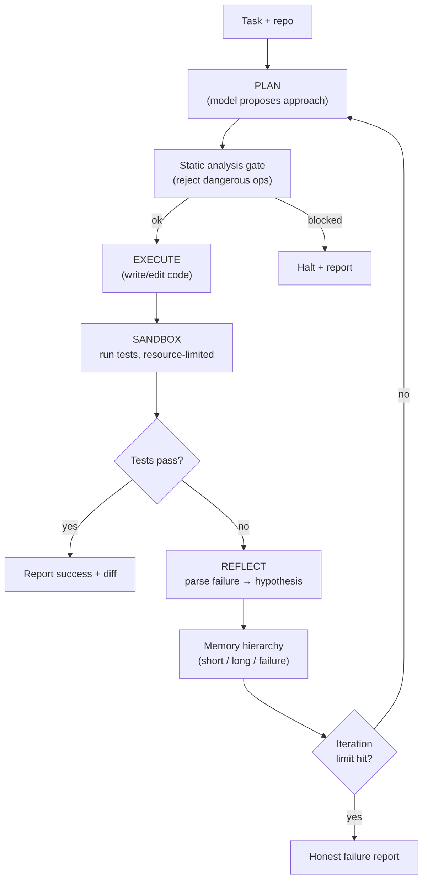
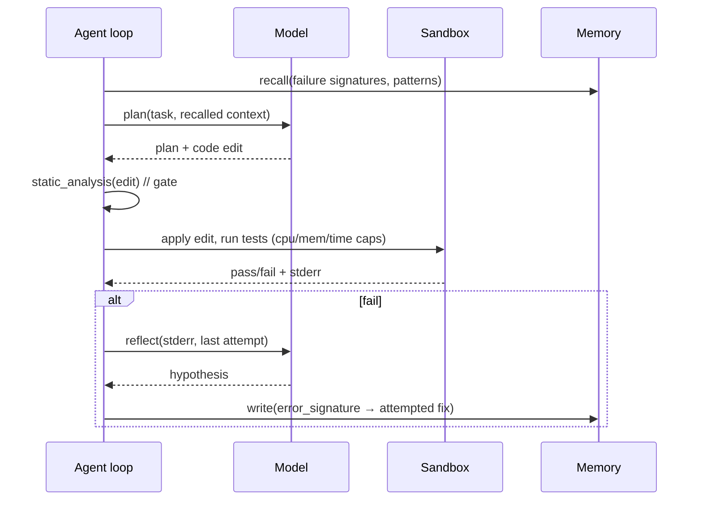

# Project 2 — Self-Improving Coding Agent

> **Level / Proves:** Intermediate · **Agentic loops + production debugging.** You
> prove you can build a real **agent** (not a workflow) that writes code, runs it,
> reads the failure, and *keeps going until the tests pass* — safely, inside a
> sandbox, without burning infinite tokens.

## Why this project gets you hired

This is the first project where the model genuinely **decides what to do next** based
on what it sees. That's the line between a *workflow* (fixed steps you wrote) and an
*agent* (the model drives the loop). The whole industry is hiring for the agent side,
and the #1 cited barrier is **reliability** — agents that loop forever, run dangerous
commands, or "succeed" without actually being correct.

A hiring manager reading this project sees that you can:

- **Design and bound an agentic loop** — Plan → Execute → Test → Reflect with a hard
  iteration cap, so the agent is autonomous but never runaway.
- **Sandbox untrusted execution.** The agent runs code it just wrote; you isolate it
  with resource limits so a bad generation can't wreck the host.
- **Build memory that actually improves behavior** — short-term, long-term, and a
  *failure* memory of error-signature → fix, which is the "self-improving" part.
- **Gate dangerous actions** with static analysis *before* execution — the
  security instinct that separates a toy from something you'd let touch a repo.

This is the project that proves you understand the harness as a **control structure**,
not a prompt.

## What you'll build

A **coding agent that closes the loop on a unit of work.** You hand it a task ("make
`tests/test_parser.py` pass" or "implement this function from its docstring") and it:

1. **Plans** an approach.
2. **Writes / edits** code.
3. **Runs the tests** in an isolated sandbox.
4. **Reflects** on the failure output and tries again — learning from each attempt —
   until the tests pass or it hits the iteration limit.

It comes back with either green tests + a diff, or an honest "I couldn't, here's how
far I got and why." Think of it as a focused, bounded, *auditable* slice of what a
coding harness like Claude Code does — built by you, loop visible, nothing hidden
behind magic.

> **WHY a coding agent specifically:** code is the one domain with a free, perfect,
> automatic oracle — the test suite. You get a ground-truth reward signal (pass/fail)
> for free, which makes the Reflect step real instead of vibes. That's why coding is
> the canonical agent benchmark.

## Architecture



The spine is the **Plan → Execute → Test → Reflect** loop with a hard cap. Every
plan passes a **static-analysis gate** before any code runs — the agent does not get
to `rm -rf` its way to green. Execution and tests happen in a **resource-limited
sandbox**, one per task. Each iteration's outcome feeds a **memory hierarchy** that
shapes the next plan. The loop ends in exactly one of two ways: success (tests pass)
or an *honest* failure report at the iteration limit. There is no third "loop
forever" outcome — that's the whole point.



## What makes it non-trivial

**Plan → Execute → Test → Reflect with a max-iteration limit.** This is the agentic
loop in its purest form, and the iteration cap is not a detail — it's the safety
rail that makes autonomy shippable. Without it the agent oscillates between two wrong
fixes forever, quietly spending money. The Reflect step is what makes it an *agent*:
it reads the actual test output and forms a hypothesis, so attempt N+1 is informed by
attempt N. Done right, the loop converges; done wrong, it thrashes. You will tune the
cap and add a "no-progress" early-stop (same failing test, same diff → give up early).

```python
from dataclasses import dataclass

@dataclass
class LoopResult:
    succeeded: bool
    iterations: int
    final_diff: str | None
    report: str

async def solve(task: Task, agent: "Agent", max_iters: int = 8) -> LoopResult:
    last_signature: str | None = None
    for i in range(1, max_iters + 1):
        ctx = agent.memory.recall(task)                 # SELECT: pull relevant memory
        plan = await agent.plan(task, ctx)
        if (verdict := agent.static_gate(plan)).blocked:
            return LoopResult(False, i, None, f"blocked: {verdict.reason}")
        await agent.apply(plan.edit)
        result = await agent.sandbox.run_tests()        # ISOLATE: own sandbox
        if result.passed:
            return LoopResult(True, i, agent.diff(), "tests green")
        sig = error_signature(result.stderr)
        if sig == last_signature:                        # no-progress early stop
            return LoopResult(False, i, agent.diff(), "stuck: repeated failure")
        agent.memory.record_failure(sig, plan.edit)      # WRITE: failure memory
        last_signature = sig
        await agent.reflect(result.stderr)
    return LoopResult(False, max_iters, agent.diff(), "hit iteration cap")
```

**Isolated execution environment per task with resource limits.** The agent runs code
it just generated — by definition *untrusted*. Each task gets its own sandbox (a
container, microVM, or at minimum a locked-down subprocess) with **CPU time, memory,
wall-clock, and network caps**. An infinite loop in generated code must die on a
timeout, not hang your machine. No network by default (so a generation can't exfil or
`pip install` something hostile). This is the **Isolate** primitive applied to
*execution*, not just context — and it's the difference between a demo and something
you'd point at a real repo.

**Memory hierarchy: short-term, long-term, and failure memory.** This is where
"self-improving" earns its name, and it's the four context primitives in one feature:

- **Short-term (Write + Compress):** the last ~5 iterations verbatim — what was tried
  and what broke — so the model has immediate working context without re-reading
  everything.
- **Long-term (Write + Select):** *successful patterns* distilled from past tasks
  ("when a fixture is missing, add it to `conftest.py`"), retrieved by relevance.
- **Failure memory (the key idea):** a store of **error-signature → attempted-fix →
  outcome**. Before planning, the agent checks "have I seen this stack trace shape
  before, and what did/didn't work?" This turns repeated mistakes into avoided ones.

```python
def error_signature(stderr: str) -> str:
    """Normalize a traceback to a stable key: drop line numbers, paths, addresses."""
    import re
    lines = [l for l in stderr.splitlines() if "Error" in l or "assert" in l.lower()]
    norm = re.sub(r"(0x[0-9a-f]+|:\d+|/[\w./-]+)", "<x>", " ".join(lines[-3:]))
    return norm.strip()
```

The signature normalization matters: raw tracebacks never match exactly (line
numbers, temp paths), so you canonicalize them into a stable key. That's a real
engineering decision with eval consequences.

**Static analysis before execution to catch dangerous operations.** Before *any*
generated code runs, parse it (AST-level) and the proposed shell commands, and block
the obvious footguns: `rm -rf`, writes outside the task dir, `subprocess` to the
network, `eval`/`exec` on untrusted strings, credential reads. This is a cheap,
deterministic gate in front of an expensive, stochastic model — the right shape for a
safety check. It is *defense in depth* with the sandbox: the gate catches intent, the
sandbox contains accidents.

**Tie-back to the mental models.** This is an **agent**, not a workflow — the model
chooses the next move from observed test output. The harness is the control structure:
the loop, the cap, the gate, the sandbox, the memory. And memory here is all four
primitives at once (Write the failures, Select relevant patterns, Compress the
iteration log, Isolate each task's sandbox). If Project 1 taught you the OS metaphor
at small scale, Project 2 is your first real OS scheduler with a feedback loop.

## Milestones

- [ ] **M1 — One-shot writer.** Agent writes code for a docstring task; you run tests
  manually. No loop yet. Establishes the prompt + diff-apply machinery.
- [ ] **M2 — The bounded loop.** Plan → Execute → Test → Reflect with a hard
  iteration cap, running tests automatically and feeding stderr back. This is the
  core deliverable.
- [ ] **M3 — Sandbox.** Move execution into an isolated, resource-limited environment
  (container/microVM/locked subprocess) with no network and time/memory caps.
- [ ] **M4 — Static-analysis gate.** AST + command screening that blocks dangerous
  operations before execution, with a test suite of malicious generations it catches.
- [ ] **M5 — Memory hierarchy.** Short-term log, long-term success patterns, and the
  failure memory keyed on normalized error signatures. Add the no-progress early-stop.
- [ ] **M6 — Self-improvement proof.** Run a batch of tasks; show that task N benefits
  from lessons learned in tasks 1..N-1 (lower iterations-to-green over time).
- [ ] **M7 — Eval harness + CI gate.** A fixed task set scored on pass-rate,
  iterations-to-green, and cost; a CI script that blocks a regression in any of them.

## How it's evaluated

| Criterion | Target | Eval type |
|-----------|--------|-----------|
| Task pass-rate on golden set | high & stable across runs | end-state |
| Median iterations-to-green | trends *down* as memory grows | trajectory |
| Loop never runs unbounded | always halts ≤ cap | trajectory |
| Dangerous op blocked | 100% of the red-team set caught pre-execution | single-turn |
| Reflection quality | failure → hypothesis is on-target | LLM-as-judge |
| Cost per solved task | within stated budget | end-state |

- **End-state evals** are the natural fit here: *did the tests pass?* — a free,
  binary, contamination-resistant oracle. This is the project's superpower.
- **Trajectory evals** grade the *path*: did it converge, did it avoid repeating a
  known-bad fix, did it halt at the cap?
- **Single-turn evals** validate the static gate against a fixed red-team set of
  dangerous generations.
- **LLM-as-judge** grades the *reflection text* — was the hypothesis a sensible read
  of the stderr? — since "good reasoning" isn't binary.

> **GOTCHA — eval contamination.** If your golden tasks are public benchmark problems
> the base model memorized, you're measuring recall, not your harness. Mix in private
> tasks from your own repos and report both.

## Stretch goals

- **Multi-file refactors** spanning a real repo, not single-function tasks.
- **Self-authored tests:** the agent writes a failing test from a bug report first,
  then makes it pass (red-green-refactor, autonomously).
- **Parallel hypotheses (Isolate):** spawn 2–3 sandboxed attempts with different
  strategies, keep the winner — sub-agents with fresh contexts.
- **Cost-aware planning:** the agent estimates token cost of a plan and prefers cheap
  fixes first.
- **Run it on SWE-bench-style tasks** and report your harness's lift over a bare
  model call (the curriculum's whole thesis, measured).

## Pitfalls

- **SECURITY — you are executing model-written code.** Treat every generation as
  hostile. Sandbox *plus* static gate *plus* no-network-by-default. The static gate
  alone is bypassable; the sandbox alone lets bad intent run. Use both.
- **GOTCHA — "tests pass" can be cheating.** A clever agent may delete the failing
  test or hard-code the expected output. Pin the test files as read-only and diff the
  test suite before/after; reject solutions that mutate the oracle.
- **GOTCHA — the infinite oscillation.** Two wrong fixes that swap forever will eat
  your whole iteration budget. The normalized-signature no-progress check is mandatory,
  not optional.
- **COST — reflection is the token sink.** Every failed iteration re-sends context.
  Compress the iteration log, cap iterations, and early-stop on no-progress, or a
  single hard task can cost more than ten easy ones.
- **GOTCHA — context rot in long loops.** By iteration 8 the window is full of dead
  ends. Compress old attempts to "tried X → failed because Y" one-liners instead of
  carrying full transcripts.
- **SECURITY — secrets in the sandbox.** Don't mount real credentials or `.env` into
  the execution environment. The agent doesn't need your AWS keys to make a parser pass.

➡️ Back to [all five portfolio projects](README.md)
