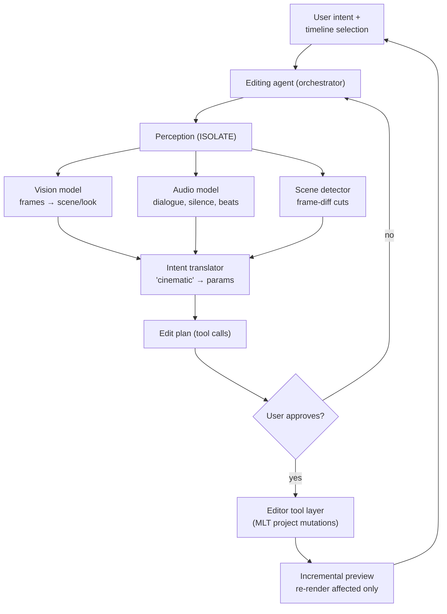
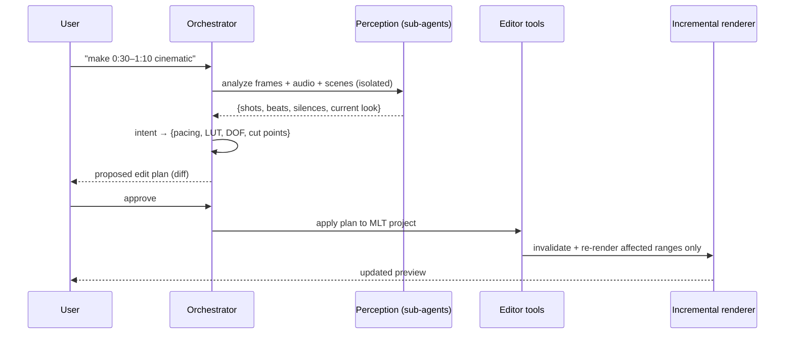

# Project 3 — "Cursor, but for Video Editors"

> **Level / Proves:** Advanced · **Multimodal AI + complex tool integration.** You
> prove you can ground a model in *pixels and audio* (not just text), translate a
> fuzzy human intent like "make this cinematic" into concrete tool calls against a
> real application, and keep the feedback loop fast enough to be usable.

## Why this project gets you hired

This is the project where the model stops living in a text box. It has to **see** the
footage, **hear** the dialogue, and then **drive a real, stateful application** — a
video editor — through a tool surface you design. That combination (multimodal
grounding + deep tool integration + a non-trivial host app) is rare and expensive to
build, which is exactly why it impresses.

A hiring manager sees that you can:

- **Engineer tools the model picks correctly** against a complex domain (timelines,
  clips, filters, transitions) — the "write tools the model chooses right" skill from
  the curriculum, at its hardest.
- **Translate intent → parameters.** "Cinematic" is not a function. Turning it into
  pacing, a LUT, and depth-of-field is the genuinely hard, judgment-laden part.
- **Fuse modalities.** Vision over frames + audio over dialogue, combined into one
  editing decision.
- **Make an expensive agent feel fast** via incremental preview — re-render only what
  changed. This is performance engineering on top of agent design.

## What you'll build

Fork an open-source non-linear editor — **Shotcut** (Qt/MLT, scriptable, permissive
license) is the recommended base — and bolt on an **AI editing copilot**. The user
selects a region of the timeline and types intent in plain language:

- "Make this cinematic" → the agent adds matched cuts on the beat, a teal-orange LUT,
  a subtle focus/DOF simulation, and slows the pacing.
- "Tighten this interview" → detect dead air and filler, cut silences, smooth the
  joins.
- "Punch up the intro" → faster cuts, a transition, a brightness/contrast lift.

The agent proposes an edit plan, shows an **incremental preview** of only the affected
sections, and applies it to the real MLT project on approval. It is "Cursor for video"
in the truest sense: an intent-driven agent over a real editor's document model, with
diffs you can accept or reject.

> **WHY fork Shotcut:** it uses the MLT framework, which has a scriptable XML project
> format and a CLI renderer (`melt`). That gives the agent a clean, inspectable
> document model to read and mutate — your tool layer talks to MLT, not to mouse
> coordinates. Teach the primitive (an agent driving a document model); MLT/Shotcut is
> the current vehicle.

## Architecture



The **orchestrator** owns the intent. It dispatches **perception** as isolated
sub-tasks — vision over sampled frames, audio over the dialogue track, and a cheap
deterministic **scene detector** — each in its own context so a huge frame analysis
never pollutes the planning window (**Isolate**). Their outputs feed the **intent
translator**, the heart of the project, which converts a vague adjective into a
concrete parameter set. That becomes an **edit plan** expressed as tool calls. Because
edits are destructive and subjective, the plan goes through **human approval** before
the **tool layer** mutates the MLT project. Finally **incremental preview** re-renders
*only* the changed sections so the loop feels live.



## What makes it non-trivial

**Vision model analyzes frames + audio model analyzes dialogue.** A text LLM cannot
edit video it can't perceive. You sample frames (not every frame — keyframes + a stride)
and run a vision model to read shot composition, lighting, motion, and current "look."
In parallel an audio model transcribes dialogue, finds silences and filler words, and
detects musical beats for cut timing. The hard part is **fusion**: a cut decision often
needs *both* (cut on a beat, but not mid-sentence). You design a shared scene
representation both modalities write into. **Isolate** is essential — frame analysis is
token-heavy, so it runs in its own context and returns a compact summary, never the raw
frames, to the planner.

**Intent translation: "cinematic" → concrete parameters.** This is the project's soul
and where most attempts go wrong. "Cinematic" is not a slider. You build a translation
layer — part lookup table, part model reasoning — that decomposes adjectives into a
typed parameter set: pacing (target shot length, cut rhythm), a color LUT (e.g. a
teal-orange grade), focus/DOF simulation strength, aspect/letterbox, and motion (subtle
speed ramps). The right design is a **typed schema** the model fills in, not free-text
the model emits — so the output is validated and applyable.

```python
from dataclasses import dataclass
from enum import StrEnum

class Pacing(StrEnum):
    SLOW = "slow"; MEDIUM = "medium"; FAST = "fast"

@dataclass
class EditPlan:
    """The validated, typed bridge between fuzzy intent and concrete tool calls."""
    pacing: Pacing
    target_shot_seconds: float            # cinematic ≈ longer holds
    lut: str | None                       # e.g. "teal_orange.cube"
    dof_strength: float                   # 0.0–1.0 focus simulation
    cut_points_s: list[float]             # beat/scene-aligned, never mid-word
    transitions: list[tuple[float, str]]  # (time, kind)
    letterbox_ratio: float | None         # e.g. 2.39 for "cinematic" bars

def cinematic_defaults() -> EditPlan:
    return EditPlan(
        pacing=Pacing.SLOW, target_shot_seconds=4.5,
        lut="teal_orange.cube", dof_strength=0.35,
        cut_points_s=[], transitions=[], letterbox_ratio=2.39,
    )
```

This typed plan is also what makes the agent **debuggable and evaluable** — you can
diff two plans, judge a plan in isolation, and reject malformed ones before any render.

**Scene detection via frame-difference analysis.** Don't pay a vision model to find
cuts a cheap algorithm finds for free. A frame-difference / histogram-delta pass
(thresholded) gives you scene boundaries deterministically and fast; the vision model
then *describes* the scenes it found rather than discovering them. This is the
curriculum's recurring move: **a cheap deterministic step in front of the expensive
stochastic one.** It cuts cost, latency, and hallucination.

```python
def detect_cuts(frames: list["Frame"], threshold: float = 0.45) -> list[int]:
    """Deterministic scene boundaries via normalized histogram delta."""
    cuts: list[int] = []
    for i in range(1, len(frames)):
        if histogram_delta(frames[i - 1], frames[i]) > threshold:
            cuts.append(i)
    return cuts
```

**Incremental preview — re-render only affected sections.** Re-rendering a 10-minute
timeline after every tweak makes the agent unusable. You build a dependency model:
each edit invalidates a *range* of the timeline; only those ranges re-render, and the
rest is served from cache. This is the same idea as incremental compilation, applied to
a render graph. It's what turns a correct-but-glacial agent into one a real editor would
actually keep open.

**Tie-back to the mental models.** This is a **human-in-the-loop agent**: the model
plans, the human approves, the harness applies — the right pattern for destructive,
subjective actions. The perception sub-agents are **Isolate** in textbook form. The
typed `EditPlan` is **tool design** done well — a schema the model fills correctly. And
the cheap-before-expensive scene detector plus the cache are the **harness** doing what
the model shouldn't: deterministic, fast, cheap.

## Milestones

- [ ] **M1 — Fork + tool surface.** Fork Shotcut/MLT and expose a clean programmatic
  tool layer: read the project model, list clips, apply a cut / filter / transition,
  render a range. No AI yet — just the hands.
- [ ] **M2 — Perception, deterministic part.** Frame-difference scene detection + audio
  silence/beat detection over a clip. Verify boundaries by eye.
- [ ] **M3 — Multimodal grounding.** Vision model describes scenes, audio model
  transcribes dialogue; fuse into one scene representation. Run perception as isolated
  sub-tasks returning compact summaries.
- [ ] **M4 — Intent translator.** The typed `EditPlan` schema + the model filling it
  from intent. Start with one intent ("cinematic") end-to-end.
- [ ] **M5 — Apply + human-in-the-loop.** Plan → diff → user approves → mutate the MLT
  project. The agent now actually edits.
- [ ] **M6 — Incremental preview.** Dependency tracking so only changed ranges
  re-render; cache the rest. Measure the speedup vs full re-render.
- [ ] **M7 — More intents + eval harness.** Add "tighten interview" and "punch up
  intro"; build a rubric-based eval set scored by an LLM/vision judge.

## How it's evaluated

| Criterion | Target | Eval type |
|-----------|--------|-----------|
| Plan matches intent | a human editor agrees the plan is reasonable | LLM/vision-as-judge |
| Cuts land on beats / not mid-word | measurable alignment | end-state |
| Scene detection accuracy | matches hand-labeled cuts | single-turn |
| Tool calls are valid | applied plan never corrupts the project | trajectory |
| Incremental preview speedup | large vs full re-render | end-state |
| Round-trip latency | preview returns fast enough to iterate | end-state |

- **LLM-as-judge (multimodal):** the dominant eval here — "is this output actually
  *cinematic*?" is subjective, so a vision-capable judge (or a human rubric) grades
  before/after frames and the plan against the stated intent.
- **Single-turn evals** grade the deterministic pieces (scene-cut accuracy vs labels).
- **Trajectory evals** confirm the tool-call sequence is valid and never leaves the
  project in a broken state.
- **End-state evals** assert measurable facts: cut/beat alignment, render-range
  correctness, preview speedup.

> **GOTCHA — subjective evals need calibration.** "Cinematic" means different things
> to different judges. Anchor your judge with reference examples and a written rubric,
> or your eval score is noise.

## Stretch goals

- **B-roll suggestion:** the agent proposes (and inserts) stock/related clips at slow
  moments.
- **Auto-subtitles + styled captions** from the audio transcription.
- **Music-driven editing:** align every cut to a supplied track's beat grid.
- **Style transfer from a reference:** "match the look of *this* clip" → derive a LUT
  and pacing profile from an example.
- **Undo as a first-class agent action** with a full edit-history diff log.

## Pitfalls

- **GOTCHA — don't send raw frames to the planner.** A minute of footage is thousands
  of frames; dumping them blows the context window and the budget. Sample, summarize in
  the perception sub-agent, pass only the compact scene representation up.
- **COST — multimodal tokens are the expensive ones.** Vision/audio inference per
  frame/second dwarfs text. Use the deterministic scene detector to *limit* how many
  frames the vision model ever sees, and cache perception results per clip.
- **SECURITY / SAFETY — edits are destructive and subjective.** Never auto-apply on
  critical content. The human-in-the-loop approval gate is mandatory, and keep the
  original project immutable (apply to a copy, support full undo).
- **GOTCHA — the editor document model is stateful and fragile.** Concurrent edits or a
  malformed tool call can corrupt the MLT XML. Validate every mutation, and treat the
  tool layer as a transaction: apply-or-rollback.
- **GOTCHA — perception/planning drift.** If the vision model and audio model disagree
  (cut here vs not), the planner must arbitrate explicitly, not silently pick one. Make
  the fusion rule visible and testable.

➡️ Back to [all five portfolio projects](README.md)
