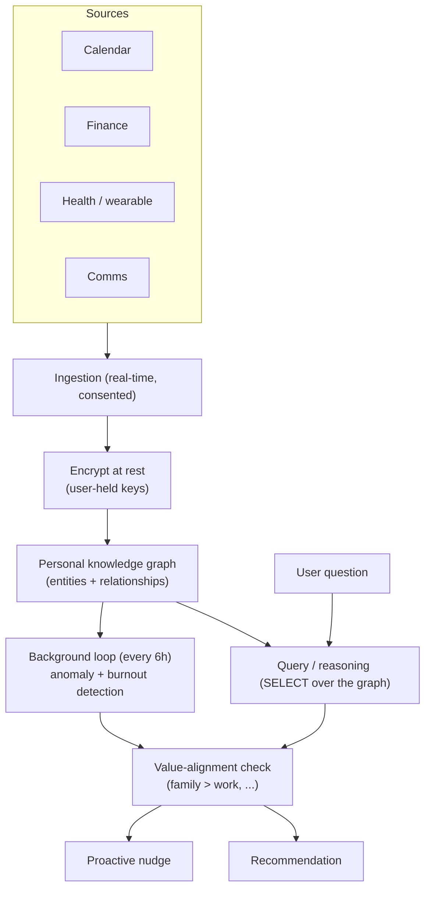
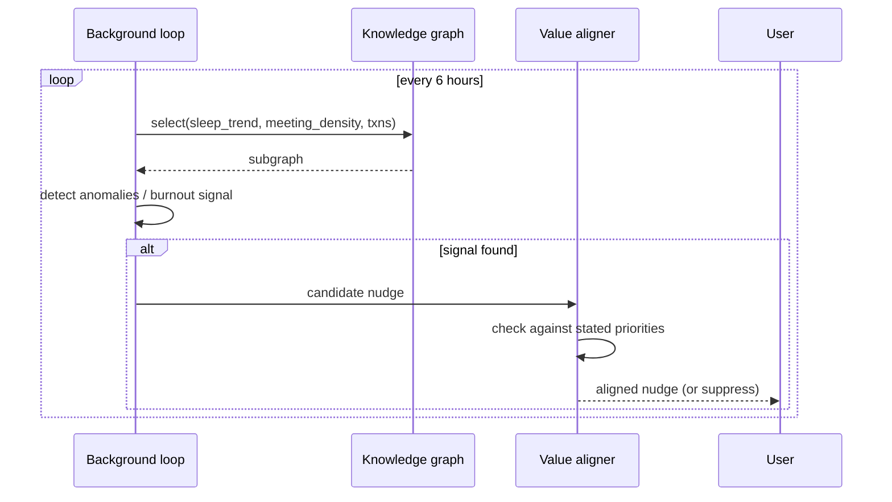

# Project 4 — Personal Life-OS Agent

> **Level / Proves:** Expert · **Deep context + privacy-first architecture.** You
> prove you can fuse a person's whole life — calendar, finances, health,
> communications — into a coherent, *durable* context, reason over it proactively,
> and do it without ever betraying the user's trust or their values.

## Why this project gets you hired

Every prior project had a bounded task. This one has an *unbounded, lifelong* one:
model a human being's situation well enough to make genuinely good recommendations,
and never leak or misuse the data that makes that possible. It is the deepest context
engineering challenge in the curriculum and the strongest privacy story.

A hiring manager sees that you can:

- **Ingest and fuse heterogeneous, real-time streams** into one model of the world —
  the Select primitive at the scale of an entire life.
- **Build and query a personal knowledge graph** — entities and relationships, not a
  flat blob — so the agent reasons about *connections* (this person, that recurring
  bill, this stress pattern).
- **Run proactive background reasoning** — a long-lived loop that surfaces things the
  user didn't ask about (burnout, an anomalous charge) — the hardest, most valuable
  agent behavior.
- **Architect for privacy from line one** — encryption at rest with user-held keys,
  local-first, value-aligned. This is the differentiator: anyone can build a chatbot
  over Google Calendar; almost no one builds one you'd actually trust with your health
  data.

## What you'll build

A **private, always-on personal operating system agent.** It connects (with explicit
consent) to the user's calendar, finances, health/wearable data, and communications,
builds a personal knowledge graph, and then:

- **Answers deep questions:** "Can I afford to take three weeks off in October?" —
  cross-referencing calendar load, finances, and commitments.
- **Plans months ahead:** notices a brutal Q3 and proposes recovery time before you
  collapse.
- **Detects burnout proactively:** correlates declining sleep with rising meeting
  density and flags it *before* you ask.
- **Catches anomalies:** an unfamiliar recurring charge, a missed bill, a health
  metric trending wrong.

Crucially, every recommendation is checked against the user's *stated values*
(e.g. "family > work"), and **all data is encrypted at rest under keys only the user
controls.** The portfolio headline: a deeply useful life agent that a privacy-paranoid
person would actually run.

> **WHY this is Expert, not Master:** the orchestration is moderate, but the *context
> depth* and *trust surface* are extreme. The hard problems are "how do I represent a
> life" and "how do I never betray it," not "how do I coordinate ten agents."

## Architecture



Consented **ingestion** pulls from each source in near-real-time; everything is
**encrypted at rest under user-held keys** *before* it touches the **personal
knowledge graph** — the heart of the system, where entities (people, accounts, bills,
events, sleep nights) and their relationships live. Both the on-demand **query path**
(user asks something) and a **background loop** (runs every ~6 hours, hunting anomalies
and burnout signals) reason by **Selecting** the relevant subgraph. Every output —
reactive or proactive — passes a **value-alignment check** before reaching the user.
That gate is what keeps a "helpful" agent from optimizing your calendar into a life you
explicitly said you didn't want.



## What makes it non-trivial

**Real-time ingestion from calendar, finance, health, and communications.** Four
sources, four APIs, four schemas, four failure modes, four consent boundaries. The hard
part isn't any single connector — it's **normalizing** them into a shared entity model
and keeping it fresh without hammering rate limits or going stale. You build an
ingestion layer with per-source consent, incremental sync (deltas, not full re-pulls),
and graceful degradation when a source is down. This is **Select** at the source level:
deciding *what to pull and when*, before anything reaches the model.

**Personal knowledge graph of entities + relationships.** A flat document store can't
answer "is my spending up *because* of the new gym *near the new apartment*?" — that's a
relationship query. You model the life as a graph: nodes (person, account, recurring
charge, event, sleep night, project) and typed edges (`pays`, `attends`, `lives_with`,
`stresses`). Reasoning then = traversing the relevant subgraph and handing *that* to the
model, not the whole life. This is the **Select** primitive made structural: retrieval
over a graph, so the context window holds the connected facts that matter and nothing
else.

```python
from dataclasses import dataclass

@dataclass(frozen=True)
class Entity:
    id: str
    kind: str            # "person" | "account" | "recurring_charge" | "event" | "sleep_night"
    attrs: dict[str, object]

@dataclass(frozen=True)
class Edge:
    src: str
    rel: str             # "pays" | "attends" | "correlates_with" | "stresses"
    dst: str

class PersonalGraph:
    def subgraph_for(self, question: str, hops: int = 2) -> "PersonalGraph":
        """SELECT: return only the entities/edges relevant to a query,
        N hops out — this is what fits in the context window, not the whole life."""
        ...
```

**Background thread every 6 hours checking for anomalies.** Reactive agents wait to be
asked; the value here is *proactive*. A long-lived background loop wakes on a schedule,
selects recent signals, and runs detectors: sleep trending down while meeting density
trends up (burnout), an unrecognized recurring charge (financial anomaly), a bill due
with no matching payment. This is genuinely hard agent design — a durable, scheduled
loop that must be cheap (it runs forever), must not nag (false positives destroy trust
fast), and must persist its state across restarts. It's the **Write** primitive at the
system level: the agent maintains durable state outside any single conversation.

**Value alignment — every recommendation validated against stated priorities.** A naive
optimizer told to "improve your schedule" will happily book your weekends. So the user
states priorities explicitly ("family > work, health is non-negotiable, protect
mornings"), and **every** recommendation — reactive or proactive — passes an alignment
check before surfacing. A nudge that trades family time for a work win is suppressed or
reframed. This is the safety/altitude idea applied to *personal* agency: the agent's
goal is the user's *stated* goal, not a proxy metric it invented.

```python
@dataclass(frozen=True)
class Values:
    priorities: list[str]          # ordered: ["family", "health", "work"]
    hard_rules: list[str]          # ["never book before 9am", "no work on weekends"]

def passes_alignment(rec: "Recommendation", values: Values) -> tuple[bool, str]:
    for rule in values.hard_rules:
        if rec.violates(rule):
            return (False, f"violates hard rule: {rule}")
    if rec.trades_down_priority(values.priorities):
        return (False, "trades a higher priority for a lower one")
    return (True, "aligned")
```

**All data encrypted at rest with user-controlled keys.** This is the property that
makes the whole thing shippable. Health + finance + comms in one place is a catastrophic
breach waiting to happen — *unless* it's encrypted at rest under a key the user holds, so
even a full disk compromise yields ciphertext. Local-first (data and ideally inference on
the user's own machine) is the strongest version. The design principle: **the operator
should be unable to read the user's data even if compelled.**

**Tie-back to the mental models.** This is a long-running, mostly-**agentic** system with
a heavy **Write** (durable life state) and **Select** (graph retrieval) emphasis, and a
hard alignment gate as its safety layer. The knowledge graph is the cleanest expression
of Select in the whole curriculum: you never put "a life" in the window — you put the
*relevant subgraph*. The background loop is the harness operating without a user present,
which is where durability and cost discipline stop being optional.

## Milestones

- [ ] **M1 — One source, encrypted.** Ingest calendar only, normalized into the entity
  model, encrypted at rest under a user-held key. Prove the key model first — it's
  load-bearing for everything after.
- [ ] **M2 — The knowledge graph.** Entities + typed edges + a subgraph-select query.
  Answer one cross-entity question.
- [ ] **M3 — Multi-source fusion.** Add finance + health + comms with per-source consent,
  incremental sync, and graceful degradation.
- [ ] **M4 — Reactive deep Q&A.** "Can I afford October off?"-class questions answered by
  selecting and reasoning over the relevant subgraph.
- [ ] **M5 — Background proactive loop.** The 6-hour durable loop with burnout + anomaly
  detectors, persisting state across restarts, tuned against false positives.
- [ ] **M6 — Value alignment gate.** Stated priorities + hard rules; every recommendation
  (reactive and proactive) routed through the check.
- [ ] **M7 — Eval + trust harness.** Eval set for recommendation quality and alignment;
  a privacy audit proving keys are user-held and data is never readable by the operator.

## How it's evaluated

| Criterion | Target | Eval type |
|-----------|--------|-----------|
| Cross-source answers are correct | grounded in the actual graph, no hallucinated facts | LLM-as-judge + end-state |
| Burnout/anomaly detection | catches seeded signals, low false-positive rate | end-state / single-turn |
| No misaligned recommendation ships | 0 violations of stated values on the test set | trajectory |
| Background loop is durable | survives restart, resumes state | trajectory |
| Data is unreadable at rest | operator cannot decrypt without user key | end-state (audit) |
| Cost of the always-on loop | within a stated monthly budget | end-state |

- **End-state evals** assert hard facts: detection caught seeded anomalies, data is
  ciphertext at rest, the loop's state survived a restart.
- **Trajectory evals** verify the *path* of a recommendation: it passed the alignment
  gate, used real graph facts, didn't fabricate.
- **Single-turn evals** test detectors against labeled signal/no-signal cases.
- **LLM-as-judge** grades the *quality and groundedness* of deep recommendations —
  is the advice actually good, and is every claim backed by a graph fact?

> **GOTCHA — eval data is real life.** You can't share a golden set of someone's health
> and bank records. Build evals on *synthetic-but-realistic* personas you generate, and
> keep the real-data run private.

## Stretch goals

- **Months-ahead planning agent:** simulate the next quarter and propose recovery weeks
  before overload, not after.
- **What-if simulation:** "what happens to my finances and calendar if I take this job?"
- **Local inference end-to-end** (an on-device SLM — reuse Project 1!) so even the model
  never sees plaintext off-device.
- **Differential-privacy aggregates** for any optional cloud features.
- **A "trust ledger"** the user can audit: every data access the agent made, queryable.

## Pitfalls

- **SECURITY — this is the highest-stakes data in the curriculum.** Health + finance +
  comms together is a breach you cannot walk back. Encrypt at rest under user-held keys,
  default to local-first, minimize what you ingest, and make the operator structurally
  unable to read plaintext. Threat-model it like it's regulated, because it morally is.
- **SECURITY — consent is per-source and revocable.** One blanket "allow" is not consent.
  Each source opts in separately, and the user can revoke and purge.
- **GOTCHA — proactive nudges are a trust speedrun.** One creepy or wrong unsolicited
  alert and the user uninstalls forever. Tune detectors for *precision* over recall and
  let the user dial sensitivity.
- **GOTCHA — value alignment is not a vibe.** "Be helpful" optimizers will quietly trade
  away what the user cares about. The alignment gate must be explicit, testable, and
  block-by-default on ambiguity.
- **COST — an always-on loop bills forever.** A 6-hour loop calling a frontier model
  over a big graph adds up. Compress the graph to the relevant subgraph before every
  call, cache detector inputs, and use a cheap model for the routine scan + an expensive
  one only when a signal fires.
- **GOTCHA — stale data gives confident-wrong answers.** A missed sync makes "you can
  afford it" dangerously wrong. Track freshness per source and degrade honestly ("I'm
  missing this week's transactions") instead of guessing.

➡️ Back to [all five portfolio projects](README.md)
