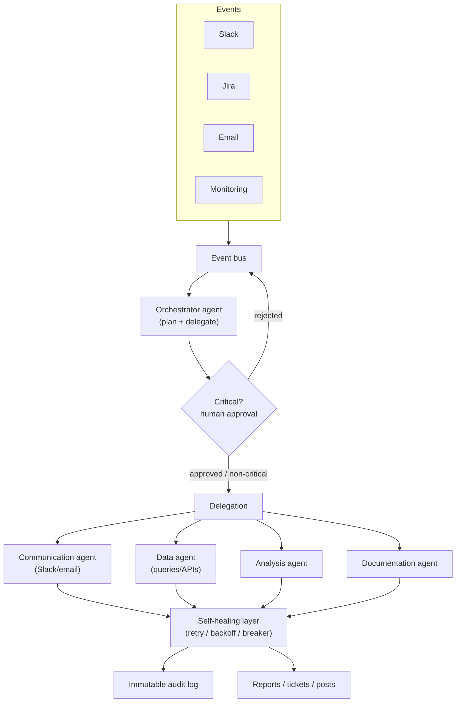

# Project 5 — Autonomous Enterprise Workflow Agent

> **Level / Proves:** Master · **Production-grade orchestration.** You prove you can
> run real business workflows end-to-end across multiple agents and external systems —
> event-driven, self-healing, fully audited, and safe enough that a human approves the
> dangerous moves. This is the capstone the whole curriculum builds toward.

## Why this project gets you hired

This is the project that *is* the job. It exercises every primitive at once and adds
the things that only matter in production: event-driven triggering, multi-agent
delegation, self-healing under failure, an immutable audit trail, and human-in-the-loop
gates on critical actions. Nothing here is a demo. It's the difference between
"replaceable" and "unfireable" rendered as software.

A hiring manager sees that you can build a system that:

- **Survives 2am on a Friday** — circuit breakers, backoff, and retry decisions instead
  of silent death.
- **Coordinates specialized agents** — an orchestrator delegating to communication,
  data, analysis, and documentation agents, each **Isolated** with its own context.
- **Proves what it did** — an immutable audit log of every action, who authorized it,
  and the outcome. This is what makes an autonomous system *legally and operationally*
  shippable.
- **Knows when to ask a human** — proposes a plan and waits for approval before
  executing anything consequential.

If Projects 1–4 each proved one competency, Project 5 proves you can run them all at
once under production conditions.

## What you'll build

An **autonomous operations agent for a business.** It watches the systems a team
actually lives in — Slack, Jira, email, monitoring alerts — and runs end-to-end
workflows triggered by events:

- A monitoring alert fires → the agent triages, gathers data, drafts an incident
  summary, opens/updates a Jira ticket, and posts a status to Slack — with humans
  approving any remediation.
- A Slack request ("can someone pull last month's churn numbers and summarize?") →
  the orchestrator delegates to a data agent and an analysis agent, then a
  documentation agent writes the report.
- A recurring report is due → the workflow runs itself, on schedule, with an audit
  trail.

The deliverable is not a chatbot. It's an **orchestrator + a fleet of specialized
sub-agents + a control plane** (event bus, audit log, approval gates, self-healing)
that runs business processes reliably enough to trust. The portfolio headline: *an
agent system that did real work, recovered from real failures, and can prove every
action it took.*

## Architecture



An **event bus** ingests triggers from Slack, Jira, email, and monitoring. The
**orchestrator** plans a response and — for anything critical — pauses at a
**human-in-the-loop** gate before delegating. Work fans out to **specialized
sub-agents** (communication, data, analysis, documentation), each running in its own
isolated context. Every external action flows through a **self-healing layer** (retry,
exponential backoff, circuit breakers) and is recorded in an **immutable audit log**
before producing the actual outputs — tickets, posts, reports.

```mermaid
sequenceDiagram
    participant Bus as Event bus
    participant O as Orchestrator
    participant H as Human approver
    participant Sub as Sub-agent
    participant R as Self-healing
    participant L as Audit log
    Bus->>O: alert event
    O->>O: plan (steps + which agents)
    O->>L: record(plan, actor=orchestrator)
    alt critical workflow
        O->>H: propose plan
        H-->>O: approve / reject
        O->>L: record(decision, actor=human)
    end
    O->>Sub: delegate step (isolated context)
    Sub->>R: external call (Slack/Jira/DB)
    R->>R: retry w/ backoff; trip breaker on repeated failure
    R-->>Sub: result or controlled failure
    Sub->>L: record(action, outcome)
    Sub-->>O: step result
```

## What makes it non-trivial

**Event-driven triggering (Slack, Jira, email, monitoring).** Unlike every prior
project, the user isn't sitting there typing. The system reacts to a heterogeneous
stream of events, each with its own webhook/poll mechanics, auth, and delivery
guarantees. You build an **event bus** that normalizes them into a common envelope,
deduplicates (webhooks fire twice), and routes by type. This is the harness as a
*reactive* system — it must be always-on, idempotent (processing the same event twice
must not double-act), and ordered where it matters. Idempotency keys and dedup are not
polish here; they're correctness.

**Multi-agent delegation (orchestrator → specialized agents).** One mega-prompt that
does everything has a context window stuffed with four jobs' worth of irrelevant
tokens and degrades fast. Instead the **orchestrator** plans and **delegates** to
specialists — a communication agent (writes Slack/email), a data agent (runs queries
and API calls), an analysis agent (reasons over data), a documentation agent (produces
the report). Each sub-agent gets a **clean, Isolated context** scoped to its task and
returns a compact result. This is the **Isolate** primitive as an org chart: the
orchestrator is a manager that never does the work itself, so its context stays a
high-level plan, not a pile of raw query results.

```python
from dataclasses import dataclass
from enum import StrEnum

class AgentKind(StrEnum):
    COMMUNICATION = "communication"; DATA = "data"
    ANALYSIS = "analysis"; DOCUMENTATION = "documentation"

@dataclass
class Step:
    agent: AgentKind
    instruction: str
    inputs: dict[str, object]

async def run_plan(orch: "Orchestrator", plan: list[Step], audit: "AuditLog") -> list[object]:
    results: list[object] = []
    for step in plan:
        sub = orch.spawn(step.agent)          # ISOLATE: fresh context per sub-agent
        out = await orch.resilient(sub.run, step)   # self-healing wrapper
        audit.record(action=step, outcome=out, actor=step.agent)  # immutable log
        results.append(out)
    return results
```

**Self-healing — exponential backoff, circuit breakers, automatic retry decisions.**
External systems fail: Slack rate-limits, Jira times out, a DB blips. A production
agent doesn't crash or, worse, retry forever and amplify an outage. You wrap every
external call in a resilience layer: **exponential backoff** on transient failures, a
**circuit breaker** that stops hammering a dead dependency (and fails fast / queues
instead), and an **automatic retry decision** — is this error retryable (timeout) or
terminal (auth denied)? Getting this right is exactly the "survives 2am Friday" skill
the curriculum sells.

```python
import asyncio, random

class CircuitBreaker:
    def __init__(self, fail_threshold: int = 5, reset_after_s: float = 30.0) -> None:
        self.failures = 0; self.fail_threshold = fail_threshold
        self.reset_after_s = reset_after_s; self.open_until = 0.0

    def allow(self, now: float) -> bool:
        return now >= self.open_until            # fail fast while open

    def record(self, ok: bool, now: float) -> None:
        if ok: self.failures = 0
        else:
            self.failures += 1
            if self.failures >= self.fail_threshold:
                self.open_until = now + self.reset_after_s   # trip

async def with_backoff(call, *, max_tries: int = 5, retryable) -> object:
    for attempt in range(max_tries):
        try:
            return await call()
        except Exception as e:
            if not retryable(e) or attempt == max_tries - 1:
                raise
            await asyncio.sleep((2 ** attempt) + random.random())  # backoff + jitter
```

**Immutable audit log — every action, who authorized it, the outcome.** Autonomy
without accountability is unshippable in an enterprise. Every action the system takes —
the plan, the human's approval, each external call, each outcome — is appended to a
**tamper-evident, append-only** log (hash-chained entries, immutable storage). When
someone asks "why did the bot close that ticket?", you have a complete, ordered,
non-repudiable answer. This is the **Write** primitive elevated to a compliance
artifact: durable state that exists precisely so the system can be inspected after the
fact.

**Human-in-the-loop — propose-before-execute on critical workflows.** Full autonomy is
the wrong default for consequential actions (sending external email, modifying prod,
spending money). The orchestrator classifies each workflow's risk and, for critical
ones, **proposes a plan and blocks for human approval** before executing — recording
both the proposal and the decision in the audit log. Non-critical workflows run
autonomously. This tiered model is what lets the system be genuinely useful *and* safe:
trusted with the routine, supervised on the dangerous.

**Tie-back to the mental models.** This is the full thesis. The orchestrator + event
bus + self-healing + audit + approval gates *are* the **harness** — the OS around a
fleet of model "CPUs." Sub-agents are **Isolate**; the audit log is **Write**; the
data agent's scoped queries are **Select**; long plans get **Compressed** into status.
It's a **workflow-of-agents** hybrid: deterministic where it should be (routing,
retries, gates) and agentic where judgment is needed (planning, analysis). That blend —
knowing which parts to make boring and which to make smart — is the master-level skill.

## Milestones

- [ ] **M1 — Event bus.** One event source (e.g. Slack) normalized into a common
  envelope, with dedup/idempotency. The system reacts to a real event.
- [ ] **M2 — Orchestrator + one sub-agent.** Orchestrator plans and delegates a single
  step to one specialist in an isolated context. End-to-end on one workflow.
- [ ] **M3 — The agent fleet.** Communication, data, analysis, and documentation
  agents, each scoped and isolated, composed into a multi-step workflow.
- [ ] **M4 — Self-healing layer.** Backoff + jitter, circuit breakers, retryable-vs-
  terminal classification wrapping every external call. Prove it with injected failures.
- [ ] **M5 — Immutable audit log.** Hash-chained, append-only record of plan, approvals,
  actions, and outcomes; a query tool to answer "why did it do X?".
- [ ] **M6 — Human-in-the-loop gates.** Risk classification + propose-before-execute on
  critical workflows, with approvals recorded.
- [ ] **M7 — Multi-source events + eval/CI harness.** Add Jira/email/monitoring; build
  trajectory + end-state evals and a CI gate that blocks orchestration regressions.

## How it's evaluated

| Criterion | Target | Eval type |
|-----------|--------|-----------|
| Workflow completes end-to-end | correct final state (ticket/report/post) | end-state |
| Delegation is correct | right agent for each step, no context bleed | trajectory |
| Survives injected failures | recovers via backoff/breaker, no crash or storm | trajectory |
| Idempotent on duplicate events | no double-action | end-state |
| Audit completeness | every action traceable to actor + outcome | end-state (audit) |
| Critical actions gated | 0 critical actions executed without approval | trajectory |
| Reasoning/output quality | reports and triage are actually good | LLM-as-judge |

- **Trajectory evals** are central: orchestration is about the *path* — right
  delegation, correct recovery, gate honored before a critical action.
- **End-state evals** assert the workflow's final facts: ticket updated correctly,
  no duplicate actions, audit log complete.
- **Single-turn evals** check sub-agent components in isolation (data agent returns the
  right query result; retry classifier labels errors correctly).
- **LLM-as-judge** grades the quality of generated artifacts (incident summaries,
  reports) against a rubric.

> **GOTCHA — multi-agent failures hide in the seams.** A system where each agent passes
> its unit test can still fail end-to-end (bad handoff, lost context, wrong delegation).
> Trajectory evals over the *whole* workflow are non-negotiable.

## Stretch goals

- **Cost & latency budgets per workflow** with automatic downgrade to a cheaper model
  when a budget is tight.
- **Replay & time-travel debugging:** re-run any past workflow from the audit log to
  reproduce a bug.
- **Dynamic agent spawning:** the orchestrator creates a new specialist on the fly for
  an unanticipated task type.
- **Policy-as-code approval rules:** declarative risk policy ("anything touching prod >
  manager approval").
- **Drift monitoring:** detect when workflow success rate degrades over time and alert.

## Pitfalls

- **SECURITY — the agent acts in the real world with real credentials.** It posts to
  Slack, edits Jira, sends email. Scope every credential to least privilege, broker auth
  rather than handing agents raw secrets, and gate destructive actions behind human
  approval. A prompt-injected Slack message must not be able to make the agent email
  your customers.
- **SECURITY — prompt injection via events.** Events contain untrusted text (a Slack
  message, an email body). Treat all event content as hostile; never let it directly
  authorize a privileged action. The HITL gate is your backstop.
- **GOTCHA — retry storms amplify outages.** Naive retry-forever turns a blip into a
  self-inflicted DDoS on your own dependency. Backoff + jitter + circuit breakers are
  mandatory, and the breaker must *fail fast*, not queue infinitely.
- **GOTCHA — duplicate events double-act.** Webhooks deliver at-least-once. Without
  idempotency keys you'll close the same ticket twice or send two emails. Dedup at the
  bus.
- **COST — a fleet of agents per event multiplies spend fast.** Four sub-agents × many
  events × a frontier model is a real bill. Use cheap models for routing/classification,
  reserve expensive ones for analysis, compress plans into status, and set per-workflow
  budgets.
- **GOTCHA — context bleed between sub-agents.** If sub-agents share context, the
  analysis agent gets polluted by the comms agent's tokens and quality drops. Keep them
  truly Isolated; pass compact structured results, not raw transcripts.
- **GOTCHA — the audit log must be immutable for real.** A log the agent can rewrite is
  not an audit log. Append-only storage, hash-chained entries, no in-place edits.

➡️ Back to [all five portfolio projects](README.md)
