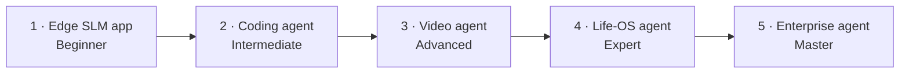
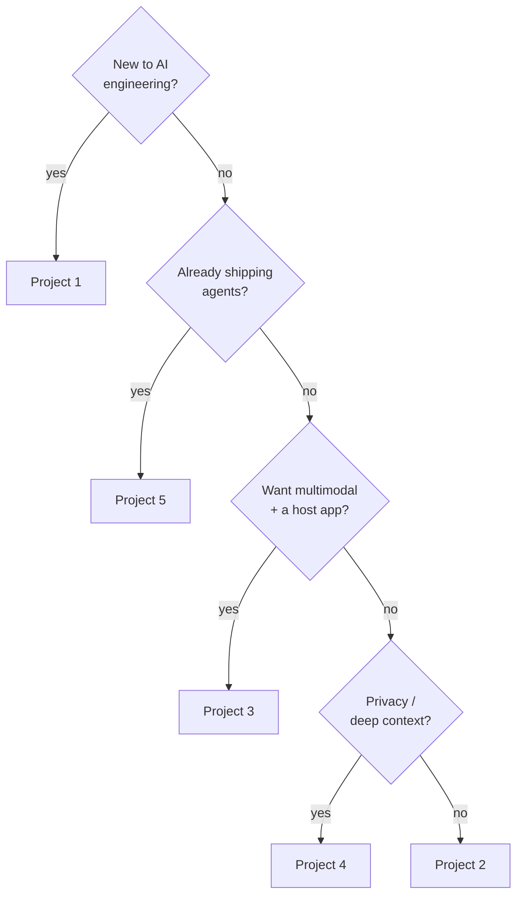
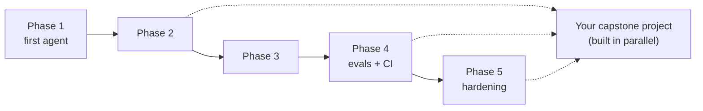

# The 5 Portfolio Projects

> Your capstone is the thing that gets you hired. The curriculum teaches the
> primitives; **a shipped project proves you can wield them under real constraints.**
> Pick one, build it for real, and keep a build log — that log *is* your interview.

Each project is ranked by difficulty and proves a **distinct competency** a hiring
manager is actually screening for. They are not toys: every spec includes a full
architecture, a sequenced build plan, concrete eval criteria, and the specific
pitfalls that bite in production.

## The projects, beginner → master

| # | Project | Level | Proves |
|---|---------|-------|--------|
| 1 | [AI-Powered Mobile App with a Small Language Model](01-edge-slm-mobile-app.md) | Beginner | Edge AI + resource optimization |
| 2 | [Self-Improving Coding Agent](02-self-improving-coding-agent.md) | Intermediate | Agentic loops + production debugging |
| 3 | ["Cursor, but for video editors"](03-multimodal-video-agent.md) | Advanced | Multimodal AI + complex tool integration |
| 4 | [Personal Life-OS Agent](04-personal-life-os-agent.md) | Expert | Deep context + privacy-first architecture |
| 5 | [Autonomous Enterprise Workflow Agent](05-enterprise-workflow-agent.md) | Master | Production-grade orchestration |

## How to pick

You only need to ship **one** to have a portfolio. Pick by where you are right now,
not by which sounds coolest:

- **Brand new to AI engineering?** → **Project 1 (Edge SLM app).** It forces all four
  context primitives at small scale where you can see the whole system at once, with a
  deterministic workflow and zero API spend. Lowest moving-part count, highest learning
  per hour.
- **Comfortable building, want to prove *agentic loops*?** → **Project 2 (Coding
  agent).** Your first real agent with a free, perfect oracle (tests pass/fail).
- **Want a standout, demo-able portfolio piece?** → **Project 3 (Video agent).**
  Multimodal grounding + a real host app reads as senior immediately.
- **Care about privacy / deep context / on-prem buyers?** → **Project 4 (Life-OS
  agent).** The strongest trust story and the deepest context engineering.
- **Already shipping agents and want the master credential?** → **Project 5
  (Enterprise workflow agent).** It *is* the job: event-driven, multi-agent,
  self-healing, audited, human-gated.

## When to build them

**Projects run in parallel with Phases 2+, not after the whole curriculum.** Once you
have a working agent (end of Phase 1) and the start of real architecture (Phase 2),
begin your capstone and let the later phases harden it:

- **Phase 2 (production architecture)** gives you durability + multi-agent patterns —
  apply them straight into your project.
- **Phase 4 (evals & regression)** is where your project gets its eval harness and CI
  gate. Every spec's "How it's evaluated" section maps to the four eval types you learn
  there (single-turn, trajectory, LLM-as-judge, end-state).
- **Phase 5 (production hardening)** is where cost, latency, safety, and resilience turn
  your project from "works in a demo" into "works at 2am on a Friday."

> **The bar:** a finished project is not "the model did the task once in a demo." It's
> a *system* — measurable (evals), recoverable (durability), affordable (cost
> controls), and safe (sandboxing / approval gates). That's the line between
> *replaceable* and *unfireable*. Build for the second one.

➡️ Back to the [curriculum README](../README.md) · See the
[week-by-week plan](../ROADMAP.md).
