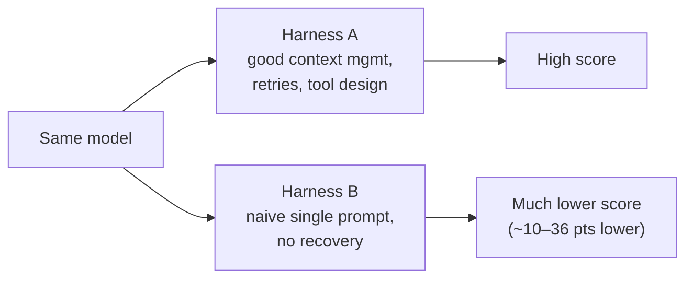
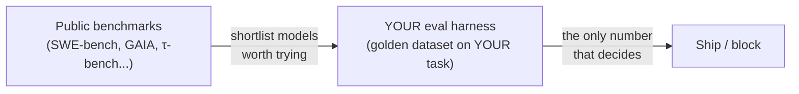

# Benchmark Literacy (Not Benchmark Numbers)

> **Goal:** read any agent leaderboard or "model X scores Y%" claim critically —
> know what each benchmark measures, why the *same model* swings wildly across
> harnesses, and why none of it tells you whether the model works on **your**
> task.

This page teaches you to *read* benchmarks. It deliberately quotes **no specific
percentages and no specific model versions** — those age within weeks and are
routinely misquoted in social-media roadmaps. The skill that lasts is knowing
what a number can and cannot mean.

> 🔒 **HONESTY BOX — do not trust a number you saw in a thread.** Specific
> benchmark percentages and model-version names quoted in roadmaps (including the
> one this curriculum is based on) age within weeks and are frequently unverified
> or flat wrong. **Do not treat any percentage on this page or in that thread as
> current fact** — there are none here on purpose. To get a real number, go to a
> **primary source** and read it yourself:
> - the **official benchmark site / paper** for the benchmark in question,
> - the **model provider's own model card** for their self-reported numbers,
> - a **third-party eval organization** that re-ran the benchmark independently.
>
> If you can't name the source and the harness behind a number, you don't have a
> fact — you have a rumor.

---

## The benchmarks worth knowing

You don't need to memorize scores. You need to know *what each one measures* so
you can tell when someone's citing the wrong benchmark for their claim.

| Benchmark | Measures | What a high score *suggests* |
|-----------|----------|------------------------------|
| **SWE-bench** / **SWE-bench Verified** | Resolving **real GitHub issues** — the agent must produce a patch that makes the repo's hidden tests pass. "Verified" is a human-filtered subset where the tasks are confirmed solvable and well-specified. | Coding-agent competence on realistic, end-to-end software fixes. |
| **GAIA** | **General assistant / agent tasks** — multi-step questions needing tool use, reasoning, and web/file navigation, graded by a single correct answer. | Broad agentic capability across tools and modalities. |
| **τ-bench** (**tau-bench**) | **Tool-use customer-service agents** — the agent acts in a simulated domain (retail, airline) following policy, using tools, against a simulated user. | Reliability at policy-following, multi-turn tool use. |
| **CORE** | Broad capability/agent evaluation (one of several "general competence" suites). | General reasoning/agent breadth — check the specific version's scope. |
| **MMLU** | **Knowledge** across many subjects via multiple-choice. Old, heavily contaminated, mostly **not** an agent benchmark. | Static knowledge recall — weak signal for agent reliability. |
| (others) | HumanEval (function-level coding), WebArena (web agents), and many domain suites. | Read each one's *task definition* before believing the headline. |

> **GOTCHA:** people cite **MMLU** to argue an agent is "smart." MMLU measures
> multiple-choice knowledge, not whether an agent can run a tool loop without
> derailing. Match the benchmark to the claim — a coding-agent claim wants
> SWE-bench Verified, not MMLU.

---

## The central lesson: a benchmark number is `model × harness`

This is the most important thing on the page, and it's why this whole curriculum
exists.

> **The same model scores very differently on the same benchmark depending on the
> harness around it** — the scaffold, the prompt, the tools, the retry logic, the
> context management. Publicly reported swings on the order of **~10–36 points**
> have been observed for an *identical model* purely from changing the harness.

So a benchmark score is never a property of the model alone. It's a measurement of
a **(model × harness)** pair.

**The question you must always ask:** *which harness / scaffold produced this
number?* A leaderboard row without its scaffold described is half a fact.

> **WHY this is the whole thesis:** the README says "the model is a commodity; the
> harness is the job." This is the empirical receipt. If a 30-point swing comes
> from the harness, then the harness is where the value — and the engineering — is.
> Connect this to
> [Phase 0, Lesson 04](../curriculum/phase-0-mental-models/04-harness-and-context-primitives.md).

---

## How to read a leaderboard critically

When you see a leaderboard, run this checklist before you believe a row:

- **Contamination / training-data leakage.** Was the benchmark (or its solutions)
  in the model's training data? Older, popular benchmarks (MMLU especially) are
  heavily contaminated, which inflates scores without reflecting real capability.
- **Eval-awareness.** Models can behave differently when they detect they're being
  evaluated. A number measured "under test conditions" may not reproduce in the
  wild.
- **Verified vs. unverified subsets.** SWE-bench full vs. SWE-bench **Verified**
  are different populations. Compare like with like — a "Verified" number and a
  "full" number are not interchangeable.
- **pass@1 vs. pass@k.** `pass@1` = solved on the first try. `pass@k` = solved in
  *any* of k attempts. `pass@k` is a much easier bar and a much bigger number —
  always check which one is quoted.
- **Self-reported vs. third-party.** A provider grading its own model on its own
  harness is a press release, not an independent result. Prefer third-party
  re-runs, or at minimum read the model card's methodology.
- **Harness disclosed?** If the row doesn't say what scaffold produced it (see the
  central lesson), you can't compare it to anything.

> **GOTCHA — apples to orchards.** Two leaderboard rows can use the same benchmark
> name, a different subset, a different harness, and a different pass@k, and still
> get printed side by side as if comparable. They aren't.

---

## Why you build your OWN evals (the Phase 4 connection)

Here's the payoff, and it's the reason public benchmarks can't be your finish
line:

> **Public benchmarks don't measure your use case.** SWE-bench measures GitHub
> issue fixes. GAIA measures general assistant tasks. None of them measures *your*
> customer's tickets, *your* documents, *your* tools, *your* definition of
> "correct." A model that tops a leaderboard can still fail your task.

That's exactly why [Phase 4](../curriculum/phase-4-evals-and-regression/) has you
build your **own** golden dataset and eval harness on **your** task, then gate CI
on it so a "better" model or prompt can't silently regress you. Public benchmarks
tell you which models are *worth trying*; your own evals tell you whether a change
actually made *your system* better.

> **WHY:** a benchmark is a map of someone else's territory. Your eval is a map of
> the territory you're actually driving through. Use the first to pick a vehicle;
> use the second to decide whether you've arrived.

---

## The one-line takeaway

> **Every benchmark number is a `(model × harness × subset × pass@k × source)`
> measurement — go to the primary source for the current value, and build your own
> evals to measure the only task that pays you.**

➡️ Next: [reference/glossary.md](glossary.md) · or jump to
[Phase 4 — Evals & Regression](../curriculum/phase-4-evals-and-regression/).
