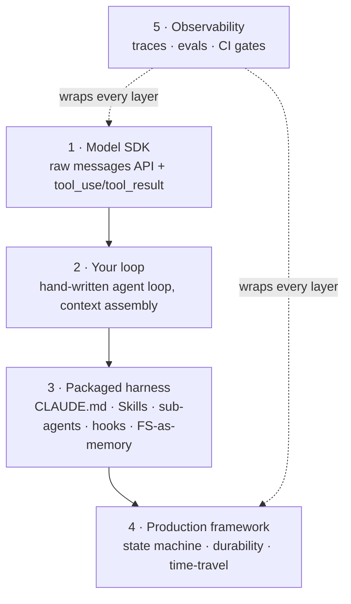

# The Stack You'll Actually Learn

> **Goal:** know what to learn, in what order, and what to skip — so you spend
> your 17 weeks on the *primitives* that transfer, not on a framework that gets
> renamed next quarter.

The single biggest way to waste this curriculum is to learn ten frameworks
shallowly. Don't. Learn the **primitives** deeply — the agent loop, tool
dispatch, context assembly, persistence, evals — then learn **one** production
framework well enough to read any other. Frameworks are vehicles; the primitives
are the road.

> ⚠️ **READ THIS BOX FIRST — framework names churn.** Every product name on this
> page will drift: versions bump, projects merge, "the obvious choice" changes.
> What does *not* change is the layered shape below: a model SDK at the bottom,
> your loop on top of it, a packaged harness on top of that, an optional
> framework, and observability wrapping the whole thing. Learn the **layer**, and
> any new tool slots into a box you already understand. We name the current
> vehicle for each layer; treat the name as disposable and the role as permanent.

---

## The mental model: a layered stack

You are not picking "a framework." You are filling five layers, bottom-up. Each
layer is replaceable without touching the others — that's the whole point.



- **You must be able to build layers 1–2 from scratch.** That's Phase 1 and
  Phase 3. If you can hand-write the loop, every higher layer becomes readable.
- **Layers 3–4 are where you stop reinventing.** Study one packaged harness and
  one framework deeply.
- **Layer 5 is non-negotiable in production.** You cannot harden what you can't
  see. Pick one tool and live in it.

---

## Layer 1–2: Primitives first (build these by hand)

Before any framework, write the loop yourself: call the model, read its
`tool_use` requests, execute the tools, feed `tool_result` back, repeat until the
model stops asking for tools. That's the entire agent loop. It's ~40 lines.

```python
# The whole agent loop, unhidden. (Anthropic SDK; Python 3.11+.)
# Needs ANTHROPIC_API_KEY. See code/ for a runnable version with real tools.
import anthropic

client = anthropic.Anthropic()
tools = [...]                       # your tool schemas
messages = [{"role": "user", "content": user_input}]

while True:
    resp = client.messages.create(
        model="claude-opus-4-8",
        max_tokens=16000,
        tools=tools,
        messages=messages,
    )
    if resp.stop_reason == "end_turn":
        break                       # model is done — no more tool calls
    messages.append({"role": "assistant", "content": resp.content})

    results = []
    for block in resp.content:
        if block.type == "tool_use":
            out = execute_tool(block.name, block.input)   # your code
            results.append({
                "type": "tool_result",
                "tool_use_id": block.id,                  # must match the request
                "content": out,
            })
    messages.append({"role": "user", "content": results})
```

> **WHY type it by hand:** every framework on this page is *this loop* with
> persistence, retries, and routing bolted on. Once you've built it, LangGraph's
> `StateGraph` and Deep Agents' planner stop being magic — you can see the loop
> underneath.

**Default to the Claude / Anthropic SDK** for the reference implementation (it's
what the rest of the curriculum uses), but the loop is provider-agnostic — the
shape is identical on any tool-calling model API.

---

## Layer 3: The reference harness — Claude Agent SDK

Study the **Claude Agent SDK** — the same harness that powers Claude Code — as
your reference for "what a mature harness contains." You're not learning it to
marry it; you're learning it because it makes the primitives concrete and
**every other harness is converging on these same primitives.**

| Primitive | What it is | Maps to (curriculum) |
|-----------|-----------|----------------------|
| **CLAUDE.md** | A project memory file the agent reads on every run — durable instructions, conventions, gotchas | Filesystem-as-memory; the **Write** primitive |
| **Skills** (`SKILL.md`) | Task-specific instructions loaded *on demand*, not stuffed in the base prompt | Progressive disclosure; the **Select** primitive |
| **Sub-agents** | Spawn a worker with its **own** context window for an isolated sub-task | The **Isolate** primitive |
| **Hooks** | Deterministic code that fires at lifecycle points (`PreToolUse`, `PostToolUse`, `PreCompact`, `Stop`) | Guardrails, auth brokering, audit |
| **Filesystem-as-memory** | The agent reads/writes real files as a scratchpad that survives the context window | The **Write** primitive; durable state |

> **WHY this one:** it's the cleanest commercial expression of the four context
> primitives (Write / Select / Compress / Isolate) you learned in
> [Phase 0](../curriculum/phase-0-mental-models/04-harness-and-context-primitives.md).
> Read its docs the way you'd read a reference implementation — to see the shape,
> then go build your own in [Phase 3](../curriculum/phase-3-build-the-harness/).

---

## Layer 4: The production framework — LangGraph + Deep Agents

When you graduate from a hand-rolled loop to something a team can operate, learn
**LangGraph** (the framework) and **Deep Agents** (a packaged harness on top of
it). Learn them *deeply*; learn the rest only well enough to read them.

**LangGraph** treats your agent as an explicit **state machine** — nodes are
steps, edges are transitions, and the graph *is* the control flow. The properties
that matter in production:

- **State machine, not a vibe.** Control flow is a graph you can read, diff, and
  reason about — not buried in prompt strings.
- **Durable execution** via a checkpointer (e.g. PostgresSaver): the run's state
  persists at every step, so a crash at 2am resumes instead of restarting.
- **Time-travel debugging:** rewind to any checkpoint, change an input, and
  replay — the single best way to debug a non-deterministic agent.
- **OTEL-friendly observability:** emits traces you can ship to standard tooling.
- **Model-agnostic:** swap the underlying model without rewriting the graph.

**Deep Agents** sits on top and packages the harness moves you'd otherwise build
yourself:

- **Planning middleware** — a plan/todo step that keeps long tasks on track.
- **Virtual filesystem** — scratchpad memory (the **Write** primitive).
- **Sub-agent spawning** — isolated context windows for sub-tasks (**Isolate**).
- **Automatic context compression** — compaction when the window fills
  (**Compress**).
- **Skills** — on-demand instruction loading (**Select** / progressive
  disclosure).

> **WHY this pairing:** LangGraph gives you the durable, debuggable *spine*;
> Deep Agents gives you the context-engineering *muscles* without hand-rolling
> them again. Together they cover Phase 2's "real agent with proper
> architecture." See
> [Phase 2](../curriculum/phase-2-production-architecture/).

---

## Why not the others (and when they're fine)

These are real, useful projects. The point isn't that they're bad — it's that
they're the *wrong default* for someone learning to ship durable agents. And, per
the box at the top: **this section ages fastest. Verify before you commit.**

| Tool | The honest read | When it's actually fine |
|------|-----------------|-------------------------|
| **CrewAI** | Fastest path to a demo; role-based multi-agent abstractions read great in a README. Tends to get fragile under real production traffic — debugging the implicit control flow is painful. | Hackathons, demos, throwaway prototypes where speed-to-first-output is everything. |
| **AutoGen** | Merged into the **Microsoft Agent Framework**; the standalone project's future is uncertain. Don't anchor your skills to a moving target mid-merge. | If your org is already all-in on the Microsoft stack and tracking the merged framework. |
| **OpenAI Swarm** | Explicitly **not production-ready per its own README** — it's an educational/experimental pattern, not a supported product. | Reading the source to learn handoff patterns. Not for anything you'd page someone over. |

> **GOTCHA:** "fragile in prod" usually means *you can't see why it broke.* That's
> a layer-5 (observability) failure as much as a framework one — which is exactly
> why observability is non-optional below.

---

## Layer 5: Observability — pick exactly one

You will not harden, optimize, or trust an agent you can't see. Choose one tool
and go deep; do not collect three.

| Tool | Best for | The pitch |
|------|----------|-----------|
| **LangSmith** | Teams living in LangGraph | Tightest integration with the LangGraph/LangChain stack; tracing + evals in one place. |
| **Braintrust** | Framework-agnostic CI gating | Eval-first; wires cleanly into CI to *block* regressions. Strong if your eval rigor matters more than framework lock-in. |
| **Arize Phoenix** | Open-source, OTEL-native | Self-hostable, standards-based (OpenTelemetry). Good when you want to own your traces and avoid a vendor. |

> **WHY one, not three:** observability tools earn their value from *coverage* —
> every run, every trace, in one place. Three half-instrumented tools give you
> three partial pictures and zero confidence. This is the through-line into
> [Phase 4 (evals & regression)](../curriculum/phase-4-evals-and-regression/) and
> [Phase 5 (hardening)](../curriculum/phase-5-production-hardening/).

---

## Skip in 2026

Time you don't spend here is time you spend on primitives. Skip:

- **OpenAI Swarm for production.** Its own README says experimental. Believe it.
- **OpenAI Assistants API.** Sunsetting — don't build new work on a deprecated
  surface. Use the plain messages API + your own loop, or a maintained framework.
- **Building your own vector store before you've measured a real recall
  problem.** Retrieval is the **Select** primitive, not a database project. Start
  with the simplest thing that could work; reach for a vector store only after an
  eval shows you a recall gap. (This is the honest caveat the original roadmap
  under-weighted — see the README's "what I improved.")
- **No-code agent platforms** for anything but throwaways. They're a great way to
  validate an idea in an afternoon and a terrible way to learn the job — they hide
  exactly the loop you're being paid to understand.

---

## Comparison table

Frameworks churn — these columns are a snapshot, not scripture. Re-check before
you commit a quarter to any row.

| Framework | Best for | Durability | Observability | Production-ready? |
|-----------|----------|-----------|---------------|-------------------|
| **Hand-written loop** (SDK) | Learning the primitives; full control | You build it | You build it | Yes, if you build the rest |
| **Claude Agent SDK** | Reference harness; studying primitives | Filesystem-as-memory + hooks | Hooks + your tooling | Yes (powers Claude Code) |
| **LangGraph** | Durable, debuggable production agents | Strong — checkpointer (PostgresSaver), time-travel | OTEL-friendly; LangSmith-native | Yes |
| **Deep Agents** | Packaged context-engineering on LangGraph | Inherits LangGraph + virtual FS | Inherits LangGraph | Yes |
| **CrewAI** | Fast demos, hackathons | Weak | Limited | Fragile under real traffic |
| **AutoGen** | MS-stack teams (now Microsoft Agent Framework) | Varies | Varies | Uncertain (mid-merge) |
| **OpenAI Swarm** | Learning handoff patterns | None | None | No (experimental per its README) |

---

## The one-line takeaway

> **Learn the primitives so deeply that every framework becomes a thin,
> readable layer on top of a loop you could write yourself.** Name the current
> vehicle, ride it, and never confuse the vehicle for the road.

➡️ Next: [reference/benchmarks.md](benchmarks.md) — how to read the numbers
people quote at you without getting fooled.
